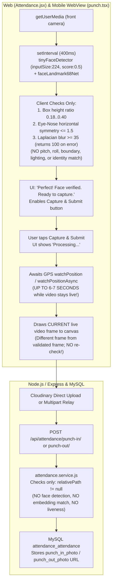

# HRMS – Advanced Face Detection, Alignment & Attendance Verification Audit

**Audit Date:** 2026-11-27  
**Scope:** Strictly READ-ONLY Investigation (React Web `hrms_saas`, Expo Mobile `hrms_mobile`, Node.js/Express Backend `node_backend`, MySQL Database)  
**Status:** Investigation Complete — No source code, schema, thresholds, or database records were modified.

---

## 1. Executive Summary

An end-to-end read-only audit of the HRMS camera-based attendance verification system revealed **why** the application marks employees as `"Perfect! Face verified"` even when their face is partially outside the frame, turned sideways, looking downward, poorly lit, or moved during `"Processing..."`:

1. **No Face Recognition / Identity Matching Exists (`FACE-01`, Critical):** Both Web and Mobile load only `tinyFaceDetector` and `faceLandmark68Net` from `@vladmandic/face-api`. Neither `faceRecognitionNet` (128-D embeddings) nor any server-side face matching exists, and `accounts_employeeprofile` stores no biometric templates. The UI falsely labels **face detection** as `"Face verified"`.
2. **Critical Frame-Capture Race Condition During `"Processing..."` (`FACE-04`, Critical):** On both Web and Mobile, pressing **Capture & Submit** transitions the UI to `"Processing..."` and **first awaits GPS acquisition (`6–7 seconds`)** *before* calling `captureImage()` / `captureFrame()` on the live un-frozen `<video>` stream. The uploaded frame is captured seconds later and is **never** the frame that passed face validation.
3. **Missing Pitch (Downward/Upward), Roll (Tilt), Frame-Boundary, and Multi-Face Checks (`FACE-02`, `FACE-03`, High):**
   - No vertical pitch check exists, so a person **looking downward** passes horizontal eye-to-nose symmetry (`symmetryRatio <= 1.5`) as long as left/right eye distances remain roughly balanced.
   - No frame-edge margin or oval-containment check exists, so partially clipped faces pass.
   - `detectSingleFace` ignores multiple faces in frame.
4. **Missing Illumination/Contrast Checks, No Multi-Frame Stability, and Silent Blur Fallback (`FACE-05`, Medium):** No brightness/contrast check exists; `checkBlurriness()` returns `100` (pass) on exception; Mobile lacks a detection mutex (`isDetectingRef`), allowing overlapping `setInterval` ticks on slower Android devices.
5. **Zero Liveness / Anti-Spoofing & Client-Only Trust (`FACE-06`, Critical):** Printed photos and phone screens pass detection; the backend accepts any uploaded image without server-side verification.

---

## 2. Existing Face Verification Architecture

---

## 3. Web Camera Investigation (`hrms_saas/src/pages/Attendance.jsx`)

- **Library:** `@vladmandic/face-api` (`Attendance.jsx:19`), loading `tinyFaceDetector` and `faceLandmark68Net` from `/models/face-api/` (`Attendance.jsx:23-40`) on `webgl` (fallback `cpu`).
- **Camera Stream (`Attendance.jsx:545-555`):** `navigator.mediaDevices.getUserMedia({ video: { facingMode: { ideal: "user" }, width: { ideal: 1280 }, height: { ideal: 720 } } })`.
- **Detection Loop (`Attendance.jsx:289-401`):** `setInterval(..., 400)` guarded by `isDetectingRef.current`.
- **Cleanup (`Attendance.jsx:463-521`):** `stopCamera()` increments `activeSessionIdRef.current`, clears interval, stops media tracks, and clears `videoRef.current.srcObject`.

---

## 4. Mobile Camera Investigation (`hrms_mobile/src/app/(tabs)/punch.tsx`)

- **Architecture:** Renders an inline HTML5 `<video>` inside `react-native-webview` (`punch.tsx:32-343`) overlaid by `CameraViewOverlay` (`CameraViewOverlay.tsx:9-77`).
- **Library:** `@vladmandic/face-api` loaded from CDN (`cdn.jsdelivr.net` / `unpkg.com`, `punch.tsx:55, 121-135`), loading `tinyFaceDetector` and `faceLandmark68Net`.
- **Camera Stream (`punch.tsx:157-160`):** `navigator.mediaDevices.getUserMedia({ video: { facingMode: 'user' }, audio: false })` (no resolution constraint).
- **Detection Loop (`punch.tsx:188-286`):** `setInterval(..., 400)` **without** an `isDetecting` overlap guard. Communicates via `window.ReactNativeWebView.postMessage`.
- **Capture (`punch.tsx:288-306`):** Triggered asynchronously when RN sends `{ type: "CAPTURE" }` *after* GPS convergence (`punch.tsx:515-540`). Writes JPEG base64 to `FileSystem.cacheDirectory` (`punch.tsx:617`) and uploads via `multipart/form-data`.

---

## 5. Face Detection Analysis

- **Detector & Threshold:** `TinyFaceDetectorOptions({ inputSize: 224, scoreThreshold: 0.5 })` (`Attendance.jsx:312`, `punch.tsx:193`).
- **Single-Face API:** Uses `faceapi.detectSingleFace(...)` instead of `detectAllFaces(...)`, so multiple people in frame are **not** rejected.
- **Distance / Size Check:** Only checks `box.height / video.videoHeight` between `0.18` and `0.40` (`Attendance.jsx:328-342`, `punch.tsx:209-225`). Width ratio is not checked.
- **Boundary / Completeness Check:** **None.** A face partially outside the left/right/top/bottom edge passes if `box.height / videoHeight >= 0.18`.
- **Oval Alignment Check:** Mobile draws a `250x300` oval (`CameraViewOverlay.tsx:100`), but neither Web nor Mobile checks if the detected face box is centered or inside the guide.
- **Detection vs. Identity Match:** Only face detection + 68 landmarks exist; there is **no** identity verification.

---

## 6. Face Alignment Analysis

- **Yaw (Sideways Turn):** Checked via `symmetryRatio = Math.max(distLeft, distRight) / Math.min(distLeft, distRight) > 1.5` (`Attendance.jsx:364-371`, `punch.tsx:248-256`) using eye-center X to nose-center X. A `1.5:1` ratio permits noticeable sideways head rotation (~20–30°).
- **Pitch (Looking Downward / Upward):** **Not checked anywhere.** Looking downward keeps `distLeft ≈ distRight`, so `symmetryRatio` remains near `1.0` and passes—directly explaining the reference image scenario.
- **Roll (Head Tilt):** **Not checked anywhere.** Tilting the head sideways is not rejected.
- **Eye / Landmark Visibility:** **Not checked.** Eye landmarks are averaged (`reduce`) without verifying eye openness, landmark bounds inside frame, or occlusion.

---

## 7. Image Quality Analysis

- **Blur Check (`Attendance.jsx:63-111, 374-389`; `punch.tsx:65-112, 259-273`):** Computes Laplacian variance on grayscale face crop (`threshold < 35`).
  - **Bug:** On any exception (`catch (e)`), `checkBlurriness` returns `100` (a passing score!).
  - **Mobile Overhead:** Allocates a new `<canvas>` every `400ms` inside the WebView loop.
- **Brightness / Contrast / Overexposure:** **Not checked anywhere.** Dark, backlit, or washed-out faces pass if `TinyFaceDetector` scores `>= 0.5`.
- **Multi-Frame Stability:** **Not checked.** A single passing tick sets `isValid = true`.

---

## 8. Frame Capture and Processing Race Analysis

### Web (`Attendance.jsx:682-770`)
1. `handleSubmit()` checks `if (loading || !validation.isValid) return;` (`683`).
2. Sets `loading = true` (`"Processing..."`) and `cameraState = "capturing"` (`686`).
3. **Awaits `getLocation({ timeout: 6000 })` (`689`)** — blocking for up to **6 seconds** while the `<video>` element remains live.
4. Calls `await captureImage()` (`768`), which draws `videoRef.current` onto `canvasRef.current` (`662`) **6 seconds after** the last validated frame.
5. **No re-validation** is performed on the captured canvas/blob before upload.

### Mobile (`punch.tsx:504-540, 288-306`)
1. `handleCaptureAndSubmit()` checks `validationStatus !== "success"` (`505`).
2. Sets `submitting = true` (`"Processing..."`) (`510`).
3. **Awaits `acquireBestMobileGpsPosition({ timeoutMs: 7000 })` (`517`)** — blocking for up to **7 seconds**.
4. Sends `{ type: "CAPTURE" }` to WebView (`535`), which captures whatever frame is currently on `<video>` (`298`) **without re-running `faceapi` validation**.
5. **Consequence:** Employees can move, look down, or leave the frame while `"Processing..."` is displayed, and the unvalidated post-GPS frame is saved as attendance proof.

---

## 9. Face Matching Analysis

- **Face Recognition Models:** `faceRecognitionNet` is **not** loaded on Web, Mobile, or Backend.
- **Database (`accounts_employeeprofile`):** Verified via `DESCRIBE accounts_employeeprofile`: columns are `id, latitude, longitude, allowed_radius, manager_id, user_id, is_active_employee, team_name, joining_date, leave_allotted, designation, profile_picture`. **No face descriptor/embedding column or face template table exists.**
- **Backend (`attendance.service.js:416, 608`):** `punchIn` and `punchOut` only verify that `relativePath` (a photo URL/file) is non-empty. No biometric matching occurs.

---

## 10. Punch In vs Punch Out Comparison

| Investigation | Punch In | Punch Out |
|---|---|---|
| **Camera initialization** | Web: `openCamera("in")` (`Attendance.jsx:524`); Mobile: `startPunch("in")` (`punch.tsx:455`) | Web: `openCamera("out")`; Mobile: `startPunch("out")` (identical pipeline) |
| **Face detection** | `tinyFaceDetector` (`224`, `0.5`) + `faceLandmark68Net` | Identical |
| **Face alignment** | Horizontal eye-nose `symmetryRatio <= 1.5` only; no pitch/roll | Identical |
| **Image quality checks** | `faceHeightRatio` `0.18..0.40` + Laplacian blur `>= 35` (`100` on error) | Identical |
| **Face capture timing** | **After** 6–7s GPS await (race condition) | **After** 6–7s GPS await (race condition) |
| **Face matching** | None | None |
| **Processing state** | `"Processing..."` shown before frame freeze | Identical |
| **Verification result** | `"Perfect! Face verified. Ready to capture."` (detection only) | Identical |
| **Backend validation** | Checks `relativePath` non-empty only (`attendance.service.js:418`) | Checks `relativePath` non-empty only (`attendance.service.js:610`) |

---

## 11. Security and Liveness Assessment

- **Liveness / Anti-Spoofing:** **None.** Neither active (challenge-response) nor passive (depth/texture/3D) liveness detection exists. A printed photo or another phone screen passes `tinyFaceDetector` + `faceLandmark68Net` + blur check.
- **Client-Side Trust & Bypass:** All face checks run in client JS/WebView. Any authenticated user can POST directly to `/api/attendance/punch-in/` or `/api/attendance/punch-out/` with any valid image URL/file and bypass face detection entirely.
- **Replay Binding:** Photos are uploaded per punch, but there is no server-side challenge nonce or cryptographic frame-verification binding.

---

## 12. Performance Analysis

- **Detection Interval:** `400ms` (2.5 FPS) on both Web and Mobile.
- **Mobile Overlap Risk (`punch.tsx:188`):** Missing `isDetecting` lock causes overlapping `tinyFaceDetector + faceLandmark68Net` inferences on low-end Android WebViews, increasing CPU/battery drain and thermal throttling.
- **Canvas Allocation (`punch.tsx:259`):** Creates a new offscreen `<canvas>` on every `400ms` tick instead of reusing one.
- **Model Hosting (`punch.tsx:121-124`):** Mobile WebView downloads models from external CDNs (`jsdelivr`/`unpkg`) with a 12s timeout rather than bundling them locally.

---

## 13. Confirmed Root Causes

| Bug ID | Severity | Platform | Operation | File & Lines | Root Cause & Impact |
|---|---|---|---|---|---|
| **FACE-01** | **Critical** | Web, Mobile, Backend, DB | Punch In & Out | `Attendance.jsx:33-40,394`; `punch.tsx:131-134,279`; `attendance.service.js:416,608` | Only `tinyFaceDetector` + `faceLandmark68Net` are used; no `faceRecognitionNet` or stored face templates exist. UI reports `"Face verified"` based solely on detection. |
| **FACE-02** | **Critical** | Web, Mobile | Punch In & Out | `Attendance.jsx:682-768`; `punch.tsx:504-540,288-306` | **Frame Capture Race Condition:** `"Processing..."` starts and awaits GPS (`6–7s`) *before* capturing the video frame, uploading an unvalidated later frame. |
| **FACE-03** | **High** | Web, Mobile | Punch In & Out | `Attendance.jsx:324-371`; `punch.tsx:205-256` | Missing pitch (downward/upward), roll (tilt), frame-margin completeness, oval-containment, and multi-face (`detectAllFaces`) checks; `symmetryRatio > 1.5` is too permissive. |
| **FACE-04** | **Critical** | Backend, Web, Mobile | Punch In & Out | `attendance.service.js:417-420,609-612` | Zero server-side face verification or liveness; client checks can be bypassed and photo spoofing (printed photo/screen) is unmitigated. |
| **FACE-05** | **Medium** | Web, Mobile | Punch In & Out | `Attendance.jsx:109`; `punch.tsx:110,188,259` | `checkBlurriness` returns `100` (pass) on catch; no brightness/contrast check; Mobile lacks `isDetecting` mutex and allocates a new canvas every `400ms`. |

---

## 14. Potential Risks

- **CDN Availability on Mobile:** `punch.tsx:121-124` relies on `jsdelivr`/`unpkg` for `@vladmandic/face-api` scripts and models; offline/restricted corporate networks can stall initialization.
- **False Positives in Crowded Offices:** `detectSingleFace` may lock onto a colleague standing behind the employee.

---

## 15. Evidence Summary (File Paths & Line Numbers)

- Web model loading & blur check: `hrms_saas/src/pages/Attendance.jsx:23-48, 63-111`
- Web detection loop & permissive checks: `hrms_saas/src/pages/Attendance.jsx:289-401`
- Web `captureImage()` & `handleSubmit()` GPS-before-capture race: `hrms_saas/src/pages/Attendance.jsx:636-679, 682-770`
- Mobile WebView model loading, blur check & detection loop: `hrms_mobile/src/app/(tabs)/punch.tsx:55, 65-112, 120-150, 185-286`
- Mobile `captureFrame()` & `handleCaptureAndSubmit()` GPS-before-capture race: `hrms_mobile/src/app/(tabs)/punch.tsx:288-306, 504-540`
- Mobile overlay UI: `hrms_mobile/src/components/CameraViewOverlay.tsx:9-77`
- Backend photo-only check & DB schema: `node_backend/src/services/attendance.service.js:416-420, 608-612`; `DESCRIBE accounts_employeeprofile` (2026-11-27).

---

## 16. Recommended Fix Strategy

1. **Freeze & Capture the Exact Validated Frame First:** Run face detection/alignment/quality validation on an offscreen canvas snapshot, **freeze that exact frame immediately** when the user taps Submit (or auto-capture after `N` stable consecutive frames), and then attach fresh GPS coordinates—never capture a new frame after waiting for GPS.
2. **Enforce Complete Face Visibility & Pose Checks:**
   - Switch to `detectAllFaces` and require `faces.length === 1`.
   - Enforce frame-edge margins (e.g., 5–8% padding on all 4 sides) and center/oval containment.
   - Add **pitch** (vertical nose-to-eye/mouth ratio), **roll** (inter-ocular angle `<= 12°`), and tighter **yaw** (`symmetryRatio <= 1.28`) checks.
   - Add brightness/contrast checks and fix `checkBlurriness` to fail closed (`return 0` on error).
   - Require 2–3 consecutive passing frames (`"Hold Still"`) before allowing capture.
3. **Separate Detection from Verification & Add Server-Side Matching:**
   - Rename client status from `"Face verified"` to `"Face aligned — Ready to capture"`.
   - Enroll employee face embeddings (`faceRecognitionNet` or server-side face service) and verify similarity on the backend before marking attendance `approved` (routing low-confidence matches to manager review).
4. **Mobile Stability & Resource Fixes:** Add `isDetecting` mutex and reuse a single offscreen `<canvas>` in `punch.tsx`; bundle face-api models locally where possible.

---

## 17. Testing Strategy

- **Unit Tests:** Pose geometry (yaw, pitch, roll), boundary margin checks, brightness/blur fail-closed tests, and multi-face rejection.
- **Integration / E2E Tests:** Verify frozen-frame capture order (frame captured before GPS wait), server-side rejection of missing/unmatched embeddings, and approval fallback routing.
- **Device QA:** Test downward-looking, sideways, clipped-edge, dark, backlit, and blurry frames on desktop Chrome and mid-range Android devices.

---

## 18. Production Readiness Assessment

- **Current Status:** **Not Production-Ready for Biometric Verification.** The system currently performs only permissive client-side face *detection* and suffers from a 6–7 second frame-capture race condition during `"Processing..."`, with zero identity matching or anti-spoofing on the backend. Implementing the phased fixes in Section 16 (starting with frame-freeze-before-GPS + pitch/roll/boundary checks, followed by server-side embedding verification) is recommended before relying on automated face verification.
