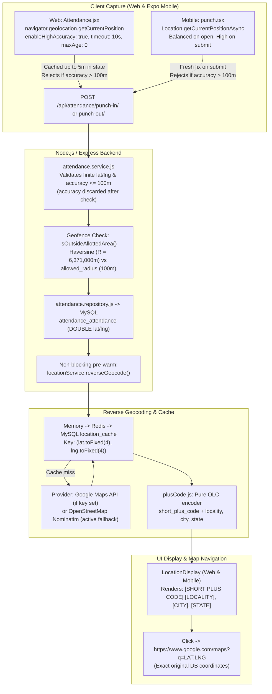

# GPS Location Mismatch & Punch-In Accuracy Investigation Report

**Audit Date:** 2026-11-27  
**Scope:** Read-Only End-to-End Investigation (React Web, Expo Mobile, Node.js/Express Backend, MySQL Database, Google Maps, Plus Code & Reverse Geocoding)  
**Status:** Investigation Complete — No source code, schema, or database records were modified.

---

## 1. Executive Summary

An end-to-end read-only audit of the HRMS geolocation pipeline was conducted to determine why an employee punching in from **Renu Bhaban, West Bengal, India** sees:
1. A Google Maps pin slightly displaced from the physical building (`22.637224, 88.465514`).
2. Inconsistent locality labels between HRMS (`JFP8+V6J North 24 Parganas, Bidhannagar, West Bengal`) and Google Maps (`JFP8+V6J Rajarhat, Kolkata, West Bengal`).

### Primary Root Causes Identified
1. **Reverse Geocoding Provider & Field Mapping Mismatch (Confirmed Software Cause for Locality Label Discrepancy):**
   - `GOOGLE_MAPS_API_KEY` is not configured in `node_backend/.env`, so `location.service.js` falls back to **OpenStreetMap Nominatim**.
   - In the MySQL `location_cache` record for `(22.6372, 88.4655)`, Nominatim returned `locality: null`, `sub_locality: null`, `city: "Bidhannagar"`, `district: "North 24 Parganas"`, while `"Rajarhat"` only appeared inside `formatted_address`. Because `formatPlusCodeLocation` falls back to `district` when `sub_locality` and `locality` are `null`, HRMS renders **`JFP8+V6J North 24 Parganas, Bidhannagar, West Bengal`**, whereas Google Maps classifies the exact same coordinates as **`JFP8+V6J Rajarhat, Kolkata, West Bengal`**.
2. **Single-Shot First-Fix GPS Capture + 100m Accuracy Tolerance (Confirmed Software + Environmental Cause for Pin Displacement):**
   - Both Web (`hrms_saas/src/pages/Attendance.jsx`) and Mobile (`hrms_mobile/src/app/(tabs)/punch.tsx`) perform a **single-shot** position request (`getCurrentPosition` / `getCurrentPositionAsync`) and accept the very first fix as long as `accuracy <= 100` meters—without waiting for GPS convergence (`watchPosition` / `watchPositionAsync`).
   - On Web, coordinates are captured **when the camera opens** (`startCamera`), cached in React state for up to **5 minutes** (`MAX_LOCATION_AGE_MS`), and silently reused even if a refresh attempt times out.
   - Indoors (or over Wi-Fi/IP positioning on desktop browsers), a first-fix uncertainty of 20m–95m naturally places the pin on an adjacent road or neighboring building.
3. **Missing GPS Accuracy & Metadata Persistence (Confirmed Observability Gap):**
   - Although Web and Mobile send `accuracy` to `/api/attendance/punch-in/` and `/api/attendance/punch-out/`, `attendance_attendance` has **no** `accuracy`, `altitude`, `location_timestamp`, or `provider` columns. `attendance.service.js` validates `accuracy <= 100` and then discards it, making post-hoc diagnosis of indoor GPS drift impossible from stored records.
4. **No Coordinate Corruption or Map Offset Bug Found:**
   - MySQL stores `punch_in_lat`, `punch_in_lng`, `punch_out_lat`, and `punch_out_lng` as `DOUBLE` (64-bit IEEE 754, sub-millimeter precision).
   - Sample stored records (`id=113`: `22.637232, 88.4655159` / `22.6372238, 88.4655142`; `id=106`: `22.6372297, 88.4655156` / `22.6372209, 88.4655131`) confirm punch-in and punch-out coordinates are stored independently without rounding, truncation, or lat/lng swapping.
   - Google Maps links (`https://www.google.com/maps?q=LAT,LNG`) and `MapPickerModal` markers use the exact stored coordinates—never reverse-geocoded centroids or Plus Code approximations.

---

## 2. Existing Location Architecture

The HRMS uses a Node.js + Express backend with raw `mysql2` queries (`node_backend/src/db/index.js`; **Prisma ORM is not used in this repository**), a React + Vite web client (`hrms_saas`), and an Expo React Native mobile client (`hrms_mobile`).

---

## 3. GPS Capture Flow

### Web (`hrms_saas/src/pages/Attendance.jsx`)
- **API:** `navigator.geolocation.getCurrentPosition` (`Attendance.jsx:130`). `watchPosition` is **not** used.
- **Options (`Attendance.jsx:123-128`):** `enableHighAccuracy: true`, `timeout: 10000`, `maximumAge: 0`.
- **Timing (`Attendance.jsx:613`, `726-756`):**
  - Location is acquired **when the camera starts** (`startCamera`), not when the employee presses Submit.
  - On `handleSubmit`, `MAX_LOCATION_AGE_MS = 5 * 60 * 1000` (5 minutes). If the reading is under 5 minutes old, it is reused without re-acquiring GPS.
  - If over 5 minutes old, `getLocation({ timeout: 5000 })` is attempted; on failure (`Attendance.jsx:753-755`), it **logs a warning and proceeds with the stale coordinates**.
- **Accuracy Gate (`Attendance.jsx:758-766`):** Rejects only if `coords.accuracy > 100` meters. If `coords.accuracy` is `null`/`undefined`, it is allowed.
- **Convergence:** Does not wait for accuracy to improve; accepts the first browser reading (on desktops/laptops, this is typically Wi-Fi/IP-based positioning).

### Mobile (`hrms_mobile/src/app/(tabs)/punch.tsx`)
- **API:** `expo-location` `Location.getCurrentPositionAsync` (`punch.tsx:474`, `505`). `watchPositionAsync` and `getLastKnownPositionAsync` are **not** used.
- **Permissions (`punch.tsx:457-464`):** Requests `Location.requestForegroundPermissionsAsync()`. No background location is used.
- **Timing & Accuracy:**
  - On camera open (`startPunch`, `punch.tsx:474-476`): `Location.Accuracy.Balanced` (used for preview display).
  - On Submit (`handleCaptureAndSubmit`, `punch.tsx:505-516`): `Location.Accuracy.High`, rejecting only if `loc.coords.accuracy > 100` meters.
- **Convergence:** Accepts the first high-accuracy reading returned by the OS without waiting for multiple samples to converge below 20m–30m.

---

## 4. Web vs Mobile Comparison

| Investigation | Web (`hrms_saas`) | Mobile (`hrms_mobile`) |
|---|---|---|
| **GPS API** | `navigator.geolocation.getCurrentPosition()` (`Attendance.jsx:130`) | `Location.getCurrentPositionAsync()` (`punch.tsx:474, 505`) |
| **High accuracy** | `enableHighAccuracy: true` (`Attendance.jsx:124`) | `Location.Accuracy.Balanced` on open (`475`), `Location.Accuracy.High` on submit (`506`) |
| **Location timeout** | `10000ms` initial (`125`), `5000ms` refresh (`740`) | OS default (no explicit timeout option passed) |
| **Maximum age** | `maximumAge: 0` at OS level (`126`), **5-minute state cache** in app (`726, 738`) | Fresh call on submit (`505`), no app-level reuse on submit |
| **Accuracy validation** | Blocks if `accuracy > 100m` (`758`) | Blocks if `accuracy > 100m` (`509`) |
| **Cached location** | Reuses `punchDetails` up to 5 min; falls back to stale coords on refresh error (`753`) | Does not use `getLastKnownPositionAsync`; fresh `High` call on submit |
| **Accuracy storage** | Sent in payload (`795, 815`), **not persisted in DB** | Sent in payload (`601`), **not persisted in DB** |
| **Map coordinate source** | Exact DB `latitude, longitude` (`LocationDisplay.jsx:40`) | Exact DB `latitude, longitude` (`LocationDisplay.tsx:66`) |

**Why Web and Mobile Punch Locations Differ:** Web relies on browser/OS location (often Wi-Fi/IP triangulation on laptops/desktops) captured at camera open and cached up to 5 minutes, whereas Mobile uses native GPS/GNSS + fused location (`Accuracy.High`) at the moment of submission.

---

## 5. Google Maps Implementation Analysis

Inspected all Google Maps usages across the repository:
1. **`LocationDisplay.jsx` (Web) & `LocationDisplay.tsx` (Mobile):**
   - `getGoogleMapsUrl(lat, lng)` (`hrms_saas/src/services/locationService.js:90`, `hrms_mobile/src/services/locationService.ts:111`) generates:
     `https://www.google.com/maps?q=${encodeURIComponent(lat)},${encodeURIComponent(lng)}`
   - Uses the **exact original `latitude` and `longitude`** from the database.
   - Plus Code (`encodePlusCode`) is used **only** for display text (`JFP8+V6J ...`), never to derive map coordinates.
2. **`MapPickerModal` (`hrms_saas/src/pages/Employees.jsx:2277-2347`):**
   - Initializes `google.maps.Map` centered at `{ lat: latNum, lng: lngNum }` (zoom `15`) and places `google.maps.Marker` at the exact same `{ lat: latNum, lng: lngNum }`.
   - Saves `pos.lat().toFixed(6)` and `pos.lng().toFixed(6)` on confirm (`~0.11m` precision).
3. **Conclusion:** There is **no** coordinate transformation, lat/lng swap, marker offset, or geocoding-centroid replacement in the Google Maps integration.

---

## 6. Reverse Geocoding Analysis

- **Providers (`node_backend/src/services/location.service.js:181-197`):**
  - Primary: Google Maps Geocoding API **only if** `GOOGLE_MAPS_API_KEY` (or `GOOGLE_GEOCODING_API_KEY`) is set in `node_backend/.env`.
  - Fallback: **OpenStreetMap Nominatim** (`https://nominatim.openstreetmap.org/reverse?format=jsonv2&lat=...&lon=...&addressdetails=1`).
  - **Current Environment Status:** No `GOOGLE_MAPS_API_KEY` is configured in `node_backend/.env`, so Nominatim is the active provider.
- **Caching (`location.service.js:235-370`):**
  - 3-tier cache: In-memory Map -> Redis (`geo:v1:<latKey>,<lngKey>`) -> MySQL `location_cache` (keyed by `lat_key = lat.toFixed(4)`, `lng_key = lng.toFixed(4)`, 30-day TTL).
  - Reverse geocoding does **not** alter `attendance_attendance` coordinates.
- **Why `Rajarhat, Kolkata` vs `North 24 Parganas, Bidhannagar` Occurs:**
  - Verified directly in MySQL `location_cache` for `(22.6372, 88.4655)`:
    - `formatted_address`: `"Bidhannagar, Greater Kolkata, Rajarhat, North 24 Parganas, West Bengal, 700136, India"`
    - `locality`: `NULL`, `sub_locality`: `NULL`, `city`: `"Bidhannagar"`, `district`: `"North 24 Parganas"`, `state`: `"West Bengal"`, `provider`: `"nominatim"`.
  - In `parseNominatimResult` (`location.service.js:98-125`), `addr.state_district` (`"North 24 Parganas"`) is mapped to `district`, `addr.city` (`"Bidhannagar"`) to `city`, while `"Rajarhat"` (likely in Nominatim's `county` or `suburb` depending on OSM boundary) was not captured into `sub_locality`/`locality` (`null`).
  - `formatPlusCodeLocation` (`plusCode.js:76-95`) sets `loc = sub_locality || locality || district`, producing `JFP8+V6J North 24 Parganas, Bidhannagar, West Bengal`.
  - Google Maps uses its own proprietary boundary hierarchy and labels the same coordinates `JFP8+V6J Rajarhat, Kolkata, West Bengal`.

---

## 7. Database Storage Analysis

- **ORM / Driver:** Raw `mysql2` (`node_backend/src/db/index.js`). No Prisma ORM exists in this repo.
- **Column Types (`DESCRIBE attendance_attendance`, `accounts_employeeprofile`, `accounts_employeelocation`):**
  - `punch_in_lat`, `punch_in_lng`, `punch_out_lat`, `punch_out_lng`: `DOUBLE` (nullable). Sufficient for sub-millimeter precision.
  - `accounts_employeeprofile.latitude/longitude`, `accounts_employeelocation.latitude/longitude`: `DOUBLE`.
- **Independent Storage:** `punch_in_lat`/`punch_in_lng` and `punch_out_lat`/`punch_out_lng` are stored independently (`attendance.service.js:503-504, 665-666`).
- **Missing Telemetry Columns:** `attendance_attendance` does **not** store `accuracy`, `altitude`, `heading`, `speed`, `location_timestamp`, or `location_provider`.
- **Trace of Sample Stored Records (No PII):**
  - Record `id=113` (`2026-11-26`): `punch_in_lat=22.637232, punch_in_lng=88.4655159` -> `punch_out_lat=22.6372238, punch_out_lng=88.4655142` (`punch_in_outside=1`, `punch_out_outside=1`).
  - Record `id=106` (`2026-11-24`): `punch_in_lat=22.6372297, punch_in_lng=88.4655156` -> `punch_out_lat=22.6372209, punch_out_lng=88.4655131` (`punch_in_outside=1`, `punch_out_outside=1`).
  - Coordinates are preserved at full `DOUBLE` precision through API responses (`attendance.service.js` / `manager-team.service.js`) to Google Maps links.
- **Limitation:** Because `accuracy` is not persisted in `attendance_attendance`, the exact device-reported accuracy radius (in meters) at the time of those punches cannot be verified from historical DB records.

---

## 8. Geofence Analysis

- **Algorithm (`attendance.service.js:96-150`):**
  - Standard Haversine formula (`distanceMeters(lat1, lng1, lat2, lng2)`) with `earthRadius = 6371000` meters.
  - Correct `(latitude, longitude)` parameter ordering.
  - Compares `dist <= radius` (default `allowed_radius = 100` meters) against `accounts_employeelocation` (or fallback `accounts_employeeprofile`).
- **Boundary & Accuracy Interaction:**
  - The geofence check treats the reported GPS point as exact and does **not** factor in `accuracy`.
  - If an employee is physically inside Renu Bhaban (e.g., 75m from the registered site center) and experiences 40m of indoor GPS drift, `dist` becomes 115m > 100m, marking `punch_in_outside = 1` and routing the punch for approval.

---

## 9. Confirmed Root Causes

| Bug ID | Severity | Platform | Module | File & Lines | Root Cause & Evidence |
|---|---|---|---|---|---|
| **GEO-01** | **High** | Backend | Reverse Geocoding | `node_backend/.env`, `node_backend/src/services/location.service.js:98-125, 181-197`, `node_backend/src/utils/plusCode.js:81` | `GOOGLE_MAPS_API_KEY` is unconfigured, so Nominatim is used; `parseNominatimResult` leaves `locality`/`sub_locality` `null` and maps `state_district` (`North 24 Parganas`) to `district` and `city` to `Bidhannagar`, while Google Maps labels the same point `Rajarhat, Kolkata`. |
| **GEO-02** | **High** | Web | Attendance Punch | `hrms_saas/src/pages/Attendance.jsx:123-138, 613, 726-756` | Captures a single `getCurrentPosition` reading when camera opens, reuses it for up to 5 minutes (`MAX_LOCATION_AGE_MS`), and silently proceeds with stale coordinates if refresh fails (`line 753`). No `watchPosition` convergence. |
| **GEO-03** | **Medium** | Web, Mobile, Backend | GPS Accuracy Gate | `Attendance.jsx:758`, `punch.tsx:509`, `attendance.service.js:434, 625` | Single-shot first fix with `accuracy <= 100m` is accepted immediately without waiting for GPS refinement, allowing 30m–100m indoor/Wi-Fi drift to displace the pin from the building. |
| **GEO-04** | **Medium** | Backend & DB | Attendance Schema | `attendance.service.js:434, 496-517`, `attendance_attendance` schema | `accuracy`, `location_timestamp`, and `provider` are not stored in `attendance_attendance`, preventing audit of poor-accuracy punches. |

---

## 10. Potential Risks & Environmental Limitations

- **Environmental Limitation (Indoor GNSS Attenuation):** Physical buildings (like Renu Bhaban) attenuate satellite signals, causing 15m–80m multipath/indoor GPS scatter on mobile devices, and desktop browsers without GPS hardware rely on Wi-Fi/IP geolocation (often 30m–100m+ offset). This is ordinary physical/network positioning uncertainty, not a coordinate conversion bug.
- **Geofence Boundary Sensitivity:** With a strict 100m radius and up to 100m allowed GPS uncertainty, employees near the perimeter of a workplace can be falsely flagged as outside the geofence.
- **No Device-Level Telemetry History:** Because `accuracy` was not stored on past punches (`id=106`, `id=113`), the exact meter uncertainty at punch time cannot be retrospectively measured.

---

## 11. Evidence Summary (File Paths & Line Numbers)

- Web GPS capture & 5-minute cache: `hrms_saas/src/pages/Attendance.jsx:115-157`, `613-629`, `726-766`
- Mobile GPS capture: `hrms_mobile/src/app/(tabs)/punch.tsx:457-484`, `504-522`, `597-602`
- Backend accuracy check & punch insert: `node_backend/src/services/attendance.service.js:430-436`, `496-517`, `621-627`, `665-666`
- Geofence Haversine: `node_backend/src/services/attendance.service.js:96-150`
- Reverse geocoding & Nominatim parser: `node_backend/src/services/location.service.js:98-125`, `181-197`
- Plus Code formatter: `node_backend/src/utils/plusCode.js:76-95`
- Google Maps URL builder: `hrms_saas/src/services/locationService.js:90-92`, `hrms_mobile/src/services/locationService.ts:111-113`
- MapPickerModal marker/center: `hrms_saas/src/pages/Employees.jsx:2295-2347`
- MySQL `location_cache` & `attendance_attendance` verified via `DESCRIBE` and read-only `SELECT` (2026-11-27).

---

## 12. Recommended Fixes (Implementation Strategy)

1. **Configure Google Maps Geocoding API on Backend (`GOOGLE_MAPS_API_KEY`):** Ensures HRMS locality names (`Rajarhat, Kolkata, West Bengal`) match Google Maps consistently, while keeping the key strictly server-side.
2. **Watch-Based GPS Convergence (Web & Mobile):** Replace single-shot `getCurrentPosition` / `getCurrentPositionAsync` with a short `watchPosition` / `watchPositionAsync` window (e.g., up to 5–8 seconds) that stops early once `accuracy <= 25m` and selects the best-accuracy fresh sample.
3. **Fresh Capture on Submit (Web):** Always acquire/confirm a fresh position (< 30s old) when clicking Submit; do not silently submit 5-minute-old coordinates on refresh failure.
4. **Persist GPS Telemetry:** Add nullable `punch_in_accuracy`, `punch_out_accuracy` (`DECIMAL(7,2)`), and `location_provider` / `location_timestamp` columns to `attendance_attendance` for auditability.
5. **Graceful Indoor Fallback & Approval Workflow:** If best-achieved accuracy after convergence is between e.g. `35m` and `100m`, allow punch-in with a warning/approval flag rather than blocking employees indoors, while keeping `> 100m` rejected or requiring manager review.
6. **Keep Exact Coordinates for Map Markers:** Continue storing raw `DOUBLE` coordinates and opening `https://www.google.com/maps?q=LAT,LNG` with exact stored coordinates.

---

## 13. Testing Strategy

- **Unit Tests:** Test `watchPosition` best-sample selection, stale-timestamp rejection, and `accuracy` payload serialization.
- **Integration / E2E Tests:** Verify `punch_in_accuracy` and `punch_out_accuracy` persistence, Google vs Nominatim locality parsing, and geofence behavior with mock coordinates.
- **Field QA at Renu Bhaban:** Compare Web (Wi-Fi laptop vs mobile browser) and Expo Mobile (indoor vs outdoor) `accuracy` readings and resulting Google Maps pin placement.

---

## 14. Production Readiness Assessment

- **Data Integrity:** **Ready** — Coordinates are stored at full `DOUBLE` precision without corruption or lat/lng swapping, and Google Maps links use exact coordinates.
- **Location Accuracy & UX:** **Needs Improvement** — Single-shot first-fix capture (especially Web's 5-minute cache and desktop Wi-Fi positioning), unpersisted `accuracy`, and Nominatim-vs-Google locality divergence (`Bidhannagar` vs `Rajarhat`) should be addressed via the recommendations in Section 12 before considering indoor punch-in accuracy production-optimal.
