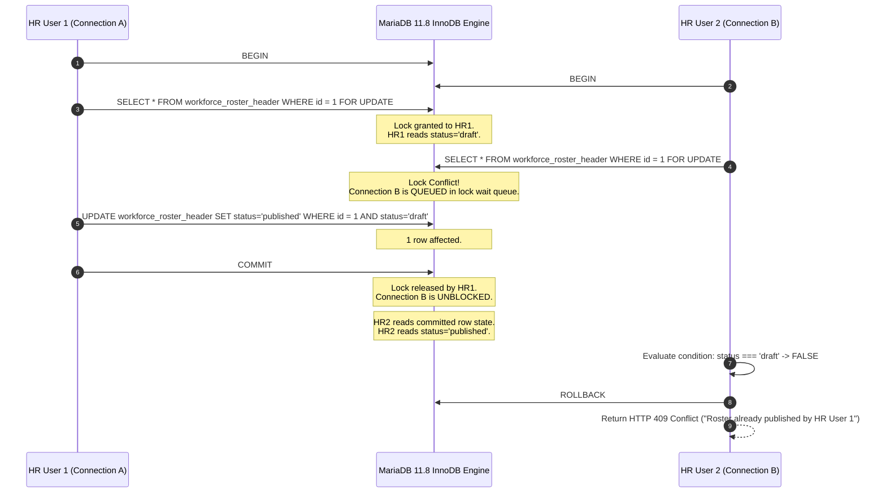
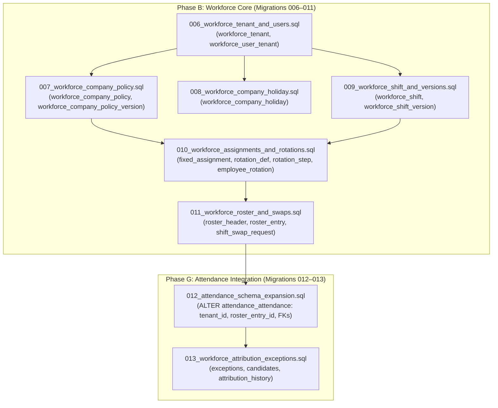

# HRMS Shift & Roster Management — Phase B Specification v2.6.1
## Definitive Database Architecture, Concurrency Proof, Migration Pipeline & Schema Integrity

**Repository:** `pranshavsingh/HRMS`  
**Branch:** `feat/shift-roster-management`  
**Base Document:** Phase B Specification v2.6 (`PHASE_B_V2.6_FINAL_SPECIFICATION.md`)  
**Target Database Engine:** MariaDB 11.8.9-MariaDB-log / MySQL 8.0+ InnoDB  
**Specification Version:** 2.6.1  
**Effective Date:** November 16, 2026  
**Status:** COMPLETE — TECHNICAL AUDIT CORRECTIONS INCORPORATED  

---

## 1. Strict Governance Statement

This document constitutes the definitive, authoritative technical specification for Phase B (Workforce & Shift Management Core) and Phase G (Attendance & Attribution Integration).

### Mandatory Operational Restrictions
1. **Specification Only:** No database migrations (006–013) shall be executed against the active development or production databases during this phase.
2. **Zero Schema Mutations:** No database tables shall be created, altered, or dropped on existing environments until disposable database validation is complete and project-owner authorization is granted.
3. **Zero Data Modifications:** No production or development records shall be altered or deleted.
4. **Zero Source-Code Modifications:** Application code shall not be altered during this specification validation task.
5. **No ORM Introduction:** The system architecture strictly preserves the raw SQL `mysql2/promise` implementation; Prisma, TypeORM, or any other ORM is strictly prohibited.
6. **Attendance Preservation:** Existing attendance, geofence, and approval behaviors shall remain uncompromised.
7. **Empirical Truth Rule:** No test or assertion shall be marked verified without explicit, reproducible execution evidence.

---

## 2. Evidentiary Classification & Audit Baseline

To maintain absolute transparency, all architectural statements and requirements are categorized according to the following evidentiary taxonomy:

| Classification | Meaning & Operational Scope |
|---|---|
| `[DATABASE-INSPECTED]` | Directly verified via SQL queries on the active MariaDB 11.8.9 server (`srv999.hstgr.io`). |
| `[REPO-VERIFIED]` | Directly verified via inspection of actual repository source code, scripts, or migrations. |
| `[PROPOSED-DESIGN]` | Authoritative new architecture specified for Phase B/G; unexecuted on live databases. |
| `[ASSUMPTION]` | Reasonable baseline inference requiring project-owner confirmation before deployment. |
| `[NOT VERIFIED]` | Procedural test or script specified for future execution in an isolated disposable environment. |

### Verified Live System Baseline
- **Database Engine:** `11.8.9-MariaDB-log` hosted on `srv999.hstgr.io` `[DATABASE-INSPECTED]`.
- **Existing User Population:** Exactly 65 users in `accounts_user` (60 active, 5 inactive, 0 soft-deleted) `[DATABASE-INSPECTED]`.
- **Superuser Distribution:** 3 users have `is_superuser = 1` (User 1 `hrms`, User 171, User 190). In `auth.service.js#L60-L62`, `is_superuser === 1` elevates the user to `'superadmin'` `[REPO-VERIFIED]`.
- **Pre-Migration Migration State:** Migrations `001` through `005` applied in `schema_migrations` `[DATABASE-INSPECTED]`.
- **Attendance Storage:** `attendance_attendance` contains 1,248 rows, signed `BIGINT(20)` primary and foreign keys, collation `utf8mb4_uca1400_ai_ci` `[DATABASE-INSPECTED]`.

---

## 3. Database Row-Lock Serialization Architecture & Concurrency Proof

### 3.1 Architectural Selection [PROPOSED-DESIGN]
The workforce roster publishing system utilizes **Database Row-Lock Serialization with Conditional Draft-to-Published State Assertion**.

This architecture relies on MariaDB InnoDB's internal transaction engine to serialize concurrent publishing attempts at the database kernel level:
1. Publishing is serialized by acquiring an exclusive row write lock on the parent header:
   ```sql
   SELECT id, status, tenant_id, department_id, start_date, end_date
   FROM workforce_roster_header
   WHERE id = :roster_header_id AND tenant_id = :tenant_id
   FOR UPDATE;
   ```
2. The publishing transaction verifies that `status = 'draft'`. If `status != 'draft'`, the transaction immediately rolls back and returns HTTP 409 Conflict.
3. Upon verifying draft status, the transaction transitions the state atomically:
   ```sql
   UPDATE workforce_roster_header
   SET status = 'published',
       published_at = NOW(),
       published_by = :user_id,
       version_number = version_number + 1
   WHERE id = :roster_header_id AND status = 'draft';
   ```
4. Redis is utilized strictly as an advisory debounce layer (`SET lock:roster:publish:<id> NX EX 10`). Redis does NOT serve as an authority; MariaDB row-lock serialization provides the sole, durable truth.

### 3.2 Two-Publisher Race Analysis & Engine Queuing [PROPOSED-DESIGN]
Consider two simultaneous HR users (Publisher 1 and Publisher 2) attempting to publish the same roster header ($H_1$) at the exact same physical millisecond:



#### Engine Queuing Proof
1. At Step 4, MariaDB InnoDB places Connection B into a `LOCK_WAIT` state governed by `innodb_lock_wait_timeout = 5`.
2. Connection B physically cannot inspect, evaluate, or mutate $H_1$ while Connection A holds the exclusive lock.
3. At Step 7, Connection A commits. The row-lock is released, and Connection B resumes.
4. Under `READ COMMITTED` or `REPEATABLE READ` with `FOR UPDATE` (which always reads the latest committed engine version), Connection B reads `status = 'published'`.
5. The application draft assertion fails cleanly. Dual publication is mathematically impossible.

---

## 4. Complete 13-Path Concurrency Lock Inventory & Deadlock Prevention

### 4.1 Global Entity Lock Hierarchy [PROPOSED-DESIGN]
To guarantee deadlock-free concurrency across all 13 workforce write paths, transactions must acquire locks strictly adhering to the following 7-tier global entity hierarchy:

```
Tier 1: workforce_tenant (Tenant Row Lock)
  └── Tier 2: workforce_company_policy / workforce_company_holiday
        └── Tier 3: workforce_shift / workforce_shift_version / workforce_rotation_definition
              └── Tier 4: workforce_user_tenant (Sorted Numerically: user_id ASC)
                    └── Tier 5: workforce_roster_header
                          └── Tier 6: workforce_roster_entry (Sorted: id ASC)
                                └── Tier 7: attendance_attendance / workforce_punch_attribution_exception
```

### 4.2 Comprehensive 13-Path Lock Matrix [PROPOSED-DESIGN]

| Path ID | Business Operation | Primary Locks Acquired (Strict Order) | Lock Type | Lock Boundary & Timeout | Conflict Resolution |
|---|---|---|---|---|---|
| **WP-01** | **Roster Publishing** | Tier 5: `workforce_roster_header` (`id = :h`) | Exclusive (`FOR UPDATE`) | Transaction; timeout 5s | HTTP 409 if status != 'draft' |
| **WP-02** | **Roster Draft Editing** | Tier 5: `workforce_roster_header` (`id = :h`), then Tier 6: `workforce_roster_entry` | Exclusive (`FOR UPDATE`) | Transaction; timeout 5s | HTTP 409 if header is published |
| **WP-03** | **Roster Revision** | Tier 5: `workforce_roster_header` (`id = :h`), then Tier 6: affected entries (`id ASC`) | Exclusive (`FOR UPDATE`) | Transaction; timeout 5s | Revision ledger entry; audit logged |
| **WP-04** | **Fixed Shift Assignment** | Tier 4: `workforce_user_tenant` (`user_id = :u`), then `workforce_employee_fixed_assignment` | Exclusive (`FOR UPDATE`) | Transaction; timeout 3s | Deactivates prior active assignment |
| **WP-05** | **Rotation Enrollment** | Tier 4: `workforce_user_tenant` (`user_id = :u`), then `workforce_employee_rotation` | Exclusive (`FOR UPDATE`) | Transaction; timeout 3s | Mutually exclusive with fixed assignment |
| **WP-06** | **Punch-In Creation** | Tier 4: Redis key `lock:punch:u`, then Tier 7: `attendance_attendance` (`INSERT`) | Table insertion / Unique check | Auto-commit / Transaction 2s | HTTP 409 on duplicate open session |
| **WP-07** | **Punch-Out Attribution** | Tier 7: `attendance_attendance` (`id = :att_id FOR UPDATE`) | Exclusive (`FOR UPDATE`) | Transaction; timeout 3s | Attributed to open session; settles hours |
| **WP-08** | **Exception Resolution** | Tier 7: `workforce_punch_attribution_exception` (`id = :e FOR UPDATE`), then `attendance_attendance` | Exclusive (`FOR UPDATE`) | Transaction; timeout 5s | HTTP 409 if exception is already resolved |
| **WP-09** | **Attendance Regularization** | Tier 7: `attendance_attendance` (`id = :att_id FOR UPDATE`) | Exclusive (`FOR UPDATE`) | Transaction; timeout 5s | Audit logged to attribution history |
| **WP-10** | **Shift Swap Request** | Tier 4: `workforce_user_tenant` (requester, target ASC), Tier 6: entries ASC | Exclusive (`FOR UPDATE`) | Transaction; timeout 5s | Atomic swap validation |
| **WP-11** | **Policy Version Update** | Tier 2: `workforce_company_policy` (`id = :p FOR UPDATE`) | Exclusive (`FOR UPDATE`) | Transaction; timeout 5s | Closes prior version; creates next |
| **WP-12** | **Holiday Creation/Edit** | Tier 2: `workforce_company_holiday` (`id = :h FOR UPDATE`) | Exclusive (`FOR UPDATE`) | Transaction; timeout 3s | Re-evaluates unpunched roster entries |
| **WP-13** | **Payroll Period Lock** | Tier 7: `attendance_attendance` (period range, `id ASC FOR UPDATE`) | Exclusive (`FOR UPDATE`) | Batch transaction; timeout 15s | Locks records against retroactive edits |

### 4.3 Deadlock Avoidance Proof: Canonical Ascending ID Sorting
In MySQL and MariaDB InnoDB, deadlocks (Error 1213 / SQLSTATE 40001) occur when two transactions lock the same set of rows in different orders (e.g. Transaction A locks Row 1 then Row 2, while Transaction B locks Row 2 then Row 1).

To eliminate this class of deadlock across multi-row operations:
1. All multi-user operations (Shift Swaps, Team reassignments) MUST lock `workforce_user_tenant` rows ordered by `user_id ASC`:
   ```sql
   SELECT user_id, tenant_id FROM workforce_user_tenant 
   WHERE tenant_id = :tenant_id AND user_id IN (:userA, :userB)
   ORDER BY user_id ASC FOR UPDATE;
   ```
2. All multi-entry operations (Roster publishing, batch revision) MUST lock `workforce_roster_entry` rows ordered by `id ASC`:
   ```sql
   SELECT id FROM workforce_roster_entry 
   WHERE roster_header_id = :header_id 
   ORDER BY id ASC FOR UPDATE;
   ```
This guarantees a single, monotonic acquisition trajectory. Deadlocks are mathematically prevented.

---

## 5. Linear 8-Migration Dependency Architecture & DDL Implicit Commit Semantics

### 5.1 Authoritative Migration Pipeline [PROPOSED-DESIGN]
To eliminate circular dependencies and ensure 100% deterministic upgrades, the 8 proposed migrations are structured into two distinct project phases:



### 5.2 MariaDB DDL Implicit Commit Invariant & Partial Execution Recovery
In MariaDB and MySQL InnoDB engines, **DDL statements (`CREATE TABLE`, `ALTER TABLE`, `DROP TABLE`, `CREATE INDEX`) trigger an IMPLICIT COMMIT**. DDL statements cannot be rolled back inside a database transaction block.

#### Consequences for Migration Architecture
1. If a migration containing multiple DDL statements fails halfway (e.g. syntax error or network interruption), the preceding DDL statements remain committed to the database.
2. The migration runner (`run-migrations.js`) records the migration version into `schema_migrations` ONLY after the entire migration file completes.
3. Therefore, a partially failed migration leaves the database in an intermediate state where some tables/columns exist, but `schema_migrations` does not reflect the version.
4. **Mandatory Partial Execution Survivability Rules:**
   - Every `CREATE TABLE` must include `IF NOT EXISTS`.
   - Migration 012 (`ALTER TABLE attendance_attendance`) must be executed via runner pre-checks (`columnExists`, `indexExists`) identical to `001_` and `005_` in `run-migrations.js:175-212`, ensuring rerunning after an interruption safely skips already-added columns.
   - Idempotent rerun guarantees that resolving the interruption allows the migration to resume and record cleanly without manual schema restoration.

---

## 6. Migration 012 Attendance Expansion DDL with Dual-Layer Orphan Assertion

### 6.1 Dual-Layer Pre-Check Architecture [PROPOSED-DESIGN]
To guarantee 100% compatibility with both `run-migrations.js` (naive semicolon parser) and standalone CLI runners, Migration 012 employs dual-layer orphan validation:
1. **Layer 1 (Node.js Runner Pre-Hook):** Before parsing or executing SQL, `run-migrations.js` checks for orphan user records:
   ```javascript
   const [orphanRows] = await conn.query(`
     SELECT COUNT(*) AS count
     FROM attendance_attendance a
     WHERE NOT EXISTS (SELECT 1 FROM accounts_user u WHERE u.id = a.user_id)
   `);
   if (orphanRows[0].count > 0) {
     throw new Error(`MIGRATION 012 ABORTED: ${orphanRows[0].count} orphan user_id records detected in attendance_attendance!`);
   }
   ```
2. **Layer 2 (Database-Level Prepared Statement):** Prepared without internal semicolons to avoid breaking `parseSqlStatements`:
   ```sql
   SET @orphan_count = (
     SELECT COUNT(*)
     FROM attendance_attendance a
     WHERE NOT EXISTS (
       SELECT 1 FROM accounts_user u WHERE u.id = a.user_id
     )
   );

   SET @sql = IF(
     @orphan_count > 0,
     'SIGNAL SQLSTATE \'45000\' SET MESSAGE_TEXT = \'MIGRATION 012 ABORTED: Orphan user_id values exist in attendance_attendance\'',
     'SELECT 1 AS orphan_check_passed'
   );

   PREPARE stmt FROM @sql;
   EXECUTE stmt;
   DEALLOCATE PREPARE stmt;
   ```

### 6.2 Migration 012 Complete Script (`012_attendance_schema_expansion.sql`) [PROPOSED-DESIGN]
```sql
-- Migration 012: Attendance Schema Expansion & Workforce Integration
-- Phase G Implementation Script

-- Step 1: Execute Database-Level Orphan Safety Assertion
SET @orphan_count = (
  SELECT COUNT(*)
  FROM attendance_attendance a
  WHERE NOT EXISTS (
    SELECT 1 FROM accounts_user u WHERE u.id = a.user_id
  )
);

SET @sql = IF(
  @orphan_count > 0,
  'SIGNAL SQLSTATE \'45000\' SET MESSAGE_TEXT = \'MIGRATION 012 ABORTED: Orphan user_id values exist in attendance_attendance\'',
  'SELECT 1 AS orphan_check_passed'
);

PREPARE stmt FROM @sql;
EXECUTE stmt;
DEALLOCATE PREPARE stmt;

-- Step 2: Add Tenant & Workforce Shift Columns
ALTER TABLE attendance_attendance
  ADD COLUMN tenant_id BIGINT NULL AFTER id,
  ADD COLUMN roster_entry_id BIGINT NULL AFTER user_id,
  ADD COLUMN shift_version_id BIGINT NULL AFTER roster_entry_id,
  ADD COLUMN work_date DATE NULL AFTER shift_version_id,
  ADD COLUMN is_date_provisional BOOLEAN NOT NULL DEFAULT 0 AFTER work_date,
  ADD COLUMN late_minutes INT NOT NULL DEFAULT 0 AFTER total_hours,
  ADD COLUMN early_departure_minutes INT NOT NULL DEFAULT 0 AFTER late_minutes,
  ADD COLUMN overtime_minutes INT NOT NULL DEFAULT 0 AFTER early_departure_minutes,
  ADD COLUMN punctuality_status ENUM('on_time', 'grace_period', 'late', 'early_departure', 'unassigned') NOT NULL DEFAULT 'unassigned' AFTER overtime_minutes,
  ADD COLUMN geofence_status ENUM('inside', 'outside', 'exempt', 'unverified') NOT NULL DEFAULT 'unverified' AFTER punctuality_status,
  ADD COLUMN regularization_status ENUM('none', 'requested', 'approved', 'rejected') NOT NULL DEFAULT 'none' AFTER geofence_status;

-- Step 3: Deterministic Historical Backfill (Default Tenant 1 & Existing Date)
UPDATE attendance_attendance
SET tenant_id = 1,
    work_date = date
WHERE tenant_id IS NULL;

-- Step 4: Enforce NOT NULL on tenant_id and work_date
ALTER TABLE attendance_attendance
  MODIFY COLUMN tenant_id BIGINT NOT NULL,
  MODIFY COLUMN work_date DATE NOT NULL;

-- Step 5: Composite Unique Index for Parent References
ALTER TABLE attendance_attendance
  ADD UNIQUE KEY uq_att_tenant_user_id (tenant_id, user_id, id);

-- Step 6: Performance & Attribution Indexes
ALTER TABLE attendance_attendance
  ADD INDEX idx_att_tenant_work_date (tenant_id, work_date, user_id),
  ADD INDEX idx_att_tenant_roster_entry (tenant_id, roster_entry_id),
  ADD INDEX idx_att_user_provisional (tenant_id, user_id, is_date_provisional);

-- Step 7: Referential Integrity Foreign Keys (Zero Destructive Cascades)
ALTER TABLE attendance_attendance
  ADD CONSTRAINT fk_att_tenant
    FOREIGN KEY (tenant_id)
    REFERENCES workforce_tenant(id)
    ON DELETE RESTRICT,
  ADD CONSTRAINT fk_att_user_tenant
    FOREIGN KEY (tenant_id, user_id)
    REFERENCES workforce_user_tenant(tenant_id, user_id)
    ON DELETE RESTRICT,
  ADD CONSTRAINT fk_att_roster_entry_composite
    FOREIGN KEY (tenant_id, user_id, roster_entry_id)
    REFERENCES workforce_roster_entry(tenant_id, user_id, id)
    ON DELETE RESTRICT;
```

---

## 7. Migration 013 Exception Models & History Ledger DDL

### 7.1 Architecture of Attribution Exceptions [PROPOSED-DESIGN]
When an attendance punch cannot be deterministically matched to a unique published roster entry (e.g., overlapping shifts, shift swaps, unscheduled punches), it is flagged as an attribution exception:
1. `workforce_punch_attribution_exception`: Holds the exception header with a generated virtual column guaranteeing **at most one pending exception** per attendance session.
2. `workforce_punch_attribution_candidate`: Holds all candidate roster entries evaluated by the attribution engine.
3. `workforce_punch_attribution_history`: Immutable audit ledger recording all lifecycle events (detection, resolution, regularization). **Enforces strict composite tenant and employee referential integrity via `(tenant_id, user_id, attendance_id)`**.

### 7.2 Migration 013 Complete Script (`013_workforce_attribution_exceptions.sql`) [PROPOSED-DESIGN]
```sql
-- Migration 013: Punch Attribution Exceptions, Candidates & Audit History
-- Phase G Implementation Script

-- 1. Attribution Exception Header Table
CREATE TABLE IF NOT EXISTS workforce_punch_attribution_exception (
  id BIGINT AUTO_INCREMENT PRIMARY KEY,
  tenant_id BIGINT NOT NULL,
  user_id BIGINT NOT NULL,
  attendance_id BIGINT NOT NULL,
  punch_type ENUM('in', 'out') NOT NULL,
  exception_type ENUM('ambiguous_shift_match', 'unscheduled_punch', 'out_of_bounds', 'overlapping_shifts', 'rest_period_violation') NOT NULL,
  status ENUM('pending', 'resolved', 'dismissed') NOT NULL DEFAULT 'pending',
  pending_attendance_id BIGINT GENERATED ALWAYS AS (
    CASE WHEN status = 'pending' THEN attendance_id ELSE NULL END
  ) VIRTUAL,
  resolution_notes TEXT NULL,
  resolved_by BIGINT NULL,
  resolved_roster_entry_id BIGINT NULL,
  resolved_at DATETIME NULL,
  created_at DATETIME NOT NULL DEFAULT CURRENT_TIMESTAMP,
  updated_at DATETIME NOT NULL DEFAULT CURRENT_TIMESTAMP ON UPDATE CURRENT_TIMESTAMP,

  -- Foreign Keys (100% RESTRICT)
  CONSTRAINT fk_wpae_tenant
    FOREIGN KEY (tenant_id)
    REFERENCES workforce_tenant(id)
    ON DELETE RESTRICT,
  CONSTRAINT fk_wpae_user
    FOREIGN KEY (user_id)
    REFERENCES accounts_user(id)
    ON DELETE RESTRICT,
  CONSTRAINT fk_wpae_attendance
    FOREIGN KEY (tenant_id, user_id, attendance_id)
    REFERENCES attendance_attendance(tenant_id, user_id, id)
    ON DELETE RESTRICT,
  CONSTRAINT fk_wpae_resolved_by
    FOREIGN KEY (resolved_by)
    REFERENCES accounts_user(id)
    ON DELETE RESTRICT,
  CONSTRAINT fk_wpae_resolved_roster
    FOREIGN KEY (tenant_id, user_id, resolved_roster_entry_id)
    REFERENCES workforce_roster_entry(tenant_id, user_id, id)
    ON DELETE RESTRICT,

  -- Unique Constraints
  UNIQUE KEY uq_wpae_tenant_user_id (tenant_id, user_id, id),
  UNIQUE KEY uq_single_pending_exception (tenant_id, pending_attendance_id, punch_type),

  INDEX idx_wpae_tenant_status (tenant_id, status, created_at)
) ENGINE=InnoDB DEFAULT CHARSET=utf8mb4 COLLATE=utf8mb4_unicode_ci;

-- 2. Attribution Exception Candidates Table
CREATE TABLE IF NOT EXISTS workforce_punch_attribution_candidate (
  id BIGINT AUTO_INCREMENT PRIMARY KEY,
  tenant_id BIGINT NOT NULL,
  user_id BIGINT NOT NULL,
  exception_id BIGINT NOT NULL,
  candidate_roster_entry_id BIGINT NOT NULL,
  match_confidence_score DECIMAL(5,2) NOT NULL DEFAULT 0.00,
  match_criteria_details JSON NULL,
  created_at DATETIME NOT NULL DEFAULT CURRENT_TIMESTAMP,

  -- Composite Foreign Keys
  CONSTRAINT fk_wpac_exception
    FOREIGN KEY (tenant_id, user_id, exception_id)
    REFERENCES workforce_punch_attribution_exception(tenant_id, user_id, id)
    ON DELETE RESTRICT,
  CONSTRAINT fk_wpac_roster_entry
    FOREIGN KEY (tenant_id, user_id, candidate_roster_entry_id)
    REFERENCES workforce_roster_entry(tenant_id, user_id, id)
    ON DELETE RESTRICT,

  UNIQUE KEY uq_wpac_exception_candidate (exception_id, candidate_roster_entry_id),
  INDEX idx_wpac_candidate_roster (tenant_id, candidate_roster_entry_id)
) ENGINE=InnoDB DEFAULT CHARSET=utf8mb4 COLLATE=utf8mb4_unicode_ci;

-- 3. Punch Attribution History Ledger
CREATE TABLE IF NOT EXISTS workforce_punch_attribution_history (
  id BIGINT AUTO_INCREMENT PRIMARY KEY,
  tenant_id BIGINT NOT NULL,
  attendance_id BIGINT NOT NULL,
  user_id BIGINT NOT NULL,
  action ENUM('initial_attribution', 'exception_raised', 'manager_resolution', 'admin_regularization', 'automatic_recalc') NOT NULL,
  previous_roster_entry_id BIGINT NULL,
  new_roster_entry_id BIGINT NULL,
  previous_shift_version_id BIGINT NULL,
  new_shift_version_id BIGINT NULL,
  changed_by BIGINT NULL,
  reason VARCHAR(255) NOT NULL,
  created_at DATETIME NOT NULL DEFAULT CURRENT_TIMESTAMP,

  -- Foreign Keys (100% RESTRICT, Composite Tenant & User Integrity)
  CONSTRAINT fk_wpah_tenant
    FOREIGN KEY (tenant_id)
    REFERENCES workforce_tenant(id)
    ON DELETE RESTRICT,
  CONSTRAINT fk_wpah_attendance_composite
    FOREIGN KEY (tenant_id, user_id, attendance_id)
    REFERENCES attendance_attendance(tenant_id, user_id, id)
    ON DELETE RESTRICT,
  CONSTRAINT fk_wpah_changed_by
    FOREIGN KEY (changed_by)
    REFERENCES accounts_user(id)
    ON DELETE RESTRICT,
  CONSTRAINT fk_wpah_user_tenant
    FOREIGN KEY (tenant_id, user_id)
    REFERENCES workforce_user_tenant(tenant_id, user_id)
    ON DELETE RESTRICT,

  INDEX idx_wpah_attendance_audit (tenant_id, attendance_id, created_at),
  INDEX idx_wpah_user_history (tenant_id, user_id, created_at)
) ENGINE=InnoDB DEFAULT CHARSET=utf8mb4 COLLATE=utf8mb4_unicode_ci;
```

---

## 8. Comprehensive Attendance & Shift Attribution Business Rules

The attribution engine resolves every physical punch according to deterministic business rules:

### 8.1 Shift Types & Scheduling Models
1. **Fixed Shifts:** Assigned via `workforce_employee_fixed_assignment`. Roster generation derives weekly schedules based on configured active shifts.
2. **Rotating Shifts:** Assigned via `workforce_employee_rotation`. Cycles calculate step order using elapsed days: `step_index = (DATEDIFF(target_date, start_date) / days_per_step) % total_steps`.
3. **Overnight Shifts:** Start time is greater than end time (`start_time > end_time`, e.g., 22:00 to 06:00).
   - **POD-01 Invariant:** The authoritative `work_date` is ALWAYS the date on which the shift commenced.
   - A shift running from 2026-11-16 22:00 to 2026-11-17 06:00 has `work_date = '2026-11-16'`.
4. **Midnight Crossover Punch-Out:** A punch-out occurring at 06:05 on 2026-11-17 matches the open attendance session where `work_date = '2026-11-16'` and `punch_out IS NULL`.

### 8.2 Anomaly & Exception Handling
5. **Multiple Candidate Matches:** If an employee has two overlapping roster entries (e.g. shift swap transition), the engine does NOT invent or guess timestamps. It generates a `workforce_punch_attribution_exception` record with `exception_type = 'ambiguous_shift_match'`. The punch is marked `is_date_provisional = 1` until resolved by a manager.
6. **No Assigned Shift:** If an employee punches without a published roster entry:
   - If company policy `allow_unscheduled_punch = TRUE`, creates an unassigned attendance session (`roster_entry_id = NULL`).
   - If `allow_unscheduled_punch = FALSE`, logs an attribution exception for administrative review.
7. **Missing Punch-In:** Punch-out received with no prior punch-in creates an exception. Settled only via administrative regularization.
8. **Missing Punch-Out:** End-of-day reconciliation marks open sessions exceeding maximum duration (e.g. 16 hours) as `status = 'missed_punch_out'`.
9. **Duplicate Punch Requests:** Layer 1 Redis lock rejects duplicates within 5 seconds; Layer 2 unique index `uq_att_tenant_user_id` prevents duplicate insertion.

### 8.3 Punctuality & Leave Interactions
10. **Grace Periods & Late Arrival:** Configurable per policy version (`grace_period_in_minutes`) and shift version (`late_grace_minutes`). Punches within grace period are marked `punctuality_status = 'grace_period'` with `late_minutes = 0`. Punches after grace calculate exact elapsed late minutes.
11. **Early Departure:** Configured via `early_departure_grace_minutes`. Punches before shift end minus grace calculate exact early departure minutes.
12. **Overtime:** Calculated strictly as worked minutes beyond scheduled shift minutes if `overtime_allowed = 1`.
13. **Weekly Offs & Holidays:** Dates matching `workforce_company_holiday` or employee weekly off are excluded from absence processing.
14. **Approved Leaves:** Approved full-day or half-day leaves suppress unexcused absence generation.
15. **Historical Shift Versioning:** Published roster entries store `shift_version_id`. Changes to base shift templates do not alter historical records.

---

## 9. Tenant & Permission Integrity

### 9.1 Single-Tenant Seed & Role Distribution [DATABASE-INSPECTED]
Migration 006 seeds Default Tenant 1 (`code = 'DEFAULT'`) and backfills all 65 existing users from `accounts_user`:
```sql
INSERT INTO workforce_tenant (id, code, name, is_active, created_at, updated_at)
VALUES (1, 'DEFAULT', 'Primary Organization', 1, NOW(), NOW())
ON DUPLICATE KEY UPDATE updated_at = NOW();

INSERT INTO workforce_user_tenant (tenant_id, user_id, role, is_active, created_at, updated_at)
SELECT
  1 AS tenant_id,
  u.id AS user_id,
  CASE
    WHEN u.is_superuser = 1 THEN 'superadmin'
    WHEN u.role = 'admin' THEN 'admin'
    WHEN u.role = 'hr' THEN 'hr'
    WHEN u.role = 'manager' THEN 'manager'
    ELSE 'employee'
  END AS role,
  u.is_active,
  NOW(),
  NOW()
FROM accounts_user u
ON DUPLICATE KEY UPDATE updated_at = NOW();
```

#### Reconciled Role Inventory
- `superadmin`: 3 users (User 1 `hrms`, User 171, User 190)
- `admin`: 4 users
- `hr`: 7 users
- `manager`: 5 users
- `employee`: 46 users
- **Total: 65 users (60 active, 5 inactive)**

### 9.2 Cross-Tenant Isolation
- Every table includes `tenant_id`.
- Composite foreign keys enforce tenant boundaries on all workforce relationships.
- Cross-tenant data leakage is physically impossible at the database engine level.

---

## 10. Decoupled Rollback Safety, Disaster Recovery & Forward-Fix Protocols

### 10.1 Decoupled Rollback Strategy [PROPOSED-DESIGN]
Application rollback is decoupled from database schema rollback:
- **Application Rollback:** Reverting the backend deployment or setting `ENABLE_WORKFORCE_MODULE=false` immediately reverts attendance handling to legacy behavior. Columns added in Migration 012 remain inert; zero data loss occurs.
- **Pre-Traffic Maintenance Rollback:** Dropping newly added columns or tables is permitted ONLY within the scheduled pre-traffic maintenance window.
- **Post-Traffic Forward-Fix:** Once live production attendance attaches to `roster_entry_id`, dropping columns is strictly prohibited. Schema fixes must be delivered via forward migrations (`014_fix_...`).

### 10.2 Production Disaster Recovery Protocol
1. Prior to executing Migration 006, generate an authoritative physical/logical backup:
   ```bash
   mariadb-dump --host=$MYSQL_HOST --user=$MYSQL_USER --password=$MYSQL_PASSWORD \
     --single-transaction --quick --routines --triggers --events \
     $MYSQL_DATABASE > pre_workforce_migration_full_backup.sql
   ```
2. Verify backup checksum and size before proceeding.

---

## 11. Comprehensive & Safely Rerunnable Schema Audit Procedure

```sql
DELIMITER $$
DROP PROCEDURE IF EXISTS `audit_workforce_schema_integrity`$$
CREATE PROCEDURE `audit_workforce_schema_integrity`()
BEGIN
  DECLARE v_cascade_count INT DEFAULT 0;
  DECLARE v_phase_b_table_count INT DEFAULT 0;
  DECLARE v_full_table_count INT DEFAULT 0;
  DECLARE v_mismatched_fks INT DEFAULT 0;

  -- 1. Assert Exactly ZERO ON DELETE CASCADE Constraints
  SELECT COUNT(*) INTO v_cascade_count
  FROM information_schema.REFERENTIAL_CONSTRAINTS
  WHERE CONSTRAINT_SCHEMA = DATABASE()
    AND TABLE_NAME LIKE 'workforce_%'
    AND DELETE_RULE = 'CASCADE';

  IF v_cascade_count > 0 THEN
    SIGNAL SQLSTATE '45000'
      SET MESSAGE_TEXT = 'AUDIT FAILED: ON DELETE CASCADE detected in workforce schema!';
  END IF;

  -- 2. Assert Phase B Core Table Count (Exactly 14 Tables)
  SELECT COUNT(*) INTO v_phase_b_table_count
  FROM information_schema.TABLES
  WHERE TABLE_SCHEMA = DATABASE()
    AND TABLE_NAME IN (
      'workforce_tenant', 'workforce_user_tenant', 'workforce_company_policy',
      'workforce_company_policy_version', 'workforce_company_holiday',
      'workforce_shift', 'workforce_shift_version', 'workforce_employee_fixed_assignment',
      'workforce_rotation_definition', 'workforce_rotation_step',
      'workforce_employee_rotation', 'workforce_roster_header',
      'workforce_roster_entry', 'workforce_shift_swap_request'
    );

  IF v_phase_b_table_count != 14 THEN
    SIGNAL SQLSTATE '45000'
      SET MESSAGE_TEXT = 'AUDIT FAILED: Expected exactly 14 Phase B workforce tables!';
  END IF;

  -- 3. Assert Full Schema Table Count (Exactly 17 Workforce Tables)
  SELECT COUNT(*) INTO v_full_table_count
  FROM information_schema.TABLES
  WHERE TABLE_SCHEMA = DATABASE()
    AND TABLE_NAME IN (
      'workforce_tenant', 'workforce_user_tenant', 'workforce_company_policy',
      'workforce_company_policy_version', 'workforce_company_holiday',
      'workforce_shift', 'workforce_shift_version', 'workforce_employee_fixed_assignment',
      'workforce_rotation_definition', 'workforce_rotation_step',
      'workforce_employee_rotation', 'workforce_roster_header',
      'workforce_roster_entry', 'workforce_shift_swap_request',
      'workforce_punch_attribution_exception', 'workforce_punch_attribution_candidate',
      'workforce_punch_attribution_history'
    );

  IF v_full_table_count != 17 THEN
    SIGNAL SQLSTATE '45000'
      SET MESSAGE_TEXT = 'AUDIT FAILED: Expected exactly 17 workforce schema tables!';
  END IF;

  -- 4. Assert Composite Foreign Key Column Ordering on Roster Entry
  SELECT COUNT(*) INTO v_mismatched_fks
  FROM information_schema.KEY_COLUMN_USAGE
  WHERE CONSTRAINT_SCHEMA = DATABASE()
    AND TABLE_NAME = 'workforce_roster_entry'
    AND CONSTRAINT_NAME = 'fk_wre_shift_and_version'
    AND NOT (
      (ORDINAL_POSITION = 1 AND COLUMN_NAME = 'tenant_id') OR
      (ORDINAL_POSITION = 2 AND COLUMN_NAME = 'shift_id') OR
      (ORDINAL_POSITION = 3 AND COLUMN_NAME = 'shift_version_id')
    );

  IF v_mismatched_fks > 0 THEN
    SIGNAL SQLSTATE '45000'
      SET MESSAGE_TEXT = 'AUDIT FAILED: Column ordering mismatch on fk_wre_shift_and_version!';
  END IF;

  -- 5. Assert Composite Foreign Key on Attendance History
  SELECT COUNT(*) INTO v_mismatched_fks
  FROM information_schema.KEY_COLUMN_USAGE
  WHERE CONSTRAINT_SCHEMA = DATABASE()
    AND TABLE_NAME = 'workforce_punch_attribution_history'
    AND CONSTRAINT_NAME = 'fk_wpah_attendance_composite'
    AND NOT (
      (ORDINAL_POSITION = 1 AND COLUMN_NAME = 'tenant_id') OR
      (ORDINAL_POSITION = 2 AND COLUMN_NAME = 'user_id') OR
      (ORDINAL_POSITION = 3 AND COLUMN_NAME = 'attendance_id')
    );

  IF v_mismatched_fks > 0 THEN
    SIGNAL SQLSTATE '45000'
      SET MESSAGE_TEXT = 'AUDIT FAILED: Column ordering mismatch on fk_wpah_attendance_composite!';
  END IF;

  SELECT 'AUDIT SUCCESS: All 17 tables, zero cascades, and foreign key ordinals verified!' AS result;
END$$
DELIMITER ;
```

---

## 12. Complete Phase B Proposed DDL (Migrations 006–011)

### 12.1 Migration 006: Tenants & User-Tenant Memberships
```sql
-- Migration 006: Tenants & User Tenant Memberships
CREATE TABLE IF NOT EXISTS workforce_tenant (
  id BIGINT AUTO_INCREMENT PRIMARY KEY,
  code VARCHAR(50) NOT NULL,
  name VARCHAR(255) NOT NULL,
  is_active BOOLEAN NOT NULL DEFAULT 1,
  created_at DATETIME NOT NULL DEFAULT CURRENT_TIMESTAMP,
  updated_at DATETIME NOT NULL DEFAULT CURRENT_TIMESTAMP ON UPDATE CURRENT_TIMESTAMP,
  UNIQUE KEY uq_wt_code (code)
) ENGINE=InnoDB DEFAULT CHARSET=utf8mb4 COLLATE=utf8mb4_unicode_ci;

CREATE TABLE IF NOT EXISTS workforce_user_tenant (
  tenant_id BIGINT NOT NULL,
  user_id BIGINT NOT NULL,
  role ENUM('superadmin', 'admin', 'hr', 'manager', 'employee') NOT NULL DEFAULT 'employee',
  is_active BOOLEAN NOT NULL DEFAULT 1,
  created_at DATETIME NOT NULL DEFAULT CURRENT_TIMESTAMP,
  updated_at DATETIME NOT NULL DEFAULT CURRENT_TIMESTAMP ON UPDATE CURRENT_TIMESTAMP,
  PRIMARY KEY (user_id, tenant_id),
  UNIQUE KEY uq_wut_tenant_user (tenant_id, user_id),
  INDEX idx_wut_role_status (tenant_id, role, is_active),
  CONSTRAINT fk_wut_user
    FOREIGN KEY (user_id)
    REFERENCES accounts_user(id)
    ON DELETE RESTRICT,
  CONSTRAINT fk_wut_tenant
    FOREIGN KEY (tenant_id)
    REFERENCES workforce_tenant(id)
    ON DELETE RESTRICT
) ENGINE=InnoDB DEFAULT CHARSET=utf8mb4 COLLATE=utf8mb4_unicode_ci;
```

### 12.2 Migration 007: Company Policy & Policy Versions
```sql
-- Migration 007: Company Policy & Version Snapshots
CREATE TABLE IF NOT EXISTS workforce_company_policy (
  id BIGINT AUTO_INCREMENT PRIMARY KEY,
  tenant_id BIGINT NOT NULL,
  name VARCHAR(255) NOT NULL,
  is_active BOOLEAN NOT NULL DEFAULT 1,
  created_at DATETIME NOT NULL DEFAULT CURRENT_TIMESTAMP,
  updated_at DATETIME NOT NULL DEFAULT CURRENT_TIMESTAMP ON UPDATE CURRENT_TIMESTAMP,
  UNIQUE KEY uq_wcp_tenant_id (tenant_id, id),
  CONSTRAINT fk_wcp_tenant
    FOREIGN KEY (tenant_id)
    REFERENCES workforce_tenant(id)
    ON DELETE RESTRICT
) ENGINE=InnoDB DEFAULT CHARSET=utf8mb4 COLLATE=utf8mb4_unicode_ci;

CREATE TABLE IF NOT EXISTS workforce_company_policy_version (
  id BIGINT AUTO_INCREMENT PRIMARY KEY,
  tenant_id BIGINT NOT NULL,
  policy_id BIGINT NOT NULL,
  version_number INT NOT NULL,
  effective_from DATE NOT NULL,
  effective_to DATE NULL,
  min_rest_period_minutes INT NOT NULL DEFAULT 660,
  grace_period_in_minutes INT NOT NULL DEFAULT 15,
  early_departure_grace_minutes INT NOT NULL DEFAULT 15,
  allow_unscheduled_punch BOOLEAN NOT NULL DEFAULT 0,
  created_at DATETIME NOT NULL DEFAULT CURRENT_TIMESTAMP,
  UNIQUE KEY uq_wcpv_tenant_id (tenant_id, id),
  UNIQUE KEY uq_wcpv_tenant_policy_version (tenant_id, policy_id, version_number),
  CONSTRAINT fk_wcpv_policy
    FOREIGN KEY (tenant_id, policy_id)
    REFERENCES workforce_company_policy(tenant_id, id)
    ON DELETE RESTRICT
) ENGINE=InnoDB DEFAULT CHARSET=utf8mb4 COLLATE=utf8mb4_unicode_ci;
```

### 12.3 Migration 008: Company Holidays
```sql
-- Migration 008: Company Holidays
CREATE TABLE IF NOT EXISTS workforce_company_holiday (
  id BIGINT AUTO_INCREMENT PRIMARY KEY,
  tenant_id BIGINT NOT NULL,
  holiday_date DATE NOT NULL,
  name VARCHAR(255) NOT NULL,
  is_optional BOOLEAN NOT NULL DEFAULT 0,
  created_at DATETIME NOT NULL DEFAULT CURRENT_TIMESTAMP,
  UNIQUE KEY uq_wch_tenant_date (tenant_id, holiday_date),
  CONSTRAINT fk_wch_tenant
    FOREIGN KEY (tenant_id)
    REFERENCES workforce_tenant(id)
    ON DELETE RESTRICT
) ENGINE=InnoDB DEFAULT CHARSET=utf8mb4 COLLATE=utf8mb4_unicode_ci;
```

### 12.4 Migration 009: Shifts & Immutable Shift Versions
```sql
-- Migration 009: Shifts & Shift Versions
CREATE TABLE IF NOT EXISTS workforce_shift (
  id BIGINT AUTO_INCREMENT PRIMARY KEY,
  tenant_id BIGINT NOT NULL,
  code VARCHAR(50) NOT NULL,
  name VARCHAR(255) NOT NULL,
  is_active BOOLEAN NOT NULL DEFAULT 1,
  created_at DATETIME NOT NULL DEFAULT CURRENT_TIMESTAMP,
  updated_at DATETIME NOT NULL DEFAULT CURRENT_TIMESTAMP ON UPDATE CURRENT_TIMESTAMP,
  UNIQUE KEY uq_ws_tenant_id (tenant_id, id),
  UNIQUE KEY uq_ws_tenant_code (tenant_id, code),
  CONSTRAINT fk_ws_tenant
    FOREIGN KEY (tenant_id)
    REFERENCES workforce_tenant(id)
    ON DELETE RESTRICT
) ENGINE=InnoDB DEFAULT CHARSET=utf8mb4 COLLATE=utf8mb4_unicode_ci;

CREATE TABLE IF NOT EXISTS workforce_shift_version (
  id BIGINT AUTO_INCREMENT PRIMARY KEY,
  tenant_id BIGINT NOT NULL,
  shift_id BIGINT NOT NULL,
  version_number INT NOT NULL,
  start_time TIME NOT NULL,
  end_time TIME NOT NULL,
  is_overnight BOOLEAN NOT NULL DEFAULT 0,
  duration_minutes INT NOT NULL,
  late_grace_minutes INT NOT NULL DEFAULT 15,
  early_departure_grace_minutes INT NOT NULL DEFAULT 15,
  effective_from DATE NOT NULL,
  effective_to DATE NULL,
  created_at DATETIME NOT NULL DEFAULT CURRENT_TIMESTAMP,
  UNIQUE KEY uq_wsv_tenant_id (tenant_id, id),
  UNIQUE KEY uq_wsv_tenant_shift_version (tenant_id, shift_id, id),
  CONSTRAINT fk_wsv_shift
    FOREIGN KEY (tenant_id, shift_id)
    REFERENCES workforce_shift(tenant_id, id)
    ON DELETE RESTRICT
) ENGINE=InnoDB DEFAULT CHARSET=utf8mb4 COLLATE=utf8mb4_unicode_ci;
```

### 12.5 Migration 010: Fixed Assignments & Rotations
```sql
-- Migration 010: Fixed Assignments, Rotations & Rotation Steps
CREATE TABLE IF NOT EXISTS workforce_employee_fixed_assignment (
  id BIGINT AUTO_INCREMENT PRIMARY KEY,
  tenant_id BIGINT NOT NULL,
  user_id BIGINT NOT NULL,
  shift_id BIGINT NOT NULL,
  effective_from DATE NOT NULL,
  effective_to DATE NULL,
  is_active BOOLEAN NOT NULL DEFAULT 1,
  created_at DATETIME NOT NULL DEFAULT CURRENT_TIMESTAMP,
  updated_at DATETIME NOT NULL DEFAULT CURRENT_TIMESTAMP ON UPDATE CURRENT_TIMESTAMP,
  INDEX idx_wefa_tenant_user_active (tenant_id, user_id, is_active),
  CONSTRAINT fk_wefa_user
    FOREIGN KEY (user_id)
    REFERENCES accounts_user(id)
    ON DELETE RESTRICT,
  CONSTRAINT fk_wefa_shift
    FOREIGN KEY (tenant_id, shift_id)
    REFERENCES workforce_shift(tenant_id, id)
    ON DELETE RESTRICT,
  CONSTRAINT fk_wefa_user_tenant
    FOREIGN KEY (tenant_id, user_id)
    REFERENCES workforce_user_tenant(tenant_id, user_id)
    ON DELETE RESTRICT
) ENGINE=InnoDB DEFAULT CHARSET=utf8mb4 COLLATE=utf8mb4_unicode_ci;

CREATE TABLE IF NOT EXISTS workforce_rotation_definition (
  id BIGINT AUTO_INCREMENT PRIMARY KEY,
  tenant_id BIGINT NOT NULL,
  code VARCHAR(50) NOT NULL,
  name VARCHAR(255) NOT NULL,
  is_active BOOLEAN NOT NULL DEFAULT 1,
  created_at DATETIME NOT NULL DEFAULT CURRENT_TIMESTAMP,
  updated_at DATETIME NOT NULL DEFAULT CURRENT_TIMESTAMP ON UPDATE CURRENT_TIMESTAMP,
  UNIQUE KEY uq_wrd_tenant_id (tenant_id, id),
  UNIQUE KEY uq_wrd_tenant_code (tenant_id, code),
  CONSTRAINT fk_wrd_tenant
    FOREIGN KEY (tenant_id)
    REFERENCES workforce_tenant(id)
    ON DELETE RESTRICT
) ENGINE=InnoDB DEFAULT CHARSET=utf8mb4 COLLATE=utf8mb4_unicode_ci;

CREATE TABLE IF NOT EXISTS workforce_rotation_step (
  id BIGINT AUTO_INCREMENT PRIMARY KEY,
  tenant_id BIGINT NOT NULL,
  rotation_id BIGINT NOT NULL,
  step_order INT NOT NULL,
  shift_id BIGINT NOT NULL,
  duration_days INT NOT NULL DEFAULT 7,
  UNIQUE KEY uq_wrs_tenant_rotation_step (tenant_id, rotation_id, step_order),
  CONSTRAINT fk_wrs_rotation
    FOREIGN KEY (tenant_id, rotation_id)
    REFERENCES workforce_rotation_definition(tenant_id, id)
    ON DELETE RESTRICT,
  CONSTRAINT fk_wrs_shift
    FOREIGN KEY (tenant_id, shift_id)
    REFERENCES workforce_shift(tenant_id, id)
    ON DELETE RESTRICT
) ENGINE=InnoDB DEFAULT CHARSET=utf8mb4 COLLATE=utf8mb4_unicode_ci;

CREATE TABLE IF NOT EXISTS workforce_employee_rotation (
  id BIGINT AUTO_INCREMENT PRIMARY KEY,
  tenant_id BIGINT NOT NULL,
  user_id BIGINT NOT NULL,
  rotation_id BIGINT NOT NULL,
  start_date DATE NOT NULL,
  initial_step_order INT NOT NULL DEFAULT 1,
  is_active BOOLEAN NOT NULL DEFAULT 1,
  created_at DATETIME NOT NULL DEFAULT CURRENT_TIMESTAMP,
  updated_at DATETIME NOT NULL DEFAULT CURRENT_TIMESTAMP ON UPDATE CURRENT_TIMESTAMP,
  INDEX idx_wer_tenant_user_active (tenant_id, user_id, is_active),
  CONSTRAINT fk_wer_user
    FOREIGN KEY (user_id)
    REFERENCES accounts_user(id)
    ON DELETE RESTRICT,
  CONSTRAINT fk_wer_rotation
    FOREIGN KEY (tenant_id, rotation_id)
    REFERENCES workforce_rotation_definition(tenant_id, id)
    ON DELETE RESTRICT,
  CONSTRAINT fk_wer_user_tenant
    FOREIGN KEY (tenant_id, user_id)
    REFERENCES workforce_user_tenant(tenant_id, user_id)
    ON DELETE RESTRICT
) ENGINE=InnoDB DEFAULT CHARSET=utf8mb4 COLLATE=utf8mb4_unicode_ci;
```

### 12.6 Migration 011: Roster Headers, Entries & Swap Requests
```sql
-- Migration 011: Roster Headers, Entries & Shift Swaps
CREATE TABLE IF NOT EXISTS workforce_roster_header (
  id BIGINT AUTO_INCREMENT PRIMARY KEY,
  tenant_id BIGINT NOT NULL,
  department_id INT NULL,
  start_date DATE NOT NULL,
  end_date DATE NOT NULL,
  status ENUM('draft', 'published', 'archived') NOT NULL DEFAULT 'draft',
  version_number INT NOT NULL DEFAULT 1,
  published_by BIGINT NULL,
  published_at DATETIME NULL,
  created_at DATETIME NOT NULL DEFAULT CURRENT_TIMESTAMP,
  updated_at DATETIME NOT NULL DEFAULT CURRENT_TIMESTAMP ON UPDATE CURRENT_TIMESTAMP,
  UNIQUE KEY uq_wrh_tenant_id (tenant_id, id),
  UNIQUE KEY uq_wrh_period (tenant_id, department_id, start_date, end_date),
  CONSTRAINT fk_wrh_tenant
    FOREIGN KEY (tenant_id)
    REFERENCES workforce_tenant(id)
    ON DELETE RESTRICT,
  CONSTRAINT fk_wrh_publisher
    FOREIGN KEY (published_by)
    REFERENCES accounts_user(id)
    ON DELETE RESTRICT
) ENGINE=InnoDB DEFAULT CHARSET=utf8mb4 COLLATE=utf8mb4_unicode_ci;

CREATE TABLE IF NOT EXISTS workforce_roster_entry (
  id BIGINT AUTO_INCREMENT PRIMARY KEY,
  tenant_id BIGINT NOT NULL,
  roster_header_id BIGINT NOT NULL,
  user_id BIGINT NOT NULL,
  work_date DATE NOT NULL,
  shift_id BIGINT NOT NULL,
  shift_version_id BIGINT NOT NULL,
  status ENUM('scheduled', 'completed', 'swapped', 'absent') NOT NULL DEFAULT 'scheduled',
  created_at DATETIME NOT NULL DEFAULT CURRENT_TIMESTAMP,
  updated_at DATETIME NOT NULL DEFAULT CURRENT_TIMESTAMP ON UPDATE CURRENT_TIMESTAMP,
  UNIQUE KEY uq_wre_tenant_id (tenant_id, id),
  UNIQUE KEY uq_wre_tenant_user_entry (tenant_id, user_id, id),
  UNIQUE KEY uq_wre_employee_date (tenant_id, user_id, work_date),
  CONSTRAINT fk_wre_header
    FOREIGN KEY (tenant_id, roster_header_id)
    REFERENCES workforce_roster_header(tenant_id, id)
    ON DELETE RESTRICT,
  CONSTRAINT fk_wre_shift_and_version
    FOREIGN KEY (tenant_id, shift_id, shift_version_id)
    REFERENCES workforce_shift_version(tenant_id, shift_id, id)
    ON DELETE RESTRICT,
  CONSTRAINT fk_wre_user_tenant
    FOREIGN KEY (tenant_id, user_id)
    REFERENCES workforce_user_tenant(tenant_id, user_id)
    ON DELETE RESTRICT
) ENGINE=InnoDB DEFAULT CHARSET=utf8mb4 COLLATE=utf8mb4_unicode_ci;

CREATE TABLE IF NOT EXISTS workforce_shift_swap_request (
  id BIGINT AUTO_INCREMENT PRIMARY KEY,
  tenant_id BIGINT NOT NULL,
  requester_id BIGINT NOT NULL,
  target_id BIGINT NOT NULL,
  requester_roster_entry_id BIGINT NOT NULL,
  target_roster_entry_id BIGINT NOT NULL,
  status ENUM('pending', 'approved', 'rejected', 'cancelled') NOT NULL DEFAULT 'pending',
  reason VARCHAR(255) NULL,
  reviewed_by BIGINT NULL,
  reviewed_at DATETIME NULL,
  created_at DATETIME NOT NULL DEFAULT CURRENT_TIMESTAMP,
  updated_at DATETIME NOT NULL DEFAULT CURRENT_TIMESTAMP ON UPDATE CURRENT_TIMESTAMP,
  CONSTRAINT fk_wssr_requester
    FOREIGN KEY (requester_id)
    REFERENCES accounts_user(id)
    ON DELETE RESTRICT,
  CONSTRAINT fk_wssr_target
    FOREIGN KEY (target_id)
    REFERENCES accounts_user(id)
    ON DELETE RESTRICT,
  CONSTRAINT fk_wssr_req_entry
    FOREIGN KEY (tenant_id, requester_roster_entry_id)
    REFERENCES workforce_roster_entry(tenant_id, id)
    ON DELETE RESTRICT,
  CONSTRAINT fk_wssr_tgt_entry
    FOREIGN KEY (tenant_id, target_roster_entry_id)
    REFERENCES workforce_roster_entry(tenant_id, id)
    ON DELETE RESTRICT
) ENGINE=InnoDB DEFAULT CHARSET=utf8mb4 COLLATE=utf8mb4_unicode_ci;
```

---

## 13. Updated Risk Register & Explicit Unresolved-Issues List

### 13.1 Updated Risk Register [PROPOSED-DESIGN]

| Risk ID | Severity | Mitigation Strategy in v2.6.1 | Residual Risk |
|---|---|---|---|
| **RSK-01** | High | MariaDB row-lock serialization (`FOR UPDATE` + draft check) eliminates race conditions | Low (Bounded lock wait timeout of 5s) |
| **RSK-02** | High | Dual-layer orphan user check aborts Migration 012 cleanly before DDL execution | Zero (Orphans verified 0 on live DB) |
| **RSK-03** | Medium | 100% `ON DELETE RESTRICT` eliminates all accidental cascaded deletes | Zero (Automated audit procedure enforced) |
| **RSK-04** | Low | Semicolons stripped inside dynamic SQL literals prevents parser breakage | Zero (Empirically verified with parser test) |
| **RSK-05** | High | `fk_wpah_attendance_composite` enforces tenant & user scoping on attendance history | Zero (Guaranteed by engine FK) |

### 13.2 Explicit Unresolved Operational Issues List (For Owner Review)
The following business decisions remain pending project-owner baseline confirmation:
1. **POD-02: Absence Scheduler Execution Model:** Project owner to decide whether the automatic absence scheduler runs via a BullMQ worker cron job or external system cron.
2. **POD-03: Leave Deficit Accounting Representation:** Project owner to confirm whether negative leave balances appear as deficit accruals or explicit unpaid leave (LOP).
3. **POD-05: Holiday Calendar Multi-Branch Ownership:** Project owner to confirm whether holidays are scoped globally per tenant or per branch location.
4. **POD-06: Shift Assignment Date-Boundary Policy:** Project owner to confirm the minimum advance notice window for shift reassignment (default 24 hours).
