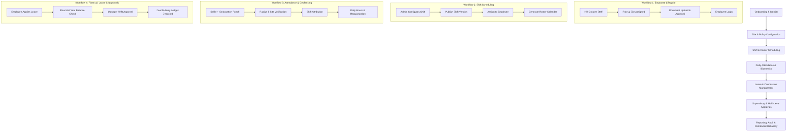

# ENTERPRISE HRMS QUALITY AUDIT — PHASE A: APPLICATION INVENTORY

**Document:** `QA_DOCUMENTATION/01_APPLICATION_INVENTORY.md`  
**Audit Phase:** Phase A — Complete Application Discovery  
**Audit Date:** 2026-11-18  
**Auditor:** Enterprise QA Department (Architecture, Automation, Security, Database, API, Performance)  
**Git Branch:** `feat/shift-roster-management`  
**Repository:** `pranshavsingh/HRMS`

---

## 1. Executive Architecture Verification

Before initiating test suites, the real codebase architecture was forensically verified across all tiers to correct any assumptions:

| Architecture Layer | Template / Assumed Context | Real Inspected Codebase State | Verified Status |
| :--- | :--- | :--- | :--- |
| **Frontend Web** | React | React 19.2 + Vite 8.0 + Tailwind CSS v4 + React Router DOM 7.14 | **VERIFIED** |
| **Mobile App** | React Native / Expo | Expo React Native (SDK 52+), Expo Router file-based tabs | **VERIFIED** |
| **Backend Runtime** | Node.js / TypeScript | Node.js (ESM `"type": "module"`), Express 4.22 | **VERIFIED** |
| **Database Layer** | Prisma ORM | **Raw SQL with `mysql2/promise` connection pool** (No Prisma) | **VERIFIED (CRITICAL)** |
| **Database Server** | MySQL / MariaDB | MariaDB 11.8.9 / MySQL 8.0+ InnoDB (`u356351105_attendance`) | **VERIFIED** |
| **Schema Migrations** | Prisma Migrate | Versioned SQL migrations (`001` through `020`), tracked in `schema_migrations` | **VERIFIED** |
| **Distributed / Cache** | In-memory / Redis | Redis (ioredis 6.0), BullMQ 6.7 distributed queues, Socket.IO 4.8 Redis adapter | **VERIFIED** |
| **Security / Auth** | JWT | Access Token (Bearer) + Refresh Token rotation (`accounts_refreshtoken`), bcryptjs, Helmet, rate-limiting | **VERIFIED** |

---

## 2. User Roles & Access Control Hierarchy

The application enforces a 5-tier role-based access control (RBAC) model:

| Role Identifier | Display Name | Access Scope | Key Capabilities & Boundaries |
| :--- | :--- | :--- | :--- |
| `superadmin` | Super Administrator | Global Multi-Tenant / System | Unrestricted access: audit logs, document permanent deletion, work site deletion, system-wide overrides, all approvals |
| `admin` | Organization Admin | Organization-wide | Employee lifecycle, company policy configuration, shifts & roster publishing, holiday calendar management, attendance & leave approvals |
| `hr` | Human Resources | Organization-wide | Employee onboarding, document verification, leave allocation & concessions, holiday calendar, shift assignments |
| `manager` | Team Manager | Department / Team Scoped | Team attendance approvals, team leave approvals, team roster calendar, direct report analytics |
| `employee` | Staff Employee | Self Scoped | Geofenced punch in/out, personal attendance history, leave applications, personal roster/schedule, profile view |

---

## 3. Frontend Web Application Inventory (`hrms_saas`)

### 3.1 Route & Page Map

The frontend routes are managed via `react-router-dom` in `hrms_saas/src/App.jsx`:

| URL Route | Page Component | Allowed Roles | Description & Primary Features |
| :--- | :--- | :--- | :--- |
| `/` | `Login.jsx` | Public | Username/password authentication, JWT storage, error handling, redirect |
| `/dashboard` | `Dashboard.jsx` | Authenticated | Role-dispatched dashboard: renders `AdminDashboard`, `HRDashboard`, `ManagerDashboard`, or `EmployeeDashboard` |
| `/attendance` | `Attendance.jsx` | Authenticated | Web punch in/out with live webcam capture, HTML5 Geolocation, allowed site/radius check |
| `/history` | `AttendanceHistory.jsx` | Authenticated | Personal attendance records, daily statuses, working hours, break attribution, filters |
| `/leave` | `Leave.jsx` | Authenticated | Leave application form, real-time balance computation, leave requests table, cancellation |
| `/documents` | `Documents.jsx` | Authenticated | Personal employee document vault (Aadhar, PAN, CV, Bank details) with upload & status |
| `/employees` | `Employees.jsx` | `admin`, `hr`, `superadmin` | Employee master registry, staff creation modal, edit modal, deactivate/activate, site assignment |
| `/employee-documents` | `EmployeeDocuments.jsx` | `admin`, `hr`, `superadmin` | Organization-wide document verification, document preview, approval/rejection |
| `/attendance-approvals` | `AttendanceApprovals.jsx` | `admin`, `hr`, `superadmin` | Pending regularizations, manual punch requests, approve/reject with supervisor notes |
| `/team-attendance-approvals` | `AttendanceApprovals.jsx` | `manager` | Team-scoped regularizations for direct reports |
| `/leave-approvals` | `LeaveApprovals.jsx` | `admin`, `hr`, `superadmin` | Organization leave requests, balance projections, concession granting, approve/reject |
| `/team-leave-approvals` | `LeaveApprovals.jsx` | `manager` | Direct report leave requests, multi-level manager approvals |
| `/team-dashboard` | `TeamDashboard.jsx` | `manager`, `admin`, `hr` | Manager team overview: present staff, team on leave, pending team actions |
| `/team-attendance` | `TeamAttendance.jsx` | `manager`, `admin`, `hr` | Department/team attendance grid, status filtering, shift match verification |
| `/team-analytics` | `TeamAnalytics.jsx` | `manager`, `admin`, `hr` | Visual analytics: attendance percentage, overtime trends, late punch frequency |
| `/hr-dashboard` | `HRDashboard.jsx` | `hr`, `admin`, `superadmin` | High-level HR statistics: headcount, turnover, pending verifications, leave rates |
| `/reports` | `Reports.jsx` | `admin`, `hr`, `superadmin` | Detailed reporting suite: Attendance summaries, leave ledger, date range & site filters |
| `/audit-logs` | `AuditLogs.jsx` | `superadmin` | Security audit trail: actor, action, target entity, timestamp, IP, metadata |
| `/shifts` | `Shifts.jsx` | `admin`, `hr`, `superadmin` | Multi-tab workforce management: Shifts, Policies, Weekly Off, Versions, Work Sites (`SiteManagement.jsx`) |
| `/roster` | `Roster.jsx` | Authenticated | Shift roster calendar (daily/weekly/monthly), fixed shift assignments, rotation patterns |
| `/holidays` | `CompanyHolidayCalendar.jsx`| Authenticated | Organization holiday calendar, recurring/floating holiday manager, financial year scope |

### 3.2 Modals, Form Controls & Interactive Components

| Component / Modal | Parent Page | Key Inputs & Interactions |
| :--- | :--- | :--- |
| **Assign Fixed Shift Modal** | `Roster.jsx` | `SearchableEmployeeSelect` (live search by name/code/role/ID), Shift Template picker, pinned version ID, date range, publish toggle |
| **New Rotation Pattern Modal** | `Roster.jsx` | Rotation code, name, description, multi-step sequence builder (shift vs weekly off day durations) |
| **Enroll Employee Modal** | `Roster.jsx` | `SearchableEmployeeSelect`, start date, initial step order selector, offset days |
| **Cancel Assignment Modal** | `Roster.jsx` | Cancellation reason text area, confirm revocation button |
| **Create Work Site Form & Cards** | `SiteManagement.jsx` | Site name, code, address, active status toggle; Superadmin edit modal & permanent delete modal with fallback deactivation |
| **Create/Edit Shift Modal** | `Shifts.jsx` | Shift name, code, start time, end time, cross-midnight overnight toggle, break rules |
| **Configure Policy Modal** | `Shifts.jsx` | Half-day minimum threshold, full-day minimum threshold, grace minutes, late count penalties |
| **Weekly-Off Policy Modal** | `Shifts.jsx` | Default weekly-off days, alternate Saturday rules, effective financial year start |
| **Create Employee Modal** | `Employees.jsx` | Personal info, credentials, designation, team, manager, site assignment, joining date, primary GPS coordinates |
| **Leave Concession Modal** | `LeaveApprovals.jsx` | Employee picker, concession adjustment days (+/-), reason, effective/expiry dates |
| **Company Leave Policy Editor** | `CompanyLeavePolicy.jsx` | Financial year reset runs, leave type policies (annual entitlement, proration, carry-forward, forfeiture) |

---

## 4. Mobile Application Inventory (`hrms_mobile`)

The mobile client is built on **Expo React Native** with file-based routing under `hrms_mobile/src/app`:

| Mobile Route | Screen File | Features & Capabilities |
| :--- | :--- | :--- |
| `/` | `index.tsx` | Splash, auth state resolution, redirect |
| `/(tabs)/dashboard` | `dashboard.tsx` | Mobile dashboard cards: today status, quick punch summary, leave balance |
| `/(tabs)/punch` | `punch.tsx` | Mobile punch interface: Camera overlay (`CameraViewOverlay.tsx`), location accuracy check |
| `/(tabs)/history` | `history.tsx` | Scrollable personal attendance history list, punch timings, status chips |
| `/(tabs)/leave` | `leave.tsx` | Mobile leave application form, leave history, balance cards |
| `/(tabs)/approvals` | `approvals.tsx` | Supervisor approval hub: tabs for attendance regularizations and leave requests |
| `/(tabs)/holidays` | `holidays.tsx` | Annual holiday list with upcoming holiday highlights |
| `/(tabs)/team-attendance` | `team-attendance.tsx`| Manager mobile view of direct reports' daily punch statuses |
| `/(tabs)/team-analytics` | `team-analytics.tsx` | Compact charts for team attendance trends |
| `/(tabs)/employees` | `employees.tsx` | Directory of company contacts, role tags, call/email actions |
| `/(tabs)/employee-documents` | `employee-documents.tsx` | Mobile document review and status check |
| `/(tabs)/profile` | `profile.tsx` | User profile, department, designation, password update, logout |
| `/(tabs)/audit-logs` | `audit-logs.tsx` | Mobile view of recent audit trail (Superadmin only) |
| `/documents` | `documents.tsx` | Document upload flow via device camera/gallery |
| `/my-documents` | `my-documents.tsx` | View status of personal submitted documents |

---

## 5. Backend API & Service Inventory (`node_backend`)

The backend exposes RESTful endpoints with backward-compatible aliases (`/api/v1/*` and legacy `/api/*`).

### 5.1 Route Modules & Endpoint Inventory

#### Module 1: Authentication & User Accounts (`accounts.routes.js`)
* `POST /api/v1/auth/login/` — Public: Credentials verification, returns JWT access & refresh token.
* `POST /api/v1/auth/refresh/` — Public: Refresh token rotation and reissue.
* `POST /api/v1/auth/logout/` — Authenticated: Refresh token revocation.
* `POST /api/v1/auth/forgot-password/request-otp/` — Public: Password reset OTP generation.
* `POST /api/v1/auth/forgot-password/verify-otp/` — Public: OTP verification token grant.
* `POST /api/v1/auth/forgot-password/reset/` — Public: New password commit with valid reset token.
* `POST /api/v1/auth/change-password/` — Authenticated: Self password change.
* `GET  /api/v1/auth/admin-summary/` — `admin`, `superadmin`: High-level organizational KPIs.
* `GET  /api/v1/auth/managers/` — `admin`, `hr`, `superadmin`: List of designated managers.
* `GET  /api/v1/auth/employees/` — `admin`, `hr`, `superadmin`: Paged staff list with site/department filtering.
* `PUT  /api/v1/auth/employees/:user_id/` — `admin`, `hr`, `superadmin`: Profile & organizational assignment update.
* `DELETE /api/v1/auth/employees/:user_id/` — `admin`, `hr`, `superadmin`: Soft-deletion / deactivation of employee.
* `GET  /api/v1/auth/documents/my/` — Authenticated: Current user's uploaded document records.
* `GET  /api/v1/auth/documents/:user_id/` — `admin`, `hr`, `manager`, `superadmin`: Employee documents by user ID.
* `GET  /api/v1/auth/cloudinary/signature/` — Authenticated: Cloudinary signed upload credentials.
* `POST /api/v1/auth/documents/register/` — Authenticated: Persist direct document metadata.
* `GET  /api/v1/auth/documents/detail/:id/` — Authenticated: Signed document redirect / download URL.
* `DELETE /api/v1/auth/documents/:id/` — `superadmin`: Permanent document removal.
* `GET  /api/v1/auth/audit-logs/` — `superadmin`: Paged query of system audit logs.
* `POST /api/v1/auth/realtime/ticket/` — Authenticated: Short-lived ticket for WebSocket connection.
* `GET  /api/v1/auth/realtime/` — Authenticated: Server-Sent Events (SSE) realtime fallback stream.

#### Module 2: Attendance Management (`attendance.routes.js`)
* `GET  /api/v1/attendance/upload-params/` — Authenticated: Attendance selfie upload signature.
* `POST /api/v1/attendance/punch-in/` — Authenticated: Record punch in (photo, latitude, longitude, site ID).
* `POST /api/v1/attendance/punch-out/` — Authenticated: Record punch out, calculates work duration.
* `GET  /api/v1/attendance/status/` — Authenticated: Today's current punch state for caller.
* `GET  /api/v1/attendance/history/` — Authenticated: Paged attendance history with date range filtering.
* `POST /api/v1/attendance/regularize/` — Authenticated: Submit attendance regularization request.
* `GET  /api/v1/attendance/approvals/` — `admin`, `hr`, `manager`, `superadmin`: Pending regularization queue.
* `POST /api/v1/attendance/approvals/:id/` — `admin`, `hr`, `manager`, `superadmin`: Action approval/rejection.
* `GET  /api/v1/attendance/team/` — `admin`, `hr`, `manager`, `superadmin`: Real-time team attendance status.
* `GET  /api/v1/attendance/team-analytics/` — `admin`, `hr`, `manager`, `superadmin`: Aggregated team metrics.
* `GET  /api/v1/attendance/reports/` — `admin`, `hr`, `superadmin`: CSV/tabular attendance export report.

#### Module 3: Leave Management (`leave.routes.js`)
* `POST /api/v1/leave/apply/` — Authenticated: Submit leave application with multi-day calculation.
* `GET  /api/v1/leave/my/` — Authenticated: Leave history & current available balance summary.
* `GET  /api/v1/leave/approvals/` — `admin`, `hr`, `manager`, `superadmin`: Actionable leave approvals.
* `POST /api/v1/leave/action/:leave_id/` — `admin`, `hr`, `manager`, `superadmin`: Approve or reject leave.
* `POST /api/v1/leave/concessions/` — `admin`, `hr`, `superadmin`: Grant special management concession.
* `POST /api/v1/leave/concessions/:concession_id/reverse/` — `admin`, `hr`, `superadmin`: Reverse a concession.
* `GET  /api/v1/leave/concessions/:employee_id/` — `admin`, `hr`, `superadmin`: Concession ledger by employee.

#### Module 4: Financial-Year Leave Policies (`financial-leave.routes.js`)
* `GET  /api/v1/leave/policy/current/` — `admin`, `hr`, `superadmin`: Active leave policy version.
* `POST /api/v1/leave/policy/draft/` — `admin`, `hr`, `superadmin`: Create new draft policy version.
* `PUT  /api/v1/leave/policy/draft/:version_id/types/` — `admin`, `hr`, `superadmin`: Configure leave type rules.
* `POST /api/v1/leave/policy/draft/:version_id/publish/` — `admin`, `hr`, `superadmin`: Publish policy version.
* `POST /api/v1/leave/policy/reset-runs/` — `admin`, `hr`, `superadmin`: Execute financial year balance reset run.
* `GET  /api/v1/leave/policy/reset-runs/` — `admin`, `hr`, `superadmin`: Reset run audit records & status.
* `GET  /api/v1/leave/policy/available-types/` — Authenticated: List of active leave types for current date.
* `GET  /api/v1/leave/policy/balance/:user_id/` — Authenticated: Granular breakdown across leave types.

#### Module 5: Shifts & Shift Versions (`shift.routes.js`)
* `GET  /api/v1/shifts/` — `admin`, `hr`, `superadmin`: List shift templates.
* `POST /api/v1/shifts/` — `admin`, `hr`, `superadmin`: Create new shift template.
* `GET  /api/v1/shifts/:id` — `admin`, `hr`, `superadmin`: Get shift details by ID.
* `GET  /api/v1/shifts/:id/versions` — `admin`, `hr`, `superadmin`: Version history for a shift.
* `POST /api/v1/shifts/:id/versions` — `admin`, `hr`, `superadmin`: Create draft shift version.
* `GET  /api/v1/shifts/:id/versions/:versionId` — `admin`, `hr`, `superadmin`: Get specific shift version.
* `PATCH /api/v1/shifts/:id/versions/:versionId` — `admin`, `hr`, `superadmin`: Modify draft version timings.
* `POST /api/v1/shifts/:id/versions/:versionId/publish` — `admin`, `hr`, `superadmin`: Publish shift version.
* `POST /api/v1/shifts/:id/versions/:versionId/archive` — `admin`, `hr`, `superadmin`: Archive shift version.
* `GET  /api/v1/shifts/:id/versions/:versionId/breaks` — `admin`, `hr`, `superadmin`: List shift break rules.
* `POST /api/v1/shifts/:id/versions/:versionId/breaks` — `admin`, `hr`, `superadmin`: Define break window.
* `PATCH /api/v1/shifts/:id/versions/:versionId/breaks/:breakId` — `admin`, `hr`, `superadmin`: Update break rule.
* `DELETE /api/v1/shifts/:id/versions/:versionId/breaks/:breakId` — `admin`, `hr`, `superadmin`: Delete break rule.

#### Module 6: Shift Assignments (`shift-assignment.routes.js`)
* `GET  /api/v1/workforce/assignments/` — `admin`, `hr`, `superadmin`: Query employee shift assignments.
* `POST /api/v1/workforce/assignments/` — `admin`, `hr`, `superadmin`: Create draft shift assignment.
* `POST /api/v1/workforce/assignments/:id/publish` — `admin`, `hr`, `superadmin`: Publish assignment snapshot.
* `POST /api/v1/workforce/assignments/:id/cancel` — `admin`, `hr`, `superadmin`: Cancel active assignment.
* `POST /api/v1/workforce/assignments/bulk` — `admin`, `hr`, `superadmin`: Bulk assign shift to user group.

#### Module 7: Shift Rotations (`rotation.routes.js`)
* `GET  /api/v1/workforce/rotations/` — `admin`, `hr`, `superadmin`: List rotation patterns.
* `POST /api/v1/workforce/rotations/` — `admin`, `hr`, `superadmin`: Create multi-step rotation cycle.
* `GET  /api/v1/workforce/rotations/:id` — `admin`, `hr`, `superadmin`: Get rotation details & steps.
* `POST /api/v1/workforce/rotations/:id/publish` — `admin`, `hr`, `superadmin`: Publish rotation pattern.
* `POST /api/v1/workforce/rotations/:id/archive` — `admin`, `hr`, `superadmin`: Archive rotation pattern.
* `GET  /api/v1/workforce/rotations/:id/preview` — `admin`, `hr`, `superadmin`: Simulate rotation schedule.
* `POST /api/v1/workforce/rotations/:id/enroll` — `admin`, `hr`, `superadmin`: Enroll employee in rotation.
* `POST /api/v1/workforce/rotations/enrollments/:enrollmentId/cancel` — `admin`, `hr`, `superadmin`: Unenroll employee.

#### Module 8: Rosters & Schedules (`roster.routes.js`)
* `GET  /api/v1/workforce/rosters/calendar` — `admin`, `hr`, `manager`, `superadmin`: Calendar schedule view.
* `GET  /api/v1/workforce/rosters/my-roster` — Authenticated: Current user's resolved roster schedule.
* `POST /api/v1/workforce/rosters/generate` — `admin`, `hr`, `superadmin`: Auto-generate roster from assignments.
* `GET  /api/v1/workforce/rosters/:id` — `admin`, `hr`, `superadmin`: Get roster batch header & entries.
* `POST /api/v1/workforce/rosters/:id/publish` — `admin`, `hr`, `superadmin`: Publish roster batch.
* `POST /api/v1/workforce/rosters/entries/:entryId/override` — `admin`, `hr`, `superadmin`: Override single work day.
* `POST /api/v1/workforce/rosters/swaps` — Authenticated: Request roster shift swap with peer.
* `POST /api/v1/workforce/rosters/swaps/:id/review` — `admin`, `hr`, `manager`, `superadmin`: Review shift swap.

#### Module 9: Company Holidays (`company-holiday.routes.js`)
* `GET  /api/v1/workforce/holidays/` — Authenticated: List company holidays by year and site.
* `POST /api/v1/workforce/holidays/` — `admin`, `hr`, `superadmin`: Create official company holiday.
* `GET  /api/v1/workforce/holidays/:id` — Authenticated: Get holiday details by ID.
* `PUT  /api/v1/workforce/holidays/:id` — `admin`, `hr`, `superadmin`: Update holiday date/name/policy.
* `DELETE /api/v1/workforce/holidays/:id` — `admin`, `hr`, `superadmin`: Delete holiday entry.

#### Module 10: Attendance Policies (`company-policy.routes.js`)
* `GET  /api/v1/workforce/policies/` — `admin`, `hr`, `superadmin`: List attendance policy definitions.
* `POST /api/v1/workforce/policies/` — `admin`, `hr`, `superadmin`: Create attendance policy.
* `GET  /api/v1/workforce/policies/:id` — `admin`, `hr`, `superadmin`: Get attendance policy details.
* `GET  /api/v1/workforce/policies/:id/versions` — `admin`, `hr`, `superadmin`: List policy versions.
* `POST /api/v1/workforce/policies/:id/versions` — `admin`, `hr`, `superadmin`: Create draft version.
* `PATCH /api/v1/workforce/policies/:id/versions/:versionId` — `admin`, `hr`, `superadmin`: Update thresholds.
* `POST /api/v1/workforce/policies/:id/versions/:versionId/publish` — `admin`, `hr`, `superadmin`: Publish version.
* `POST /api/v1/workforce/policies/:id/versions/:versionId/archive` — `admin`, `hr`, `superadmin`: Archive version.

#### Module 11: Weekly-Off Policies (`weekly-off-policy.routes.js`)
* `GET  /api/v1/workforce/weekly-off-policies/` — `admin`, `hr`, `superadmin`: List weekly-off policies.
* `POST /api/v1/workforce/weekly-off-policies/` — `admin`, `hr`, `superadmin`: Create weekly-off policy.
* `GET  /api/v1/workforce/weekly-off-policies/:id` — `admin`, `hr`, `superadmin`: Get policy details.
* `GET  /api/v1/workforce/weekly-off-policies/:id/versions` — `admin`, `hr`, `superadmin`: Version history.
* `POST /api/v1/workforce/weekly-off-policies/:id/versions` — `admin`, `hr`, `superadmin`: Create draft version.
* `PATCH /api/v1/workforce/weekly-off-policies/:id/versions/:versionId` — `admin`, `hr`, `superadmin`: Update off days.
* `POST /api/v1/workforce/weekly-off-policies/:id/versions/:versionId/publish` — `admin`, `hr`, `superadmin`: Publish version.
* `POST /api/v1/workforce/weekly-off-policies/:id/versions/:versionId/archive` — `admin`, `hr`, `superadmin`: Archive version.

#### Module 12: Work Sites (`site.routes.js`)
* `GET  /api/v1/workforce/sites/` — `admin`, `hr`, `manager`, `superadmin`: List all registered work sites.
* `POST /api/v1/workforce/sites/` — `admin`, `superadmin`: Create work site (name, code, address).
* `PATCH /api/v1/workforce/sites/:siteId` — `admin`, `superadmin`: Edit site details and active status.
* `DELETE /api/v1/workforce/sites/:siteId` — `superadmin`: Delete site (with integrity guard against linked history).
* `PUT  /api/v1/workforce/sites/:siteId/assignments/:userId` — `admin`, `superadmin`: Assign employee to site.
* `GET  /api/v1/workforce/sites/:siteId/assignments` — `admin`, `superadmin`: List site employee assignments.
* `GET  /api/v1/workforce/sites/:siteId/access` — `admin`, `superadmin`: List supervisor access grants.
* `PUT  /api/v1/workforce/sites/:siteId/access/:userId` — `admin`, `superadmin`: Grant supervisor site scope.
* `DELETE /api/v1/workforce/sites/:siteId/access/:userId` — `admin`, `superadmin`: Revoke supervisor site scope.

---

## 6. Database Schema & Models Inventory

The database is MariaDB / MySQL InnoDB with 44 active relational tables and 20 versioned schema migrations:

### 6.1 Database Migration History (`schema_migrations`)

| Migration File | Checksum (SHA-256) | Applied Timestamp | Scope & Purpose |
| :--- | :--- | :--- | :--- |
| `001_phase1_security_hardening.sql` | `76407d90b24a...` | `2026-11-18T15:41:59Z` | Password security, session tokens, audit trail |
| `002_phase2_performance_indexes.sql` | `703575718896...` | `2026-11-18T15:42:00Z` | High-frequency query indexes & constraints |
| `003_phase3_outbox_events.sql` | `88a7783cc235...` | `2026-11-18T15:42:00Z` | Transactional outbox event publishing table |
| `004_phase3_consumer_idempotency.sql` | `e34c72a68019...` | `2026-11-18T15:42:00Z` | Durable consumer idempotency ledger |
| `005_phase3_recoverable_consumer_claims.sql` | `b23f4ef35878...` | `2026-11-18T15:42:01Z` | Worker lease fencing & dead-letter queue |
| `006_workforce_tenant_and_users.sql` | `3fb71e2fce56...` | `2026-11-18T15:42:01Z` | Multi-tenant user mapping & tenant scoping |
| `007_workforce_company_policy.sql` | `61d32a2d18db...` | `2026-11-18T15:42:01Z` | Attendance policy versioning tables |
| `008_workforce_company_holiday.sql` | `0d35508f77c3...` | `2026-11-18T15:42:02Z` | Company holiday master & financial year bounds |
| `009_workforce_shift_and_versions.sql` | `7462b49015d3...` | `2026-11-18T15:42:02Z` | Shift templates & immutable published versions |
| `010_workforce_assignments_and_rotations.sql` | `8cb25e1685e7...` | `2026-11-18T15:42:17Z` | Individual & bulk shift assignments, rotations |
| `011_workforce_roster_and_swaps.sql` | `cac2a84de13e...` | `2026-11-18T15:42:18Z` | Roster headers, daily entries, peer swap workflow |
| `012_attendance_schema_expansion.sql` | `d06eaa51ac82...` | `2026-11-18T15:43:42Z` | Multi-site foreign keys, tenant constraints |
| `013_workforce_attribution_exceptions.sql` | `ba2eb595a238...` | `2026-11-18T15:43:42Z` | Break exceptions and attribution tracking |
| `014_workforce_shift_policy_and_breaks.sql` | `d221ff94b1a6...` | `2026-11-18T15:43:42Z` | Shift break windows & meal duration rules |
| `015_workforce_assignments_and_roster.sql` | `17e73933739d...` | `2026-11-17T13:09:49Z` | Roster calendar generation & status states |
| `016_attendance_shift_attribution_enhancement.sql`| `9cf829ce9ae6...`| `2026-11-18T15:43:42Z` | Cross-midnight attribution & tolerance windows |
| `017_workforce_company_holiday_details.sql` | `e85ac3245d60...` | `2026-11-18T15:43:42Z` | Floating holidays, religious categories |
| `018_workforce_sites.sql` | `040b9e1fd43e...` | `2026-11-18T07:29:38Z` | Physical work sites & supervisor site scopes |
| `019_leave_concession_ledger.sql` | `f48a12c47134...` | `2026-11-18T13:05:21Z` | Management leave concession ledger |
| `020_financial_year_leave_policies.sql` | `8a814eae7366...` | `2026-11-18T15:44:30Z` | Financial year leave types, carry forward, ledger |

### 6.2 Relational Tables Inventory by Domain

#### Domain A: Identity, Authentication & Profile
1. `accounts_user` — Core credentials, role, status, email, deletion flags.
2. `accounts_employeeprofile` — Employment details, team name, designation, manager ID, joining date, leave allotment.
3. `accounts_employeedocument` — Employee identification files, verification status, Cloudinary / local URLs.
4. `accounts_employeelocation` — Primary & secondary office coordinates, allowed geofence radii.
5. `accounts_refreshtoken` — Hashed refresh tokens, expiration timestamps, revocation states.
6. `workforce_tenant` — Multi-tenant organization boundaries.
7. `workforce_user_tenant` — Tenant membership mapping, tenant-specific active status.

#### Domain B: Attendance & Regularization
8. `attendance_attendance` — Daily attendance logs, punch in/out timestamps, selfie URLs, lat/long coordinates, daily work minutes.
9. `attendance_attendanceapproval` — Regularization / manual correction requests, approval workflow status, reviewer remarks.
10. `workforce_attendance_shift_attribution` — Attribution link between daily attendance punch and scheduled shift version.
11. `workforce_attendance_break_attribution` — Detected meal and rest breaks matching shift break rules.

#### Domain C: Leave Management & Financial Policies
12. `leave_leave` — Legacy & operational leave applications, date ranges, leave types, status (`approved`, `pending`, `rejected`).
13. `leave_concession_ledger` — Discretionary management concessions, adjustment days, expiry dates.
14. `workforce_leave_policy_version` — Financial-year policy definitions, proration mode, timezone, shared pool toggle.
15. `workforce_leave_type_policy` — Granular leave types (Casual, Sick, Earned, Paternity), annual entitlement, carry-forward caps, forfeiture rules.
16. `workforce_employee_leave_eligibility` — Employee-specific overrides for leave entitlement.
17. `workforce_employee_leave_entitlement` — Opening balance, carry forward, and earned days per employee per financial year.
18. `workforce_leave_ledger_transaction` — Immutable double-entry ledger for leave accruals, adjustments, carry forwards, forfeitures, and consumptions.
19. `workforce_leave_reset_run` — Financial year automated reset execution batches.
20. `workforce_leave_reset_employee_result` — Per-employee reset execution records and failure traces.

#### Domain D: Shifts, Rosters & Rotations
21. `workforce_shift` — Master shift templates (Day, Evening, Night).
22. `workforce_shift_version` — Immutable published shift versions with pinned start/end times and overnight flags.
23. `workforce_shift_break` — Break templates associated with shifts.
24. `workforce_shift_break_version` — Pinned break windows for published shift versions.
25. `workforce_employee_shift_assignment` — Direct employee-to-shift assignments with effective dates.
26. `workforce_shift_rotation` — Cyclic shift rotation patterns (e.g., 2 weeks Day, 2 weeks Night).
27. `workforce_shift_rotation_step` — Steps within rotation cycles defining shift vs weekly off day durations.
28. `workforce_employee_rotation_enrollment` — Employee enrollments in rotation patterns.
29. `workforce_roster_header` — Published roster periods by department/site.
30. `workforce_roster_entry` — Daily employee roster assignments with override support.
31. `workforce_roster_swap_request` — Peer-to-peer shift swap requests and supervisor approval logs.

#### Domain E: Workforce Policy & Work Sites
32. `workforce_company_policy` — Master attendance policy definitions.
33. `workforce_company_policy_version` — Immutable attendance grace periods, half-day/full-day thresholds.
34. `workforce_weekly_off_policy` — Master weekly-off definitions.
35. `workforce_weekly_off_policy_version` — Configured weekly rest days and alternate weekend patterns.
36. `workforce_company_holiday` — Company holiday definitions and financial year scoping.
37. `workforce_company_holiday_details` — Observance dates, mandatory vs floating flags.
38. `workforce_site` — Physical company sites/branches with code and address.
39. `workforce_site_access` — Supervisor site-scoping permissions for multi-branch isolation.
40. `workforce_employee_site_assignment` — Employee work site assignments with transfer history.

#### Domain F: Distributed Architecture, Reliability & Observability
41. `outbox_events` — Transactional outbox event store for asynchronous event dispatching.
42. `consumer_idempotency` — Deduplication ledger for incoming background worker jobs.
43. `consumer_claims` — Fenced worker lease ownership, preventing split-brain execution across worker nodes.
44. `audit_log` — Security audit log recording actor ID, IP address, event type, and target entity metadata.

---

## 7. Major Enterprise Workflows Identified for Testing

---

## 8. Gap Analysis & Modules Not Implemented

In strict adherence to rule 15 (*"Never fabricate successful test results"*), the following modules listed in the QA specification were independently checked across the repository:

| Spec Module | Codebase Status | Architectural Reality | Testing Action |
| :--- | :--- | :--- | :--- |
| **Prisma ORM** | **Not Implemented** | Backend uses raw SQL + `mysql2/promise` pool. | Audit raw SQL queries, parameterized statements, transactions |
| **Payroll Management** | **Not Implemented** | No payroll routes, calculation engines, or payroll DB tables exist. | Marked as **UNIMPLEMENTED** in test register; cannot test |
| **Expense & Reimbursement**| **Not Implemented** | No expense submission or reimbursement tables exist. | Marked as **UNIMPLEMENTED** in test register; cannot test |
| **Recruitment & ATS** | **Not Implemented** | No job posting, candidate pipeline, or interview modules exist. | Marked as **UNIMPLEMENTED** in test register; cannot test |
| **Performance Reviews** | **Not Implemented** | No goal setting or performance review models exist. | Marked as **UNIMPLEMENTED** in test register; cannot test |

---

## 9. Verification & Phase A Sign-Off

* Complete application discovery finished across all 28 frontend pages, 17 mobile screens, 12 backend route controllers (60+ API endpoints), and 44 database tables.
* Architecture baseline established: React 19 + Node.js ESM + MariaDB/MySQL raw SQL + Redis/BullMQ.
* Initial deliverable `QA_DOCUMENTATION/01_APPLICATION_INVENTORY.md` generated and committed to the workspace.

**Phase A Status:** **COMPLETED** — Ready to proceed to **Phase B: Authentication & Access Control Testing**.
