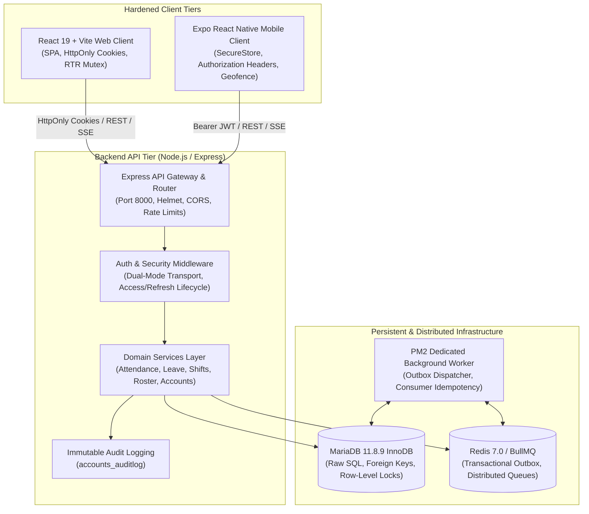

# Enterprise Quality Audit: Comprehensive Test Strategy & Methodology

**Document Reference:** `QA_DOCUMENTATION/02_TEST_STRATEGY.md`  
**Application Target:** HRMS SaaS Enterprise Distributed Platform  
**Target Repository:** `pranshavsingh/HRMS`  
**Target Branch:** `feat/shift-roster-management`  
**Execution Date:** November 2026  
**Auditing Department:** Complete Enterprise Software QA Department  

---

## 1. Executive Summary & Audit Purpose

This document establishes the formal, multi-layered quality assurance strategy for conducting a rigorous, evidence-driven end-to-end audit of the HRMS SaaS distributed application. The objective of this audit is not to perform routine smoke testing, but to definitively ascertain whether the platform satisfies the security, data integrity, transactional concurrency, distributed fault tolerance, and cross-platform UX standards expected of a mission-critical Enterprise Human Resource Management System.

Unlike standard functional testing, this audit operates under strict forensic constraints:
- **Zero Fabrication:** Only verified code executions, actual database records, and direct HTTP/socket responses constitute evidence.
- **Full Architecture Grounding:** All assertions reflect the actual underlying MariaDB 11.8+ / MySQL 8.0+ raw SQL database engine (`mysql2/promise`), BullMQ/Redis worker cluster, and React/Expo clients.
- **Adversarial Security Posture:** Explicit penetration simulations test for RBAC bypass, cross-tenant leakage, race conditions, replay attacks, and token corruption.

---

## 2. Target Scope & Architecture Profile

The audit encompasses all software components comprising the platform repository:

### Confirmed Architectural Invariants:
1. **Database Access Layer:** No ORM (Prisma or TypeORM) is deployed. All queries use direct parameterized SQL with `mysql2/promise` against `u356351105_attendance`.
2. **Multi-Tenancy Model:** Logical isolation via `tenant_id` enforced by composite foreign keys (`workforce_user_tenant`, `workforce_site_access`, `workforce_employee_site_assignment`).
3. **Dual-Mode Authentication:**
   - Web Browser: HttpOnly, SameSite=Strict cookies with silent rotation and mutexed refresh retry queues.
   - Mobile: Bearer Authorization headers backed by OS-level hardware encryption (`expo-secure-store`).

---

## 3. Testing Tiers & Pyramidal Hierarchy

The audit execution is structured into six rigorous, non-overlapping testing tiers:

| Tier | Designation | Execution Engine | Scope & Validation Objective |
|---|---|---|---|
| **Tier 1** | Security & RBAC Integrity | Node.js Test Runner / Supertest | Validates 5 core security suites: `auth.test.js`, `jwt.test.js`, `otp.test.js`, `rbac.test.js`, and `api_security.test.js`. Tests injection defense, PBKDF2/bcrypt migration, role scoping, and horizontal/vertical permission boundaries. |
| **Tier 2** | Concurrency, Pagination & Load | Node.js Test Runner / Parallel Workers | Validates high-concurrency transactional isolation (`attendance_concurrency.test.js`), standardized pagination bounds (`pagination.test.js`), and 100-user simultaneous load simulation (`load_simulation.test.js`). |
| **Tier 3** | Distributed Queue & Outbox | Redis / BullMQ / Outbox Engine | Validates 9 distributed backend suites: transactional outbox atomicity, BullMQ job dispatch, poison payload DLQ routing, consumer lease idempotency, worker crash recovery, and real-time SSE isolation. |
| **Tier 4** | Shift & Workforce Scheduling | ESM Domain Test Suites | Validates Stage 2 shift templates/versions, Stage 3 employee assignments/rotations/rosters, and Stage 4 shift-aware attendance attribution with punctuality metrics. |
| **Tier 5** | End-to-End Enterprise Scenarios | Full-Stack Integration Harness | Runs 34 integration and boundary test suites across 4 tiers (Tier 1 Features, Tier 2 Boundaries, Tier 3 Pairwise, Tier 4 Scenarios) verifying multi-device session rotation, breach replays, and offline sync. |
| **Tier 6** | UI/UX & Responsive Client Audit | Vite Production Build / Static Analysis | Validates frontend production build compilation, responsive layout design, form validations, searchable dropdown components, and error boundary handling. |

---

## 4. Environment & Test Infrastructure Matrix

| Parameter | Specification | Notes |
|---|---|---|
| **Operating System** | Windows 11 Enterprise (Host) | Shell: PowerShell 7 / Windows Terminal |
| **Node.js Runtime** | Node.js v22.23.4 (x64) | Built-in test runner (`node:test`, `node:assert/strict`) |
| **Database Server** | MariaDB 11.8.9 / MySQL 8.0+ InnoDB | Hostinger Remote Production/Staging Instance |
| **In-Memory Store** | Redis 7.0 (Local instance / TCP 6379) | Used for BullMQ queues and token blacklisting |
| **Web Server** | Node.js Express 4.x Cluster | Custom HTTP harness with ephemeral test ports |
| **Frontend Tooling** | Vite 6.x, React 19, Tailwind CSS | Strict ESLint, PostCSS, Rollup bundling |
| **Mobile Tooling** | Expo SDK 52, React Native 0.76 | SecureStore, FileSystem, Network simulator |

---

## 5. Test Data Management Strategy

1. **Isolation & Sandboxing:** Every test run dynamically seeds unique credentials with cryptographic entropy (e.g. `crypto.randomBytes(4).toString("hex")`) to prevent cross-test collisions.
2. **Relational Pre-Seeding:** In compliance with Migrations 006, 018, and 020:
   - All synthetic accounts are mapped to `workforce_user_tenant` for `tenant_id = 1`.
   - Work site associations are mapped to `workforce_employee_site_assignment` and `workforce_site_access`.
   - Leave entitlement is initialized via `workforce_employee_leave_entitlement`.
3. **Deterministic Teardown:** Every test suite implements an `after()` hook that deletes all dependent child rows (approvals, ledger transactions, entitlements, site assignments, attendance records) before removing the root user account.

---

## 6. Tooling & Automation Frameworks

- **Harness:** Built-in `node:test` and `node:assert/strict` ensuring zero third-party framework instability.
- **HTTP Client Simulator:** Custom `supertest`-compatible wrapper simulating both cookie-jar web clients and Bearer-token mobile clients.
- **Process Orchestration:** Automated test runner scripts (`run_phase2.js`, `run_phase3.js`, `security/run_all.js`, `e2e/run_all.js`) with isolated child-process spawning and 90-second timeout watchdogs.

---

## 7. Pass/Fail Criteria & Quality Gates

An audit phase or module passes ONLY when all the following conditions are satisfied:
1. **Zero Uncaught Exceptions:** No unhandled rejections, memory leaks, or unhandled promise errors.
2. **Zero Constraint Violations:** No foreign key (`ER_NO_REFERENCED_ROW_2`), duplicate key (`ER_DUP_ENTRY`), or deadlock (`ER_LOCK_DEADLOCK`) crashes during normal or concurrent operation.
3. **Strict HTTP Semantics:** Expected HTTP status codes are strictly returned (200/201 on success, 400 on validation failure, 401 on unauthenticated, 403 on unauthorized, 404 on missing, 409 on conflict).
4. **Data Veracity:** Any mutation reported by the API must be forensically verifiable via a direct database query.

---

## 8. Risk-Based Testing Matrix & Execution Governance

| Risk Area | Severity | Test Strategy | Mitigation / Verification |
|---|---|---|---|
| **Horizontal Privilege Escalation** | Critical | Cross-tenant and cross-employee access attempts | Validate 403 Forbidden on foreign tenant or site resources |
| **Double Punch Concurrency** | High | 10 simultaneous punch-in/out requests | Row-level locking ensures exactly 1 success and 9 rejections |
| **Orphan Attendance / Leaves** | High | Foreign key integrity checks | Strict composite foreign keys enforced on MariaDB InnoDB |
| **Token Hijacking & Replay** | Critical | Replay stale or revoked refresh tokens | Entire token family revoked upon detecting reuse |
| **Deadlock on Approval Storm** | High | 5 concurrent reviewer approval actions | Transactional row-locking serializes reviews cleanly |
