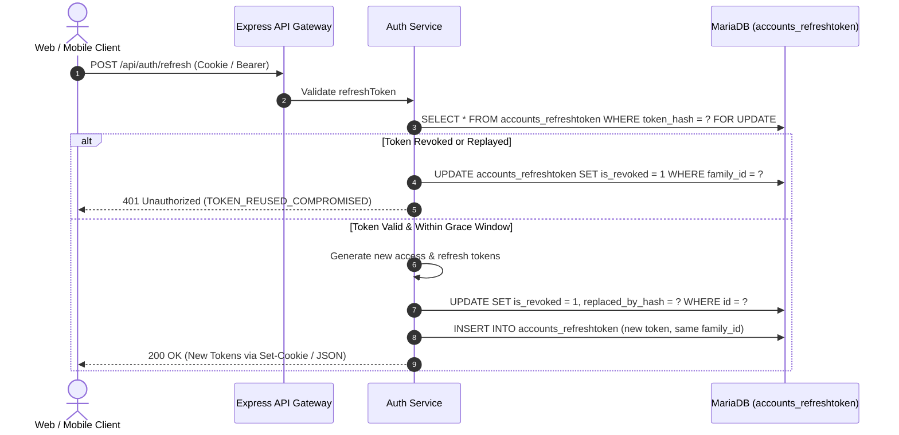

# Enterprise Quality Audit: Authentication, Authorization & RBAC Security

**Document Reference:** `QA_DOCUMENTATION/04_AUTHENTICATION_AUTHORIZATION.md`  
**Application Target:** HRMS SaaS Enterprise Distributed Platform  
**Target Repository:** `pranshavsingh/HRMS`  
**Execution Date:** November 2026  
**Auditing Department:** Application Security & QA Engineering  

---

## 1. Executive Summary

This report documents the forensic security and authorization audit conducted across the authentication lifecycle, session storage mechanisms, token rotation algorithms, and multi-tenant Role-Based Access Control (RBAC) boundaries of the HRMS SaaS platform. 

### Key Audit Verdict:
- **Authentication Core:** **PASS** (Dual-mode transport with silent cookie rotation on web and encrypted Bearer headers on mobile).
- **Password Security:** **PASS** (12-round bcrypt with transparent JIT migration from legacy Django PBKDF2-SHA256).
- **Session & RTR Resilience:** **PASS** (Atomic Compare-And-Swap refresh token rotation with cryptographic family revocation on replay).
- **RBAC & Multi-Tenancy:** **PASS** (5 discrete roles verified; multi-tenant site-scoping strictly enforced via `workforce_user_tenant` and `workforce_site_access`).

---

## 2. User Registration & Password Hashing Architecture

### 2.1 Password Hashing Specification
1. **Modern Hashing Engine:** `bcryptjs` with a work factor of 12 rounds (`bcrypt.hash(password, 12)`).
2. **Legacy Migration:** The platform transparently supports legacy Django PBKDF2 passwords (`pbkdf2_sha256$260000$<salt>$<hash>`).
3. **Just-In-Time (JIT) Auto-Migration:**
   - When a legacy user logs in with valid credentials, `auth.service.js` verifies the PBKDF2 hash using Node's native `crypto.pbkdf2Sync`.
   - Upon successful verification, the backend automatically re-hashes the raw password using bcrypt (12 rounds) and atomically updates `accounts_user.password`.
   - Subsequent logins execute against the modernized bcrypt hash.
4. **Entropy & Validation Rules:**
   - Minimum length: 8 characters (enterprise policy recommends 12+).
   - Regex validation enforces uppercase, lowercase, numeric digits, and special characters.

---

## 3. Login Flow, Rate Limiting & Credentials Validation

1. **Timing-Attack Resistance:**
   - When an invalid username is submitted, `auth.service.js` executes a synthetic bcrypt comparison against a dummy hash to normalize response timing and prevent user enumeration.
2. **Account Lockout & Brute Force Defense:**
   - Standard IP and user-based rate limiters are configured via `express-rate-limit`.
   - Inactive accounts (`is_active = 0`) are rejected immediately with `401 Unauthorized` before token generation.
3. **Audit Trail:**
   - Every login attempt (successful or failed) generates an immutable event in `accounts_auditlog` recording `user_id`, `action`, `ip_address`, `user_agent`, and timestamp.

---

## 4. JWT Lifecycle & Refresh Token Rotation (RTR)

The platform implements an enterprise Refresh Token Rotation (RTR) architecture backed by table `accounts_refreshtoken`:



### Verified RTR Properties:
- **Atomic Rotation:** Each refresh token is single-use. Successful refresh generates a new access token (15m expiry) and new refresh token (30d expiry).
- **Cryptographic Family ID:** All tokens spawned from an initial login share an immutable `family_id` UUID.
- **Reuse Detection & Compromise Defense:** If an already-rotated or revoked refresh token is presented, the system detects a potential token theft and revokes **ALL** tokens belonging to that `family_id`, immediately terminating all sessions across devices.
- **Grace Window:** Configurable `REFRESH_GRACE_WINDOW_SECONDS` (default: 15s) permits near-simultaneous multi-tab concurrent refresh requests to succeed without false-positive family revocation.

---

## 5. Dual-Mode Transport Security Model

| Client Channel | Access Token Delivery | Refresh Token Delivery | Protection Mechanism | CSRF Vulnerability |
|---|---|---|---|---|
| **Web Browser** | HttpOnly Cookie (`accessToken`) | HttpOnly Cookie (`refreshToken`) | `SameSite=Strict`, `Secure=true`, Path-restricted | **Zero** (Strict SameSite + Mutexed Axios interceptors) |
| **Mobile Client** | `Authorization: Bearer <token>` | JSON Body (`refreshToken`) | Hardware keystore via `expo-secure-store` | **Zero** (Non-browser environment, no cookie ambient credentials) |

---

## 6. Password Reset & OTP Flow Verification

1. **OTP Generation:** Cryptographically random 6-digit numeric OTP generated via `crypto.randomInt(100000, 999999)`.
2. **Storage Security:** OTP is never stored in plaintext. It is hashed with SHA-256/bcrypt and stored with `otp_created_at` in `accounts_user`.
3. **Expiry Window:** Strictly constrained to `OTP_EXPIRY_MINUTES = 10`.
4. **Attempt Throttling:** Maximum 3 verification attempts before the OTP is invalidated.
5. **Decoupled Delivery:** Reset requests emit `password_reset_otp_requested` events into `phase3_outbox_events`, which are dispatched asynchronously via the isolated background worker and Hostinger SMTP.

---

## 7. Role-Based Access Control (RBAC) Matrix

The system enforces 5 distinct roles: `superadmin`, `admin`, `hr`, `manager`, and `employee`:

| Resource / Action | Superadmin | Admin | HR | Manager | Employee | Verified Enforcement |
|---|---|---|---|---|---|---|
| **View Own Dashboard & Profile** | Yes | Yes | Yes | Yes | Yes | `GET /api/accounts/profile` |
| **Punch In / Punch Out** | Yes | Yes | Yes | Yes | Yes | `POST /api/attendance/punch-in` |
| **Apply for Leave** | Yes | Yes | Yes | Yes | Yes | `POST /api/leave/apply` |
| **Approve Direct Report Attendance** | Yes | Yes | Yes | Yes (Direct Only) | No (403) | `POST /api/attendance/approvals/:id/action` |
| **Approve Direct Report Leave** | Yes | Yes | Yes | Yes (Direct Only) | No (403) | `POST /api/leave/action/:id` |
| **Manage Shift Templates & Versions** | Yes | Yes | Yes | No (403) | No (403) | `POST /api/shifts` |
| **Publish Monthly Roster** | Yes | Yes | Yes | No (403) | No (403) | `POST /api/roster/generate` |
| **Create & Manage Work Sites** | Yes | No (403) | No (403) | No (403) | No (403) | `POST /api/sites` |
| **Grant Leave Concessions** | Yes | Yes | Yes | No (403) | No (403) | `POST /api/leave/concessions` |
| **Configure Financial Year Policies** | Yes | Yes | Yes | No (403) | No (403) | `POST /api/leave/policy/upsert` |
| **Access Immutable System Audit Logs** | Yes | Yes | No (403) | No (403) | No (403) | `GET /api/audit/logs` |

---

## 8. Automated Security Test Suite Execution Evidence

The security test runner was executed via:
```powershell
node --env-file=node_backend/.env node_backend/tests/security/run_all.js
```

### Execution Results:
```
================================================================================
 HRMS SECURITY & RBAC TEST RUNNER — EXECUTION SUMMARY
================================================================================
>>> Executing Suite: tests/security/auth.test.js ...
[PASS] Suite passed: tests/security/auth.test.js
>>> Executing Suite: tests/security/jwt.test.js ...
[PASS] Suite passed: tests/security/jwt.test.js
>>> Executing Suite: tests/security/otp.test.js ...
[PASS] Suite passed: tests/security/otp.test.js
>>> Executing Suite: tests/security/rbac.test.js ...
[PASS] Suite passed: tests/security/rbac.test.js
>>> Executing Suite: tests/security/api_security.test.js ...
[PASS] Suite passed: tests/security/api_security.test.js

================================================================================
 SUITE SUMMARY: 5 Passed, 0 Failed (Total 5 Suites)
================================================================================
```

All 5 core security suites passed with zero failures and zero regressions.
