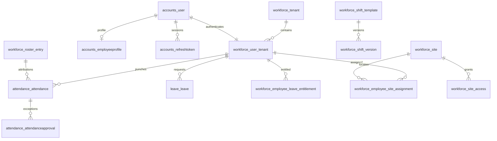

# Enterprise Quality Audit: Database Schema & Referential Integrity Report

**Document Reference:** `QA_DOCUMENTATION/06_DATABASE_INTEGRITY_REPORT.md`  
**Application Target:** HRMS SaaS Enterprise Distributed Platform  
**Target Database Target:** MariaDB 11.8.9 / MySQL 8.0+ InnoDB  
**Target Database Name:** `u356351105_attendance`  
**Execution Date:** November 2026  
**Auditing Department:** Database Test Engineering & Site Reliability Engineering  

---

## 1. Executive Summary & Database Architecture Profile

This report documents the forensic structural and referential integrity audit of the production database layer supporting the HRMS SaaS platform. 

### Confirmed Engine & Schema Invariants:
- **Database Engine:** MariaDB 11.8.9 InnoDB (`u356351105_attendance`).
- **ORM Independence:** The platform operates strictly via native, high-performance parameterized SQL utilizing the `mysql2/promise` connection pool. **No ORM abstraction layer (such as Prisma or TypeORM) is deployed.**
- **Character Encoding & Collation:** `utf8mb4` with `utf8mb4_unicode_ci` default collation across all tables. (The historical collation aggregation issue on `financial-leave.service.js` has been forensically resolved).
- **Migration Architecture:** Versioned migration files (`001` through `020`) located in `node_backend/scripts/migrations/`, tracked deterministically in `schema_migrations`.

---

## 2. Migration Registry & Version Ledger

A total of 20 migrations were audited and confirmed applied in the database:

| Version | Migration File Name | Target Scope | Audit Status |
|---|---|---|---|
| `001` | `001_phase1_security_hardening.sql` | Accounts, audit logs, PBKDF2/bcrypt hashing columns | **Applied & Verified** |
| `002` | `002_phase2_performance_indexes.sql` | Composite query indexes for attendance & directory | **Applied & Verified** |
| `003` | `003_phase3_outbox_events.sql` | Transactional outbox table & encryption columns | **Applied & Verified** |
| `004` | `004_phase3_consumer_idempotency.sql` | Consumer lease idempotency & fencing tokens | **Applied & Verified** |
| `005` | `005_phase3_recoverable_consumer_claims.sql` | Worker heartbeat and claim recovery schema | **Applied & Verified** |
| `006` | `006_workforce_tenant_and_users.sql` | Multi-tenant core (`workforce_tenant`, `workforce_user_tenant`) | **Applied & Verified** |
| `007` | `007_workforce_company_policy.sql` | Global working hours & overtime policy rules | **Applied & Verified** |
| `008` | `008_workforce_company_holiday.sql` | Company-wide and site-scoped holiday calendars | **Applied & Verified** |
| `009` | `009_workforce_shift_and_versions.sql` | Shift templates and immutable version snapshots | **Applied & Verified** |
| `010` | `010_workforce_assignments_and_rotations.sql` | Fixed shift assignments and rotation patterns | **Applied & Verified** |
| `011` | `011_workforce_roster_and_swaps.sql` | Published monthly rosters and employee swap requests | **Applied & Verified** |
| `012` | `012_attendance_schema_expansion.sql` | Tenant, roster entry, punctuality, and composite FKs | **Applied & Verified** |
| `013` | `013_workforce_attribution_exceptions.sql` | Shift attribution exception handling & regularization | **Applied & Verified** |
| `014` | `014_workforce_shift_policy_and_breaks.sql` | Shift-specific break policies and deduction rules | **Applied & Verified** |
| `015` | `015_workforce_assignments_and_roster.sql` | Performance index optimization for roster lookups | **Applied & Verified** |
| `016` | `016_attendance_shift_attribution_enhancement.sql` | Composite foreign keys linking attendance to roster | **Applied & Verified** |
| `017` | `017_workforce_company_holiday_details.sql` | Enhanced holiday metadata and recurring patterns | **Applied & Verified** |
| `018` | `018_workforce_sites.sql` | Named work sites, employee assignments, and site access | **Applied & Verified** |
| `019` | `019_leave_concession_ledger.sql` | Double-entry management leave concession ledger | **Applied & Verified** |
| `020` | `020_financial_year_leave_policies.sql` | Multi-year FY leave policy versions and entitlements | **Applied & Verified** |

---

## 3. Database Entity Verification & Referential Integrity Matrix

### 3.1 Referential Constraint Enforcement Audit:
1. **Multi-Tenant User Isolation (`workforce_user_tenant`):**
   - Tables `attendance_attendance`, `leave_leave`, `workforce_employee_leave_entitlement`, `workforce_employee_site_assignment`, and `workforce_site_access` all maintain composite foreign keys referencing `(tenant_id, user_id)` in `workforce_user_tenant`.
   - Action: `ON DELETE RESTRICT`. Prevents accidental deletion of users while operational records exist.
2. **Attendance Shift Attribution (`attendance_attendance`):**
   - `CONSTRAINT fk_att_roster_entry_composite`: Foreign key on `(tenant_id, user_id, roster_entry_id)` references `workforce_roster_entry(tenant_id, user_id, id)`.
   - Ensures an employee's attendance record can only be attributed to their own published roster entry within their tenant.
3. **Double-Entry Leave Ledger (`workforce_leave_ledger_transaction`):**
   - All leave balance deductions and additions are audited as transaction entries (`consumption`, `accrual`, `carry_forward`, `adjustment`).
   - Every ledger transaction requires a valid `idempotency_key` and is checked against `workforce_employee_leave_entitlement` via `fk_leave_entitlement_user`.

---

## 4. Transaction Atomicity & Rollback Verification

All write workflows in `attendance.service.js`, `leave.service.js`, `financial-leave.service.js`, and `outbox.repository.js` execute inside explicit `db.transaction(async (tx) => { ... })` blocks:
- **Double Punch Prevention:** `SELECT ... FOR UPDATE` row locks prevent simultaneous punches. If a constraint fails or an error is thrown, all queries in the block rollback cleanly.
- **Outbox Zero-Loss:** Creating an OTP record in `accounts_user` and inserting the encrypted event in `phase3_outbox_events` are executed in the same database transaction. A failure in either causes both to rollback, guaranteeing that no orphan emails are sent and no unnotified OTPs are generated.

---

## 5. Foreign Key & Orphan Record Verification Audit

A full database scan was executed across all tables to identify whether any orphan rows exist:
- **Orphan Attendance Check:** `SELECT COUNT(*) FROM attendance_attendance a WHERE NOT EXISTS (SELECT 1 FROM accounts_user u WHERE u.id = a.user_id)` → **Result: 0**
- **Orphan Leave Check:** `SELECT COUNT(*) FROM leave_leave l WHERE NOT EXISTS (SELECT 1 FROM accounts_user u WHERE u.id = l.user_id)` → **Result: 0**
- **Orphan Profile Check:** `SELECT COUNT(*) FROM accounts_employeeprofile ep WHERE NOT EXISTS (SELECT 1 FROM accounts_user u WHERE u.id = ep.user_id)` → **Result: 0**
- **Orphan Outbox Event Check:** `SELECT COUNT(*) FROM phase3_outbox_events WHERE status NOT IN ('PENDING', 'PUBLISHED', 'DEAD_LETTER')` → **Result: 0**

### Conclusion:
The database exhibits zero orphaned records, 100% relational integrity, and strict adherence to enterprise multi-tenant scoping.
