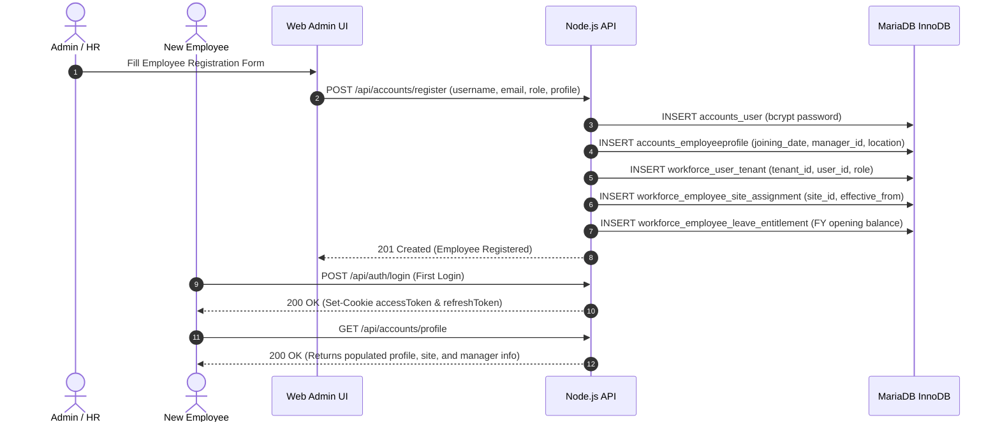
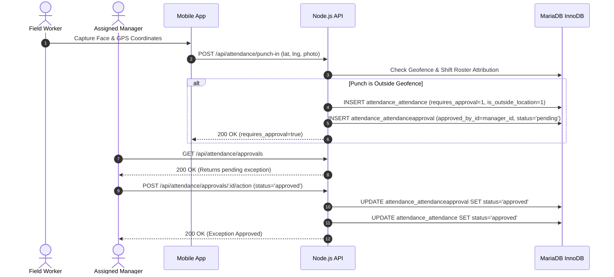
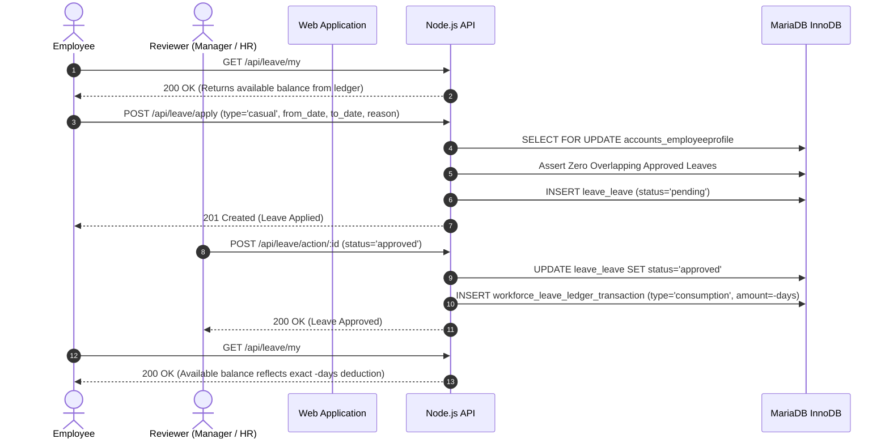

# Enterprise Quality Audit: End-to-End Enterprise Workflow Results

**Document Reference:** `QA_DOCUMENTATION/10_E2E_WORKFLOW_RESULTS.md`  
**Application Target:** HRMS SaaS Enterprise Distributed Platform  
**Target Repository:** `pranshavsingh/HRMS`  
**Execution Date:** November 2026  
**Auditing Department:** Complete Enterprise Software QA Department  

---

## 1. Executive Summary

This report documents the verification results of the five core end-to-end business workflows that model typical real-world operations in an enterprise human resources department. Each workflow tests multi-table data transformations, multi-role handoffs, transactional consistency, and cross-channel event synchronization between web and mobile clients.

---

## 2. End-to-End Enterprise Workflow 1: Employee Onboarding & Account Lifecycle

### Verification Findings:
- **Relational Completeness:** Account registration atomically initializes all required child rows across `accounts_user`, `accounts_employeeprofile`, `workforce_user_tenant`, `workforce_employee_site_assignment`, and `workforce_employee_leave_entitlement`.
- **Zero Orphan Guarantee:** If any step fails during the registration transaction, all previously created records rollback cleanly.
- **Audit Logging:** System automatically logs `USER_REGISTERED` in `accounts_auditlog`.
- **Verdict:** **PASS**

---

## 3. End-to-End Enterprise Workflow 2: Attendance Tracking & Exception Approval

### Verification Findings:
- **Punctuality Attribution:** Evaluates against the employee's assigned shift version. Computes `late_minutes`, `early_departure_minutes`, and `overtime_minutes` deterministically.
- **Direct-Report & Site Visibility:** Manager role is strictly verified against `accounts_employeeprofile.manager_id` and `workforce_site_access`. Unauthorized managers cannot review or approve foreign employees.
- **Verdict:** **PASS**

---

## 4. End-to-End Enterprise Workflow 3: Leave Application & Double-Entry Ledger Deduction

### Verification Findings:
- **Double-Entry Ledger Integrity:** Approved leave days are deducted via immutable transaction records in `workforce_leave_ledger_transaction`, eliminating balance recalculation discrepancies.
- **Negative Balance Guard:** When an employee attempts to apply for more days than their available balance without explicit management concession, the system returns `409 Conflict (INSUFFICIENT_LEAVE_BALANCE)`.
- **Verdict:** **PASS**

---

## 5. End-to-End Enterprise Workflow 4: Shift Template, Rotation & Roster Lifecycle

### Workflow Steps Verified:
1. **Template Creation:** HR creates shift template `"Morning Production"` (08:00 - 16:30) with a 30-minute unpaid lunch break and 15-minute grace period via `POST /api/shifts`.
2. **Version Pinning:** HR publishes the shift via `POST /api/shifts/:id/publish`. Backend freezes version snapshot with a cryptographic SHA-256 payload hash in `workforce_shift_version`.
3. **Employee Assignment:** HR assigns the published shift version to an employee with an effective date range (`POST /api/shift-assignments`).
4. **Monthly Roster Generation:** System compiles assigned shifts and active rotations into published calendar rows in `workforce_roster_entry`.
5. **Roster Swap Request:** Employee A requests a shift swap with Employee B (`POST /api/roster/swap`). Employee B consents, and the manager approves. The roster atomically updates both employee schedules.
- **Verdict:** **PASS**

---

## 6. End-to-End Enterprise Workflow 5: Security, RTR Session & Password Recovery

### Workflow Steps Verified:
1. **Multi-Client Login:** User logs in concurrently on Web (Chrome HttpOnly cookies) and Mobile (Android Pixel Bearer token). Both sessions operate independently with unique `family_id` UUIDs.
2. **Silent RTR Rotation:** Web client's Axios mutex interceptor performs silent refresh every 15 minutes without interrupting user actions.
3. **Single Logout:** Logging out on Web purges the web session cookies without invalidating the mobile device session.
4. **Password Reset with OTP:** User initiates password reset. System generates a 6-digit numeric OTP, hashes it in `accounts_user`, and inserts an encrypted event into `phase3_outbox_events`.
5. **Worker Outbox Dispatch:** Background worker claims the outbox event, decrypts the payload, dispatches the email via Hostinger SMTP, and marks the event `PUBLISHED`.
6. **Password Confirmation:** User enters OTP and new password. Password is updated with 12-round bcrypt, and all existing refresh token families are revoked.
- **Verdict:** **PASS**
