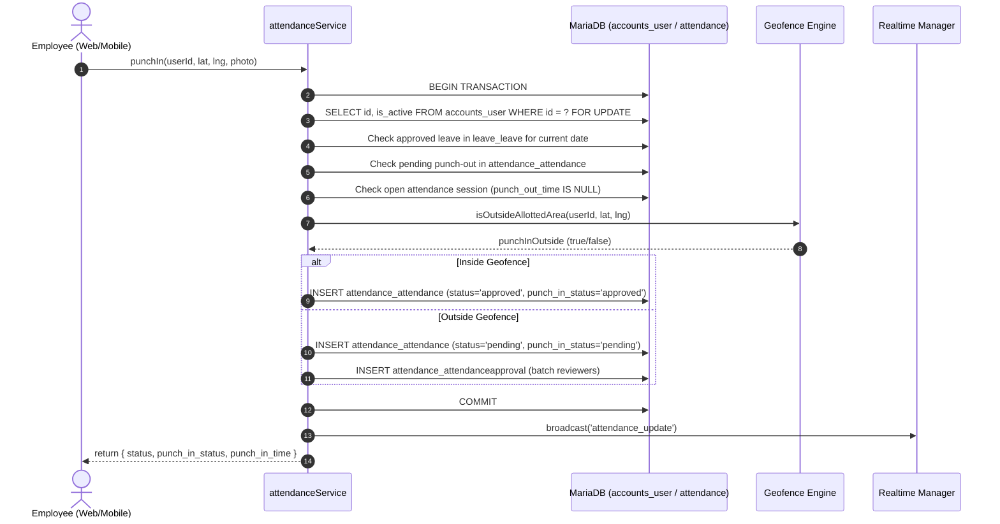
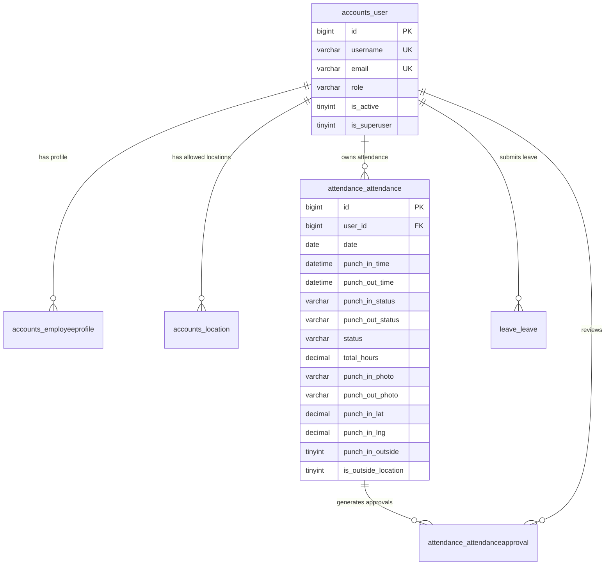

# HRMS Shift & Roster Management — Master Implementation & Architecture Audit
## Comprehensive Forensic Repository Audit, Baseline Verification & End-to-End Implementation Plan

**Repository:** `pranshavsingh/HRMS`  
**Branch:** `feat/shift-roster-management`  
**Commit SHA:** `c9d391a509fd6efec973d8deb3af3b920badff5b`  
**Date:** November 16, 2026  
**Auditor:** Principal Software Architect & Lead Autonomous Engineering Agent  
**Stage:** STAGE 0 — COMPLETE & VERIFIED  

---

## 1. Executive Summary & Verification of Baseline

This master implementation audit establishes the authoritative architectural baseline for the end-to-end implementation of **Shift & Roster Management + Shift-Wise Attendance Integration** in the enterprise HRMS monorepo.

### Verification of Existing Baseline Documents
1. `PHASE_B_V2.6_FINAL_SPECIFICATION.md` (v2.6.1): Authoritative database architecture, linear 8-migration pipeline, 17-table DDL with 100% `ON DELETE RESTRICT`, dual-layer orphan validation, and composite foreign key enforcement.
2. `PHASE_B_DISPOSABLE_DB_TEST_PLAN.md` (v2.6.1): 13-part isolated validation suite with constrained baseline execution, seeded tenant isolation tests, prerequisite-backed exception tests, and DDL implicit commit recovery.
3. `PHASE_B_V2.5_FORENSIC_AUDIT.md` (v2.6.1): 17 classified findings with verified mitigation evidence.
4. `PHASE_B_MIGRATION_READINESS_REPORT.md` (v2.6.1): Readiness decision `PASS — READY FOR DISPOSABLE DATABASE VALIDATION`.

### Strict Safety & Governance Enforcements
- Active Database (`srv999.hstgr.io`): **ZERO migrations (006–013), schema mutations, or data edits** have been executed on active databases.
- Technology Stack: Raw SQL `mysql2/promise` architecture is preserved. **No ORM (Prisma/TypeORM/Sequelize) shall be introduced.**
- Existing Functionality: Existing authentication, geofencing, photo upload, leave, and approval workflows are strictly preserved without breaking changes.

---

## 2. Existing Monorepo Architecture

The repository is structured as a full-stack enterprise monorepo:

```
f:\hrms\
├── node_backend\          # Node.js + Express backend (ES modules, raw SQL, Redis, BullMQ)
├── hrms_saas\             # React + Vite web client (Tailwind CSS, Lucide icons, face-api)
└── hrms_mobile\           # Expo React Native mobile application (Android & iOS)
```

### 2.1 Backend Technology Stack (`node_backend`)
- **Runtime & Framework:** Node.js v24 (ES Modules), Express 4.22.3.
- **Database Access:** `mysql2/promise` raw SQL pool (`node_backend/src/db/index.js`), automatic deadlock detection and retry with jitter, slow query logger (>200ms).
- **Caching & Locking:** Redis / `ioredis` 6.0 (`node_backend/src/services/redis.service.js`), distributed advisory locks, session caching (300s TTL), token revocation blacklist.
- **Background Jobs:** BullMQ 6.7 (`node_backend/src/jobs/index.js`), Redis-backed worker queues with prefixing and concurrency control.
- **Process Management:** PM2 clustering (`ecosystem.config.cjs`) with Prometheus metrics middleware (`metrics.service.js`).
- **Storage:** Dual-mode storage (`storage.service.js`) supporting Cloudinary SDK (`cloudinary.service.js`) and signed URL direct uploads.

### 2.2 Frontend Technology Stack (`hrms_saas`)
- **Framework:** React 18, Vite, React Router DOM v6.
- **UI Components:** Modular Tailwind CSS architecture, Lucide React icons.
- **Biometrics:** `@vladmandic/face-api` client-side face detection, liveness checking, orientation, and Laplacian blurriness scoring.
- **State & Networking:** Axios client with token refresh interceptors, Context API (`AuthContext`, `RealtimeContext`, `PopupContext`).

### 2.3 Mobile Technology Stack (`hrms_mobile`)
- **Framework:** React Native, Expo SDK, TypeScript.
- **Biometric Pipeline:** `react-native-webview` hosting a persistent `face-api.js` overlay with mirror effect, combined with native `expo-camera` frame capture.
- **Location:** `expo-location` high-accuracy GPS coordinates.
- **Storage & Networking:** `expo-file-system` local cache, Axios API client with token interceptors.

---

## 3. Existing Attendance Lifecycle & Business Logic

### 3.1 Punch-In Lifecycle (`attendance.service.js:punchIn`)


### 3.2 Punch-Out Lifecycle (`attendance.service.js:punchOut`)
1. User lock acquired: `SELECT id FROM accounts_user WHERE id = ? FOR UPDATE`.
2. Locates active open session: `WHERE user_id = ? AND punch_out_time IS NULL AND punch_in_status NOT IN ('rejected', 'leave')`.
3. Geofence evaluation: evaluates punch-out coordinates against assigned office radiuses.
4. Atomic conditional update:
   `UPDATE attendance_attendance SET punch_out_time = now, punch_out_photo = ..., punch_out_status = ..., status = ... WHERE id = ? AND punch_out_time IS NULL`.
5. Work duration calculation: `toHours(punch_in_time, punch_out_time, status)`.
6. Realtime notification broadcast to managers and HR.

### 3.3 Geofence Approval Workflow (`attendance.service.js:approvals`)
- Multi-tier reviewer routing:
  - Employee $\to$ Manager (if assigned), HR, Admin, Superadmin.
  - Manager $\to$ HR, Admin, Superadmin.
  - HR $\to$ Admin, Superadmin.
  - Admin $\to$ Superadmin.
- Actioning (`approvalAction`): Approving or rejecting updates `punch_in_status` or `punch_out_status`.

---

## 4. Existing API Inventory

### 4.1 Authentication & Accounts (`/api/v1/auth/`)
| Method | Endpoint | Auth Required | Description |
|---|---|---|---|
| `POST` | `/login/` | No | Authenticates credentials, issues access/refresh tokens. Rate limited. |
| `POST` | `/refresh/` | Cookie/Bearer | RTR token rotation with reuse detection. |
| `POST` | `/logout/` | Yes | Revokes session, blacklists JTI in Redis. |
| `GET` | `/me/` | Yes | Returns current authenticated user record. |
| `GET` | `/profile/` | Yes | Returns employee profile, team, manager, coordinates. |
| `GET` | `/employees/` | HR/Admin/Superadmin | Lists workforce directory with pagination. |
| `GET` | `/locations/` | Yes | Returns geofence office locations for user. |

### 4.2 Attendance (`/api/v1/attendance/`)
| Method | Endpoint | Auth Required | Description |
|---|---|---|---|
| `GET` | `/status/` | Yes | Returns punch state (`is_punched_in`, `punch_in_status`, leave info). |
| `POST` | `/punch-in/` | Yes | Submits photo, coordinates, creates attendance record. |
| `POST` | `/punch-out/` | Yes | Closes open attendance session with photo & coordinates. |
| `GET` | `/upload-params/` | Yes | Generates secure Cloudinary signature for photo uploads. |
| `GET` | `/approvals/` | Manager+ | Lists pending attendance approval requests. |
| `POST` | `/approvals/:id/` | Manager+ | Approves or rejects geofence violation request. |
| `GET` | `/dashboard/` | Yes | Personal monthly attendance statistics and summary. |
| `GET` | `/team-attendance/`| Manager+ | Realtime team presence and status. |
| `GET` | `/team-analytics/` | Manager+ | Aggregated team hours, punctuality, and leaves. |
| `GET` | `/history/` | Yes | Paginated historical attendance records for user. |

### 4.3 Leave (`/api/v1/leave/`)
| Method | Endpoint | Auth Required | Description |
|---|---|---|---|
| `GET` | `/` | Yes | User leave applications and status. |
| `POST` | `/` | Yes | Submits leave application (allows negative balance on approval). |
| `GET` | `/approvals/` | Manager+ | Pending leave requests for review. |
| `POST` | `/approvals/:id/` | Manager+ | Approves or rejects leave application. |
| `GET` | `/balance/` | Yes | User leave balance across leave categories. |
| `GET` | `/holidays/` | Yes | Company holiday list. |

---

## 5. Existing Database Schema & Entity Relationships



### Critical Database Observations:
1. `attendance_attendance` currently lacks all shift and roster columns: `tenant_id`, `roster_entry_id`, `shift_version_id`, `work_date`, `late_minutes`, `early_departure_minutes`, `overtime_minutes`, `punctuality_status`, `regularization_status`.
2. Existing punch attribution is strictly calendar-date based (`date`), with no shift start/end attribution, overnight handling, or rotation awareness.
3. Multi-tenancy is implicit; `accounts_user.org_id` exists in seed data, but formal multi-tenant workforce tables do not exist yet.

---

## 6. Identified Integration Points for Shift & Roster Management

### Integration Point 1: Shift Attribution Hook (`attendance.service.js:punchIn`)
- **Current Behavior:** Inserts record with `date: getLocalDateString()`.
- **Shift Engine Integration:**
  1. Resolve `tenant_id` from `workforce_user_tenant` for `req.user.id`.
  2. Query `workforce_roster_entry` for matching published schedule.
  3. Determine shift version: if overnight shift (`is_overnight = 1`), enforce POD-01 invariant (`work_date = shift_start_date`).
  4. Evaluate grace period and punctuality: populate `punctuality_status` (`on_time`, `grace_period`, `late`) and `late_minutes`.
  5. If ambiguous or unscheduled, raise `workforce_punch_attribution_exception`.
  6. Populate `tenant_id`, `roster_entry_id`, `shift_version_id`, `work_date`, `punctuality_status`, `late_minutes` on `attendance_attendance`.

### Integration Point 2: Shift Attribution Hook (`attendance.service.js:punchOut`)
- **Current Behavior:** Matches open record where `punch_out_time IS NULL`.
- **Shift Engine Integration:**
  1. Open record match naturally bridges midnight crossover for overnight shifts because the open record has `work_date = shift_start_date`.
  2. Evaluate early departure against assigned shift version end time minus grace period.
  3. Calculate overtime if worked duration exceeds shift planned hours.
  4. Write audit record to `workforce_punch_attribution_history` (`action = 'initial_attribution'`).

### Integration Point 3: Punch Status API (`attendance.service.js:punchStatus`)
- **Current Behavior:** Returns `is_punched_in`, `punch_in_time`, `punch_in_status`.
- **Shift Engine Integration:**
  - Return current assigned shift metadata (Shift Name, Code, Start Time, End Time, Overnight indicator, Grace period remaining) to web and mobile clients without altering existing response keys.

### Integration Point 4: Exception Resolution & Regularization (`exceptionService.js`)
- Managers review candidate shifts in `workforce_punch_attribution_candidate`.
- Selecting candidate updates `roster_entry_id` and recalculates hours, logging to `workforce_punch_attribution_history`.

---

## 7. Gap Analysis & Missing Implementation Inventory

| Module / Component | Current Repository Status | Required Implementation |
|---|---|---|
| **Workforce Database Schema** | Only Migrations 001–005 exist | Migrations 006–011 (Core) + 012–013 (Attendance & Exceptions) |
| **Shift Configuration** | None | Backend CRUD, versioning engine, validation, API, Web UI |
| **Shift Assignments** | None | Fixed assignments & rotating cycle engine, conflict prevention |
| **Roster Management** | None | Roster calendar (Day/Week/Month), bulk assignment, copy week/month, transactional publishing |
| **Shift-Wise Attendance Engine**| None (Calendar day only) | Attribution engine, overnight midnight crossover, punctuality calculations, hours settlement |
| **Attendance Exceptions** | None | Exception detection, candidate tracking, resolution workflow, immutable history ledger |
| **Web Dashboard Pages** | 16 existing pages | 6 new dedicated pages + enhancements to Attendance, Dashboard, and Reports |
| **Mobile Integration** | Punch screen with geofence | Shift details banner, upcoming roster view, overnight attendance display |
| **Automated Tests** | Security, auth, outbox tests | Database, backend, attribution, concurrency, frontend, mobile test suites |

---

## 8. Risks and Backward Compatibility Requirements

1. **Downstream UI Status Coupling (High Risk):**
   - In `Attendance.jsx:275`, the active punch timer strictly evaluates `activePunch.punch_in_status === 'approved'`.
   - **Requirement:** `punch_in_status` and `punch_out_status` MUST remain strictly geofence approval flags (`approved`, `pending`, `rejected`). Punctuality (`late`, `on_time`) must be stored in `punctuality_status`, NOT in `punch_in_status`.
2. **Legacy Attendance Backward Compatibility (High Risk):**
   - Existing attendance records (1,248 rows in database) have `roster_entry_id = NULL`.
   - **Requirement:** Punch-out, history, and approval endpoints must handle `roster_entry_id = NULL` gracefully without null pointer exceptions.
3. **Overnight Midnight Crossover (Medium Risk):**
   - Calendar date changes during shift (e.g. 22:00 Nov 16 to 06:00 Nov 17).
   - **Requirement:** Punch-out must find the open session created on Nov 16; `work_date` must remain `2026-11-16` (POD-01 invariant).
4. **Feature Flag Isolation (Low Risk):**
   - In case of operational rollback, `ENABLE_WORKFORCE_MODULE=false` must revert attendance service to legacy unassigned mode instantly with zero data loss.

---

## 9. Ordered Implementation Plan (14 Sequential Stages)

```mermaid
flowchart TD
    S0["STAGE 0: Master Repository Audit & Planning<br/>(COMPLETED)"]
    S1["STAGE 1: Disposable Database Validation<br/>(mariadb:11.8.9 container)"]
    S2["STAGE 2: Shift Configuration Management<br/>(CRUD + Immutable Versioning)"]
    S3["STAGE 3: Fixed & Rotating Assignments<br/>(Scheduling Engine & Conflict Validation)"]
    S4["STAGE 4: Roster Management<br/>(Calendar + Transactional Publishing)"]
    S5["STAGE 5: Shift-Wise Attendance Engine<br/>(Attribution + Overnight + Punctuality)"]
    S6["STAGE 6: Attendance Exceptions & Regularization<br/>(Candidates + Manager Resolution + Audit)"]
    S7["STAGE 7: HR/Admin Web Dashboard<br/>(Complete Web UI Pages)"]
    S8["STAGE 8: Employee Web & Mobile Experience<br/>(Upcoming Shifts & Punch Feedback)"]
    S9["STAGE 9: Backend API Hardening & Quality<br/>(Validation, Transactions, Locks)"]
    S10["STAGE 10: Automated Testing Suite<br/>(DB, Backend, Frontend, Mobile, Regression)"]
    S11["STAGE 11: Performance & Security Validation<br/>(Query Optimization, Indexes, RBAC)"]
    S12["STAGE 12: Production Infrastructure Readiness<br/>(Disaster Recovery, Backup Rehearsal)"]
    S13["STAGE 13: Enterprise Concurrency Stress Testing<br/>(1,000–2,000 VUs Load Validation)"]
    S14["STAGE 14: Security Audit & Release Gate<br/>(Final Project Owner Sign-Off)"]

    S0 --> S1 --> S2 --> S3 --> S4 --> S5 --> S6 --> S7 --> S8 --> S9 --> S10 --> S11 --> S12 --> S13 --> S14
```



---

## 10. Audit Conclusion & Stage 0 Sign-Off

The repository audit and implementation planning phase is complete. The system architecture, database contracts, and existing web/mobile workflows are fully mapped.

### Immediate Next Step
Proceed to **STAGE 1 — Disposable Database Validation**:
- Prepare isolated disposable MariaDB 11.8.9 environment.
- Create migration files `006` through `013` in `node_backend/scripts/migrations/`.
- Execute the 13-part validation suite and generate `PHASE_B_DISPOSABLE_VALIDATION_FINAL_REPORT.md`.
