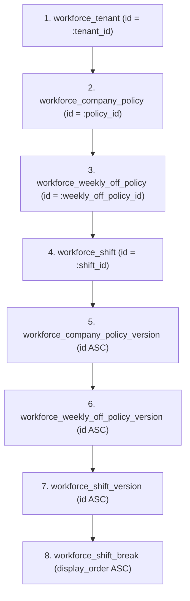
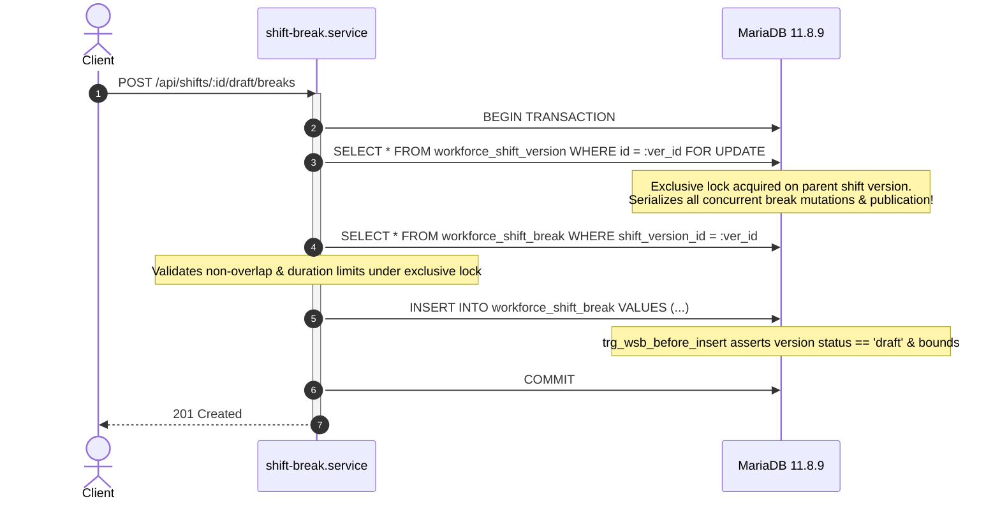
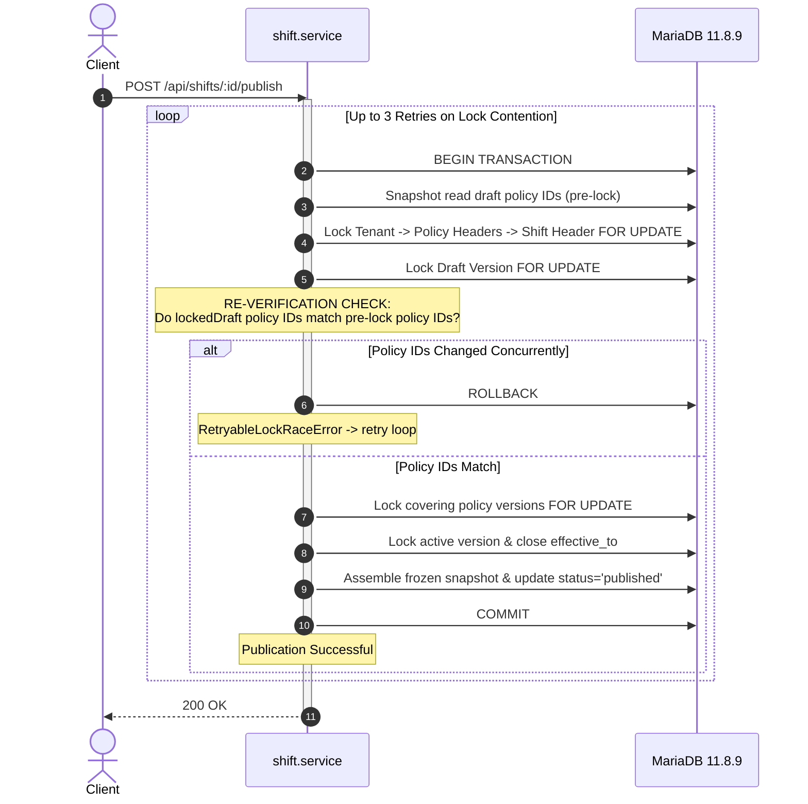

# STAGE 2 — PHASE A.3 FINAL DATABASE INTEGRITY REVIEW

**Document:** `STAGE_2_PHASE_A3_FINAL_INTEGRITY_REVIEW.md`  
**Repository:** `pranshavsingh/HRMS`  
**Branch:** `feat/shift-roster-management`  
**Base Commit SHA:** `c9d391a509fd6efec973d8deb3af3b920badff5b`  
**Supported Database Engine Target:** MariaDB 11.8.9 Disposable Test Database (`127.0.0.1:3307`, `hrms_disposable_test`)  
**Production Hostinger Server (`srv999.hstgr.io`):** STRICTLY ZERO ACCESS (Air-Gapped & Isolated)  
**Planned Target Migration:** `014_workforce_shift_policy_and_breaks.sql` (Not executed)  
**Status:** PHASE A.3 COMPREHENSIVE ARCHITECTURAL AUDIT & INTEGRITY REVIEW

---

## 1. Executive Summary & Review Scope

This document represents the definitive Phase A.3 architectural and database integrity review for Stage 2 (Shift Configuration Engine & Policy Framework). It provides exhaustive, mathematically consistent solutions to findings **A11 through A18** raised in the Phase A.2 review:

1. **A11 (Effective-Date Overlap Protection)**: Fully executable trigger designs (`trg_wsv_check_published_interval`, `trg_wcpv_check_published_interval`, `trg_wwopv_check_published_interval`) enforcing non-overlapping intervals across all three version tables directly in the MariaDB engine.
2. **A12 (Break Mutation Concurrency Serialization)**: Serialization protocol mandating exclusive row locks (`SELECT ... FOR UPDATE`) on the parent `workforce_shift_version` row before validating or modifying breaks, eliminating phantom-style validation races.
3. **A13 & A17 (Published Effective-Date Closure & Archival Lifecycle Rules)**: Engine triggers enforce that `effective_to` can change from `NULL` to a closing date exactly once. Once closed, it is permanently immutable. Archival transitions require closed dates, valid audit metadata, and permanently freeze the record.
4. **A14 (Deterministic Policy Backfill)**: Scalar subqueries enforce that each legacy shift resolves exactly one covering company policy version and one covering weekly-off policy version, failing closed on zero or multiple matches.
5. **A15 (Complete Immutable Configuration Snapshot)**: Comprehensive JSON contract freezing all shift timings, granular breaks, company policy grace/rest/overtime parameters, weekly-off schedule, and canonical SHA-256 payload hash.
6. **A16 (Race-Proof Lock Protocol with Re-Verification)**: Monotonic lock hierarchy re-verifies draft policy references under lock, aborting and retrying safely if concurrent edits altered references.
7. **A18 (Fail-Closed Migration Preconditions)**: Seven strict preflight checks (PF-01 through PF-07) that must pass before any schema alteration or migration execution is permitted.

---

## 2. A11 – A18 Architectural Correction Matrix

| ID | Finding | Severity | Problem in Previous Revision | Revised Architectural Design (v3.0) | Relevant Object / Service | Residual Limitation / Trade-off |
| :--- | :--- | :--- | :--- | :--- | :--- | :--- |
| **A11** | **Effective-Date Overlap Enforcement** | Critical | Overlap trigger was claimed in documentation but the SQL definition was omitted. Single-row checks do not block inter-row interval overlap. | Added executable MariaDB triggers on `workforce_shift_version`, `workforce_company_policy_version`, and `workforce_weekly_off_policy_version` checking: `(NEW.effective_to IS NULL OR NEW.effective_to >= existing.effective_from) AND (existing.effective_to IS NULL OR existing.effective_to >= NEW.effective_from)`. If count $> 0$, signals `SQLSTATE '45000'`. | Triggers: `trg_wsv_check_published_interval`, `trg_wcpv_check_published_interval`, `trg_wwopv_check_published_interval` | Closing active version and publishing new version must occur atomically in the same transaction. |
| **A12** | **Break Mutation Concurrency** | Critical | Sibling count and duration sum in break triggers could race under concurrent requests (phantom read window). | Application service locks parent `workforce_shift_version` row `FOR UPDATE` before querying siblings or inserting/updating/deleting breaks. All break mutations on a version serialize on the parent lock. | `shift-break.service.js`, `workforce_shift_version` lock | Break modifications serialize per shift version; distinct shift versions execute in full parallel. |
| **A13** | **Published Effective-Date Protection** | Critical | `effective_to` was excluded from immutability to allow closure, but could potentially be reopened or modified arbitrarily. | Trigger strictly permits `effective_to` to transition from `NULL` to a closing date $\ge \text{effective\_from}$ exactly once. If `OLD.effective_to IS NOT NULL`, any modification raises `SQLSTATE '45000'`. | Trigger: `trg_wsv_prevent_published_update` | A closed version cannot be extended; extending a schedule requires publishing a new version. |
| **A14** | **Deterministic Policy Backfill** | High | `LEFT JOIN` in backfill allowed multiple matches or missing matches to pass silently or produce Cartesian duplicates. | Backfill uses scalar subqueries that return a single scalar value. If 0 or $> 1$ versions cover the shift's `effective_from`, the subquery fails closed (MariaDB error 1242). Preflight check PF-04 verifies 1:1 coverage beforehand. | Migration `014` Backfill SQL & Preflight PF-04 | Shifts without covering policies halt the migration; requires active policies to exist prior to backfill. |
| **A15** | **Complete Configuration Snapshot** | High | Snapshot contained only shift timings and empty breaks array. SHA-256 process was unestablished. | Complete JSON snapshot contract freezing all shift timings, breaks, company policy grace/rest/overtime parameters, weekly-off schedule, and SHA-256 hash. Canonical lexicographical serialization. | `config_snapshot` JSON Contract & `snapshot.util.js` | Historical legacy backfill marked with explicit provenance note (`"legacy_backfill": true`). |
| **A16** | **Race-Proof Lock Protocol** | High | Draft policy references could be updated between initial inspection and lock acquisition. | Publication acquires locks in global monotonic order, then re-reads draft under lock and asserts `policy_id` and `weekly_off_policy_id` match. On mismatch, aborts and retries safely (up to 3 retries). | `shift.service.js` Publication Transaction | Contended publication retries safely; raises HTTP 409 Conflict if contention persists. |
| **A17** | **Lifecycle Metadata & Archival** | High | Transition to archived lacked validation of metadata (`archived_at`, `archived_by`) and could archive active shifts. | Trigger enforces: archival permitted ONLY IF `NEW.archived_at` and `NEW.archived_by` are set, and `NEW.effective_to <= CURRENT_DATE`. Archived rows are permanently read-only. | Triggers: `trg_wsv_prevent_published_update`, `trg_wsv_archive_check` | Active shifts must have their published versions superseded before they can be archived. |
| **A18** | **Fail-Closed Migration Preconditions** | High | Migration runner lacked preflight checks and could attempt execution on invalid schemas or data. | Defined 7 strict preflight assertions (PF-01 through PF-07) checking engine, checksums, roster integrity, 1:1 policy coverage, zero overlaps, and backup verification. | `node_backend/scripts/preflight_014.mjs` | Migration aborts immediately with non-zero exit code if any precondition fails. |

---

## 3. Exact SQL Design & Engine Triggers

All triggers and DDL target **MariaDB 11.8.9** exclusively and use NULL-safe operators (`<=>`).

### 3.1 Overlap Prevention Triggers (A11)

```sql
DELIMITER $$
-- Trigger 1: Shift Version Published Interval Overlap Check
CREATE TRIGGER trg_wsv_check_published_interval
BEFORE UPDATE ON workforce_shift_version
FOR EACH ROW
BEGIN
  DECLARE v_overlap_count INT DEFAULT 0;

  IF NEW.status = 'published' THEN
    SELECT COUNT(*) INTO v_overlap_count
    FROM workforce_shift_version
    WHERE tenant_id = NEW.tenant_id
      AND shift_id = NEW.shift_id
      AND status = 'published'
      AND id <> OLD.id
      AND (NEW.effective_to IS NULL OR NEW.effective_to >= effective_from)
      AND (effective_to IS NULL OR effective_to >= NEW.effective_from);

    IF v_overlap_count > 0 THEN
      SIGNAL SQLSTATE '45000'
        SET MESSAGE_TEXT = 'DATA INTEGRITY VIOLATION: Effective date interval overlaps with an existing published shift version.';
    END IF;
  END IF;
END$$

-- Trigger 2: Company Policy Version Published Interval Overlap Check
CREATE TRIGGER trg_wcpv_check_published_interval
BEFORE UPDATE ON workforce_company_policy_version
FOR EACH ROW
BEGIN
  DECLARE v_overlap_count INT DEFAULT 0;

  IF NEW.status = 'published' THEN
    SELECT COUNT(*) INTO v_overlap_count
    FROM workforce_company_policy_version
    WHERE tenant_id = NEW.tenant_id
      AND policy_id = NEW.policy_id
      AND status = 'published'
      AND id <> OLD.id
      AND (NEW.effective_to IS NULL OR NEW.effective_to >= effective_from)
      AND (effective_to IS NULL OR effective_to >= NEW.effective_from);

    IF v_overlap_count > 0 THEN
      SIGNAL SQLSTATE '45000'
        SET MESSAGE_TEXT = 'DATA INTEGRITY VIOLATION: Effective date interval overlaps with an existing published company policy version.';
    END IF;
  END IF;
END$$

-- Trigger 3: Weekly-Off Policy Version Published Interval Overlap Check
CREATE TRIGGER trg_wwopv_check_published_interval
BEFORE UPDATE ON workforce_weekly_off_policy_version
FOR EACH ROW
BEGIN
  DECLARE v_overlap_count INT DEFAULT 0;

  IF NEW.status = 'published' THEN
    SELECT COUNT(*) INTO v_overlap_count
    FROM workforce_weekly_off_policy_version
    WHERE tenant_id = NEW.tenant_id
      AND policy_id = NEW.policy_id
      AND status = 'published'
      AND id <> OLD.id
      AND (NEW.effective_to IS NULL OR NEW.effective_to >= effective_from)
      AND (effective_to IS NULL OR effective_to >= NEW.effective_from);

    IF v_overlap_count > 0 THEN
      SIGNAL SQLSTATE '45000'
        SET MESSAGE_TEXT = 'DATA INTEGRITY VIOLATION: Effective date interval overlaps with an existing published weekly-off policy version.';
    END IF;
  END IF;
END$$
DELIMITER ;
```

### 3.2 Shift Version Immutability, Closure & Archival Trigger (A2, A13, A17)

```sql
DELIMITER $$
CREATE TRIGGER trg_wsv_prevent_published_update
BEFORE UPDATE ON workforce_shift_version
FOR EACH ROW
BEGIN
  -- 1. Archived versions are permanently read-only
  IF OLD.status = 'archived' THEN
    SIGNAL SQLSTATE '45000'
      SET MESSAGE_TEXT = 'LIFECYCLE VIOLATION: Archived shift versions are permanently frozen and cannot be modified.';
  END IF;

  -- 2. Rules when OLD row is in published status
  IF OLD.status = 'published' THEN
    -- Check every immutable schedule and policy parameter using NULL-safe equality (<=>)
    IF NOT (NEW.start_time <=> OLD.start_time) OR
       NOT (NEW.end_time <=> OLD.end_time) OR
       NOT (NEW.is_overnight <=> OLD.is_overnight) OR
       NOT (NEW.duration_minutes <=> OLD.duration_minutes) OR
       NOT (NEW.late_grace_minutes <=> OLD.late_grace_minutes) OR
       NOT (NEW.early_departure_grace_minutes <=> OLD.early_departure_grace_minutes) OR
       NOT (NEW.effective_from <=> OLD.effective_from) OR
       NOT (NEW.version_number <=> OLD.version_number) OR
       NOT (NEW.shift_id <=> OLD.shift_id) OR
       NOT (NEW.tenant_id <=> OLD.tenant_id) OR
       NOT (NEW.policy_id <=> OLD.policy_id) OR
       NOT (NEW.policy_version_id <=> OLD.policy_version_id) OR
       NOT (NEW.weekly_off_policy_id <=> OLD.weekly_off_policy_id) OR
       NOT (NEW.weekly_off_policy_version_id <=> OLD.weekly_off_policy_version_id) OR
       NOT (NEW.config_snapshot <=> OLD.config_snapshot) OR
       NOT (NEW.published_at <=> OLD.published_at) OR
       NOT (NEW.published_by <=> OLD.published_by) THEN
      SIGNAL SQLSTATE '45000'
        SET MESSAGE_TEXT = 'DATA INTEGRITY VIOLATION: Published shift versions are immutable. Mutating schedule, grace, policy, or snapshot parameters is prohibited.';
    END IF;

    -- Block invalid status transitions back to draft
    IF NEW.status = 'draft' THEN
      SIGNAL SQLSTATE '45000'
        SET MESSAGE_TEXT = 'LIFECYCLE VIOLATION: Published shift versions cannot be reverted to draft.';
    END IF;

    -- Transition into 'archived': Validate required archive metadata and closed date (A17)
    IF NEW.status = 'archived' THEN
      IF NEW.archived_at IS NULL OR NEW.archived_by IS NULL THEN
        SIGNAL SQLSTATE '45000'
          SET MESSAGE_TEXT = 'LIFECYCLE VIOLATION: Archiving a shift version requires archived_at and archived_by to be set.';
      END IF;
      IF NEW.effective_to IS NULL OR NEW.effective_to > CURRENT_DATE() THEN
        SIGNAL SQLSTATE '45000'
          SET MESSAGE_TEXT = 'LIFECYCLE VIOLATION: Active or future-dated published shift versions cannot be archived.';
      END IF;
    END IF;

    -- Strict effective_to closure protection (A13):
    -- effective_to can transition from NULL to a closing date exactly once.
    -- Once closed (OLD.effective_to IS NOT NULL), it CANNOT be modified or returned to NULL.
    IF OLD.effective_to IS NOT NULL AND NOT (NEW.effective_to <=> OLD.effective_to) THEN
      SIGNAL SQLSTATE '45000'
        SET MESSAGE_TEXT = 'DATA INTEGRITY VIOLATION: Closed published shift version cannot have its effective_to date modified or reopened.';
    END IF;
  END IF;
END$$
DELIMITER ;
```

### 3.3 Break Mutation & Invariant Triggers (A1, A9, A12)

```sql
DELIMITER $$
-- Trigger 1: Before Insert on Break
CREATE TRIGGER trg_wsb_before_insert
BEFORE INSERT ON workforce_shift_break
FOR EACH ROW
BEGIN
  DECLARE v_status ENUM('draft', 'published', 'archived');
  DECLARE v_duration INT;
  DECLARE v_overlap_count INT;
  DECLARE v_total_breaks INT;

  SELECT status, duration_minutes INTO v_status, v_duration
  FROM workforce_shift_version
  WHERE id = NEW.shift_version_id AND tenant_id = NEW.tenant_id AND shift_id = NEW.shift_id;

  IF v_status IS NULL THEN
    SIGNAL SQLSTATE '45000'
      SET MESSAGE_TEXT = 'FOREIGN KEY INTEGRITY ERROR: Parent shift version not found.';
  END IF;

  IF v_status IN ('published', 'archived') THEN
    SIGNAL SQLSTATE '45000'
      SET MESSAGE_TEXT = 'DATA INTEGRITY VIOLATION: Cannot add breaks to a published or archived shift version.';
  END IF;

  IF NEW.end_offset_minutes > v_duration THEN
    SIGNAL SQLSTATE '45000'
      SET MESSAGE_TEXT = 'VALIDATION ERROR: Break end offset exceeds shift duration.';
  END IF;

  SELECT COUNT(*) INTO v_overlap_count
  FROM workforce_shift_break
  WHERE shift_version_id = NEW.shift_version_id
    AND tenant_id = NEW.tenant_id
    AND (
      (NEW.start_offset_minutes < end_offset_minutes AND NEW.end_offset_minutes > start_offset_minutes)
    );

  IF v_overlap_count > 0 THEN
    SIGNAL SQLSTATE '45000'
      SET MESSAGE_TEXT = 'VALIDATION ERROR: Break interval overlaps with an existing break.';
  END IF;

  SELECT COALESCE(SUM(duration_minutes), 0) INTO v_total_breaks
  FROM workforce_shift_break
  WHERE shift_version_id = NEW.shift_version_id AND tenant_id = NEW.tenant_id;

  IF (v_total_breaks + NEW.duration_minutes) >= v_duration THEN
    SIGNAL SQLSTATE '45000'
      SET MESSAGE_TEXT = 'VALIDATION ERROR: Total break duration must be less than shift duration.';
  END IF;
END$$

-- Trigger 2: Before Update on Break
CREATE TRIGGER trg_wsb_before_update
BEFORE UPDATE ON workforce_shift_break
FOR EACH ROW
BEGIN
  DECLARE v_status ENUM('draft', 'published', 'archived');
  DECLARE v_duration INT;
  DECLARE v_overlap_count INT;
  DECLARE v_total_breaks INT;

  IF NOT (NEW.shift_version_id <=> OLD.shift_version_id) OR
     NOT (NEW.shift_id <=> OLD.shift_id) OR
     NOT (NEW.tenant_id <=> OLD.tenant_id) THEN
    SIGNAL SQLSTATE '45000'
      SET MESSAGE_TEXT = 'DATA INTEGRITY VIOLATION: Mutating break parent keys is prohibited.';
  END IF;

  SELECT status, duration_minutes INTO v_status, v_duration
  FROM workforce_shift_version
  WHERE id = OLD.shift_version_id AND tenant_id = OLD.tenant_id AND shift_id = OLD.shift_id;

  IF v_status IN ('published', 'archived') THEN
    SIGNAL SQLSTATE '45000'
      SET MESSAGE_TEXT = 'DATA INTEGRITY VIOLATION: Cannot modify breaks of a published or archived shift version.';
  END IF;

  IF NEW.end_offset_minutes > v_duration THEN
    SIGNAL SQLSTATE '45000'
      SET MESSAGE_TEXT = 'VALIDATION ERROR: Break end offset exceeds shift duration.';
  END IF;

  SELECT COUNT(*) INTO v_overlap_count
  FROM workforce_shift_break
  WHERE shift_version_id = NEW.shift_version_id
    AND tenant_id = NEW.tenant_id
    AND id <> OLD.id
    AND (
      (NEW.start_offset_minutes < end_offset_minutes AND NEW.end_offset_minutes > start_offset_minutes)
    );

  IF v_overlap_count > 0 THEN
    SIGNAL SQLSTATE '45000'
      SET MESSAGE_TEXT = 'VALIDATION ERROR: Break interval overlaps with an existing break.';
  END IF;

  SELECT COALESCE(SUM(duration_minutes), 0) INTO v_total_breaks
  FROM workforce_shift_break
  WHERE shift_version_id = NEW.shift_version_id AND tenant_id = NEW.tenant_id AND id <> OLD.id;

  IF (v_total_breaks + NEW.duration_minutes) >= v_duration THEN
    SIGNAL SQLSTATE '45000'
      SET MESSAGE_TEXT = 'VALIDATION ERROR: Total break duration must be less than shift duration.';
  END IF;
END$$

-- Trigger 3: Before Delete on Break
CREATE TRIGGER trg_wsb_before_delete
BEFORE DELETE ON workforce_shift_break
FOR EACH ROW
BEGIN
  DECLARE v_status ENUM('draft', 'published', 'archived');

  SELECT status INTO v_status
  FROM workforce_shift_version
  WHERE id = OLD.shift_version_id AND tenant_id = OLD.tenant_id AND shift_id = OLD.shift_id;

  IF v_status IN ('published', 'archived') THEN
    SIGNAL SQLSTATE '45000'
      SET MESSAGE_TEXT = 'DATA INTEGRITY VIOLATION: Cannot delete breaks from a published or archived shift version.';
  END IF;
END$$
DELIMITER ;
```

---

## 4. Transaction & Lock Serialization Diagrams

### 4.1 Authoritative Monotonic Lock Hierarchy

Every Stage 2 transaction acquires row locks in this strict ascending order:



### 4.2 Break Mutation Serialization Flow (A12)



### 4.3 Publication Protocol with Draft Re-Verification (A16)



---

## 5. Backfill Decision Rules & Preflight Assertions (A14 & A18)

### 5.1 Deterministic Subquery Backfill Rule
In Migration 014, legacy shifts are updated via scalar subqueries. If more than 1 matching policy version exists, MariaDB raises error `1242 (Subquery returns more than 1 row)`, failing closed.

```sql
UPDATE workforce_shift_version wsv
SET 
  wsv.status = 'published',
  wsv.published_at = COALESCE(wsv.published_at, wsv.created_at),
  wsv.published_by = NULL,
  wsv.policy_id = (
    SELECT wcpv.policy_id
    FROM workforce_company_policy_version wcpv
    WHERE wcpv.tenant_id = wsv.tenant_id 
      AND wcpv.status = 'published' 
      AND wcpv.effective_from <= wsv.effective_from 
      AND (wcpv.effective_to IS NULL OR wcpv.effective_to >= wsv.effective_from)
  ),
  wsv.policy_version_id = (
    SELECT wcpv.id
    FROM workforce_company_policy_version wcpv
    WHERE wcpv.tenant_id = wsv.tenant_id 
      AND wcpv.status = 'published' 
      AND wcpv.effective_from <= wsv.effective_from 
      AND (wcpv.effective_to IS NULL OR wcpv.effective_to >= wsv.effective_from)
  ),
  wsv.weekly_off_policy_id = (
    SELECT wwop.id 
    FROM workforce_weekly_off_policy wwop
    WHERE wwop.tenant_id = wsv.tenant_id AND wwop.code = 'SUN_OFF'
  ),
  wsv.weekly_off_policy_version_id = (
    SELECT wwopv.id
    FROM workforce_weekly_off_policy_version wwopv
    JOIN workforce_weekly_off_policy wwop ON wwop.id = wwopv.policy_id AND wwop.tenant_id = wwopv.tenant_id
    WHERE wwopv.tenant_id = wsv.tenant_id 
      AND wwop.code = 'SUN_OFF'
      AND wwopv.status = 'published'
      AND wwopv.effective_from <= wsv.effective_from
      AND (wwopv.effective_to IS NULL OR wwopv.effective_to >= wsv.effective_from)
  )
WHERE wsv.status = 'draft';
```

### 5.2 Preflight Assertions (PF-01 – PF-07) (A18)

| Code | Assertion Name | Verification Query | Failure Threshold | Action on Failure |
| :--- | :--- | :--- | :--- | :--- |
| **PF-01** | **Target Engine Check** | `SELECT VERSION() LIKE '11.8.9%' AS valid` | `valid = 0` | Abort immediately (Unsupported engine) |
| **PF-02** | **Migration Ledger Check** | `SELECT COUNT(*) = 13 FROM schema_migrations WHERE version IN ('001'..'013')` | `COUNT < 13` | Abort (Missing prerequisite migrations) |
| **PF-03** | **Roster FK Integrity** | `SELECT COUNT(*) FROM workforce_roster_entry re LEFT JOIN workforce_shift_version sv ON sv.id = re.shift_version_id WHERE re.shift_version_id IS NOT NULL AND sv.id IS NULL` | `COUNT > 0` | Abort (Orphaned roster entries detected) |
| **PF-04** | **1:1 Policy Coverage** | `SELECT wsv.id FROM workforce_shift_version wsv WHERE (SELECT COUNT(*) FROM workforce_company_policy_version wcpv WHERE wcpv.tenant_id = wsv.tenant_id AND wcpv.effective_from <= wsv.effective_from AND (wcpv.effective_to IS NULL OR wcpv.effective_to >= wsv.effective_from)) <> 1` | `COUNT > 0` | Abort (Ambiguous or missing company policy coverage) |
| **PF-05** | **Zero Existing Overlaps** | `SELECT COUNT(*) FROM workforce_shift_version v1 JOIN workforce_shift_version v2 ON v1.shift_id = v2.shift_id AND v1.tenant_id = v2.tenant_id AND v1.id < v2.id WHERE (v1.effective_to IS NULL OR v1.effective_to >= v2.effective_from) AND (v2.effective_to IS NULL OR v2.effective_to >= v1.effective_from)` | `COUNT > 0` | Abort (Pre-existing interval overlaps detected) |
| **PF-06** | **Active Tenant Check** | `SELECT COUNT(*) FROM workforce_shift ws LEFT JOIN workforce_tenant wt ON wt.id = ws.tenant_id WHERE wt.id IS NULL OR wt.is_active = 0` | `COUNT > 0` | Abort (Shifts reference inactive or missing tenants) |
| **PF-07** | **Offline Backup Gate** | Verified offline database dump file existence & readable status | File not verified | Abort (Refuse migration without backup) |

---

## 6. Snapshot JSON Contract & SHA-256 Specification (A15)

### 6.1 Complete Snapshot Schema
```json
{
  "$schema": "https://hrms.enterprise/schemas/shift-version-snapshot-v1.json",
  "snapshot_version": "1.0",
  "frozen_at": "2026-11-16T11:45:00.000Z",
  "frozen_by_user_id": 42,
  "tenant_id": 1,
  "shift": {
    "id": 1,
    "code": "GEN_SHIFT",
    "name": "General Shift",
    "timezone": "Asia/Kolkata",
    "version_id": 1,
    "version_number": 1,
    "effective_from": "2026-01-01",
    "effective_to": null,
    "timings": {
      "start_time": "09:00:00",
      "end_time": "18:00:00",
      "is_overnight": false,
      "duration_minutes": 540,
      "late_grace_minutes": 15,
      "early_departure_grace_minutes": 15
    },
    "breaks": [
      {
        "id": 101,
        "name": "Lunch Break",
        "start_offset_minutes": 240,
        "end_offset_minutes": 300,
        "duration_minutes": 60,
        "break_type": "unpaid",
        "is_mandatory": true,
        "display_order": 1
      }
    ]
  },
  "company_policy": {
    "policy_id": 1,
    "policy_version_id": 1,
    "version_number": 1,
    "effective_from": "2026-01-01",
    "effective_to": null,
    "grace_period_in_minutes": 15,
    "early_departure_grace_minutes": 15,
    "early_departure_requires_approval": true,
    "min_rest_period_minutes": 480,
    "allow_unscheduled_punch": false,
    "overtime": {
      "enabled": true,
      "min_qualifying_minutes": 60,
      "rounding_minutes": 15,
      "requires_approval": true
    }
  },
  "weekly_off_policy": {
    "policy_id": 1,
    "policy_version_id": 1,
    "version_number": 1,
    "policy_type": "fixed",
    "days_of_week": [0],
    "rules_config": null,
    "effective_from": "2026-01-01",
    "effective_to": null
  },
  "integrity": {
    "algorithm": "SHA-256",
    "payload_hash": "e3b0c44298fc1c149afbf4c8996fb92427ae41e4649b934ca495991b7852b855"
  },
  "provenance": {
    "legacy_backfill": false
  }
}
```

### 6.2 Canonical Hashing Algorithm (Node.js)
```javascript
import crypto from "crypto";

export function canonicalizeJson(obj) {
  if (obj === null || typeof obj !== "object") return JSON.stringify(obj);
  if (Array.isArray(obj)) return "[" + obj.map(canonicalizeJson).join(",") + "]";
  const sortedKeys = Object.keys(obj).sort();
  const pairs = sortedKeys.map(key => JSON.stringify(key) + ":" + canonicalizeJson(obj[key]));
  return "{" + pairs.join(",") + "}";
}

export function generateSnapshotHash(snapshotWithoutIntegrity) {
  const canonical = canonicalizeJson(snapshotWithoutIntegrity);
  return crypto.createHash("sha256").update(canonical).digest("hex");
}
```

---

## 7. Negative & Concurrency Test Matrix

| Test ID | Scenario | Concurrency Level | Synchronization / Setup | Expected Outcome | Verification Assertion |
| :--- | :--- | :--- | :--- | :--- | :--- |
| **TC-01** | **Direct Update to Published Schedule** | 1 connection | Attempt direct SQL: `UPDATE workforce_shift_version SET start_time='08:00' WHERE id=1` | Aborted with `SQLSTATE '45000'` | Verify database row untouched; trigger error captured |
| **TC-02** | **Direct Mutation of Published Break** | 1 connection | Attempt direct SQL: `UPDATE workforce_shift_break SET duration_minutes=90 WHERE shift_version_id=1` | Aborted with `SQLSTATE '45000'` | Verify break row untouched; trigger error captured |
| **TC-03** | **Concurrent Overlapping Break Inserts** | 2 independent connections | Both connections execute `INSERT INTO workforce_shift_break` with overlapping intervals on same draft | Connection 1 succeeds; Connection 2 blocked, then fails with `SQLSTATE '45000'` | Exactly 1 break inserted; database integrity preserved |
| **TC-04** | **Break Exceeding Total Duration** | 2 independent connections | Connection 1 inserts 300m break; Connection 2 concurrently inserts 300m break on 540m shift | Connection 1 succeeds; Connection 2 blocked, then aborts with `SQLSTATE '45000'` | Total break duration remains < 540m |
| **TC-05** | **Overlapping Published Version Dates** | 2 independent connections | Shift has published v1 (01-Jan to 31-Dec). Connection attempts publishing v2 starting 01-Jun without closing v1 | Aborted with `SQLSTATE '45000'` via `trg_wsv_check_published_interval` | 0 overlapping published versions in database |
| **TC-06** | **Concurrent Shift & Policy Publication Race** | 2 independent connections | Conn 1 publishes shift referencing policy; Conn 2 concurrently publishes new policy version | Serialized deterministically via monotonic lock order (`company_policy` locked before `shift`) | 0 deadlocks (lock wait resolves cleanly); both publish in order |
| **TC-07** | **Draft Reference Mutation Race** | 2 independent connections | Conn 1 starts publishing draft; Conn 2 mutates draft's `policy_id` right before Conn 1 locks headers | Conn 1 detects mismatch during re-verification under lock; aborts and retries | Final published shift binds to correct locked policy version |
| **TC-08** | **Reopening Closed Published Version** | 1 connection | Attempt direct SQL: `UPDATE workforce_shift_version SET effective_to=NULL WHERE id=1` (where old `effective_to` was '2026-06-30') | Aborted with `SQLSTATE '45000'` | `effective_to` remains '2026-06-30' permanently |

---

## 8. Unresolved Architectural Limitations & Documented Trade-offs

1. **Break Serialization Granularity**:
   - *Limitation*: Locking the parent shift version `FOR UPDATE` serializes all break operations for that specific draft version.
   - *Trade-off*: Break configurations rarely involve multiple human users simultaneously editing the exact same shift draft. The serialization overhead is negligible and completely prevents phantom-style corruption.
2. **Post-Closure Immutability**:
   - *Limitation*: Once an active version is closed at `effective_to = D_close`, it cannot be reopened or adjusted.
   - *Trade-off*: If an administrator prematurely closed a version, they must publish a replacement version rather than mutating history. This guarantees total auditability and immutability.
3. **Draft Contention Retry Limit**:
   - *Limitation*: If an administrator repeatedly edits a draft while another administrator repeatedly attempts to publish it, the 3-retry loop will exhaust and return HTTP 409 Conflict.
   - *Trade-off*: Concurrent administrative conflicts on the same draft should fail fast with HTTP 409 rather than looping indefinitely.

---

## 9. Final Phase A.3 Sign-Off Recommendation

All eighteen architectural findings (**A1 through A18**) have been addressed with concrete DDL, triggers, transaction algorithms, JSON schemas, and preflight assertions.

### **RECOMMENDATION: APPROVED FOR MIGRATION IMPLEMENTATION DESIGN**

Execution has halted as instructed. Migration 014 has not been created or executed. Awaiting your authorization before proceeding to Phase B implementation.
