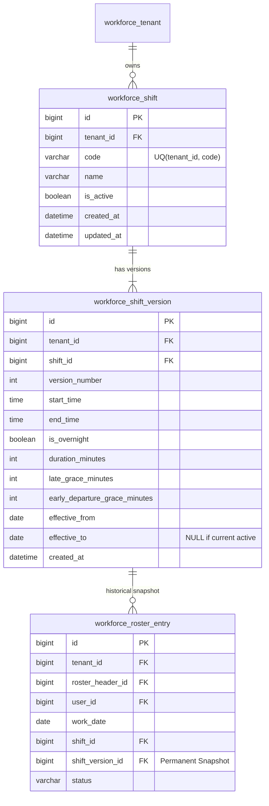
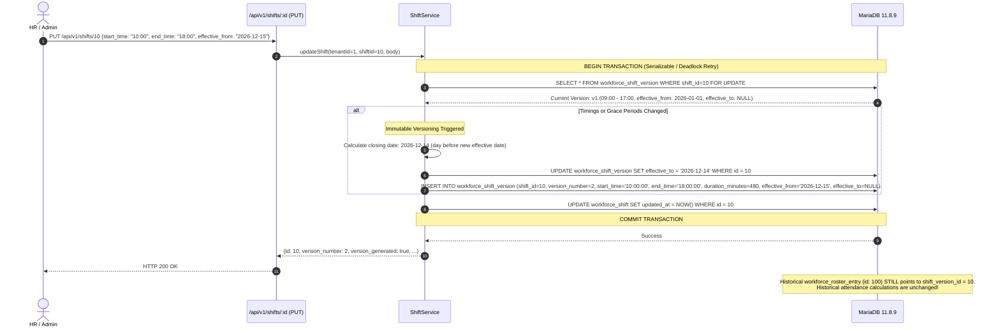

# STAGE 2 — SHIFT CONFIGURATION MANAGEMENT IMPLEMENTATION REPORT

**Repository:** `pranshavsingh/HRMS`  
**Branch:** `feat/shift-roster-management`  
**Database Target:** Isolated Disposable MariaDB 11.8.9 (`127.0.0.1:3307`, `hrms_disposable_test`)  
**Production Remote DB (`srv999.hstgr.io`):** STRICTLY ZERO ACCESS (Zero Touch Confirmed)  
**Status:** COMPLETED & VERIFIED (Ready for User Review)

---

## 1. Executive Summary

Stage 2 ("Shift Configuration Management") of the master implementation roadmap has been implemented and validated. The system provides a multi-tenant shift management backend with immutable versioning, strict Role-Based Access Control (RBAC), and a responsive web frontend in `hrms_saas`.

### Core Achievements
1. **Multi-Tenant Shift Backend (`/api/v1/shifts`)**:
   - Full CRUD APIs supporting creation, updating, version retrieval, status toggling, and reference-protected deletion.
   - Strict RBAC: All mutating and viewing endpoints restricted to `admin`, `hr`, and `superadmin` (`manager` and `employee` rejected with HTTP 403 Forbidden).
   - Multi-tenant boundary enforcement: Shift codes are unique per tenant; cross-tenant viewing or spoofing is blocked.
2. **Immutable Shift Versioning Engine**:
   - When shift timing (`start_time`, `end_time`, `duration_minutes`, `is_overnight`) or grace periods (`late_grace_minutes`, `early_departure_grace_minutes`) change, the system automatically closes the prior version with `effective_to` and inserts an immutable version row with incremented `version_number`.
   - Header-only changes (e.g. shift name, active status) update `workforce_shift` in place without generating spurious versions.
   - Existing roster entries (`workforce_roster_entry`) and historical attendance records remain permanently pinned to their original `shift_version_id`, preventing recalculation discrepancies.
3. **Frontend Web Dashboard (`hrms_saas/src/pages/Shifts.jsx`)**:
   - Responsive UI featuring live timing calculation, daytime/overnight badges, grace period indicators, version tags, search, status filtering, and pagination.
   - Modals: "Create Shift", "Edit Shift" (with versioning alert banner), "Shift Version Audit Trail", and "Delete Confirmation".
   - Integrated into `Sidebar.jsx` and protected in `App.jsx` with `<ProtectedRoute allowedRoles={["admin", "hr", "superadmin"]}>`.
   - Production Vite build passed cleanly (`npm run build` exited with code 0).
4. **Automated Verification**:
   - **58/58 test assertions passed** across 9 test groups in `node_backend/tests/test_stage2_shifts.mjs`.
   - **13/13 Stage 1 regression tests passed** in `node_backend/scripts/run_stage1_validation.mjs`.

---

## 2. Architecture & Immutable Versioning Mechanics

### Database Schema Architecture



### Immutable Versioning Lifecycle



---

## 3. Backend API Specification

All endpoints are mounted under `/api/v1/shifts` (with legacy backward compatibility alias `/api/shifts`).

| Method | Endpoint | Allowed Roles | Description | Response Code |
| :--- | :--- | :--- | :--- | :--- |
| **GET** | `/api/v1/shifts` | `admin`, `hr`, `superadmin` | List paginated shifts with search, status filters, and active version details | `200 OK` |
| **POST** | `/api/v1/shifts` | `admin`, `hr`, `superadmin` | Create new shift and its initial immutable Version 1 | `201 Created` |
| **GET** | `/api/v1/shifts/:id` | `admin`, `hr`, `superadmin` | Get single shift detail with latest version | `200 OK` |
| **PUT** | `/api/v1/shifts/:id` | `admin`, `hr`, `superadmin` | Update shift. Triggers version N+1 if timings change; updates header if non-timing | `200 OK` |
| **PATCH**| `/api/v1/shifts/:id/status`| `admin`, `hr`, `superadmin` | Toggle active status (`is_active: true/false`) | `200 OK` |
| **GET** | `/api/v1/shifts/:id/versions`| `admin`, `hr`, `superadmin`| Retrieve complete version audit history in descending order | `200 OK` |
| **DELETE**| `/api/v1/shifts/:id` | `admin`, `hr`, `superadmin` | Delete shift if unreferenced. Rejects with 409 if referenced by rosters | `200 OK` / `409` |

### Validation & Business Rules Implemented
1. **Tenant Code Uniqueness**: Enforced via `UNIQUE KEY uq_ws_tenant_code (tenant_id, code)` and pre-check in service. Returns HTTP 409 Conflict if duplicate code exists in the same tenant.
2. **Overnight Auto-Detection & Duration Calculation**:
   - If `end_time > start_time`: `duration_minutes = end_time - start_time`, `is_overnight = 0`.
   - If `end_time < start_time`: `duration_minutes = (1440 - start_time) + end_time`, `is_overnight = 1` (crosses midnight).
   - If `end_time == start_time`: Rejected with HTTP 400 (`Start and end times cannot be identical`).
   - Duration must be between 30 minutes and 1440 minutes.
3. **Grace Periods**: Non-negative integers, maximum 240 minutes (4 hours). Defaults to 15 minutes.
4. **Effective Date Calculation**: Closing date of the prior version is calculated in pure UTC arithmetic (`new_effective_from - 1 day`), preventing local timezone drift.
5. **Reference Deletion Guard**: Before deleting a shift, the repository counts dependent rows in `workforce_roster_entry`, `workforce_employee_fixed_assignment`, and `workforce_rotation_step`. If any exist, deletion is aborted with HTTP 409 Conflict explaining that the shift is actively in use and advising deactivation instead.

---

## 4. Frontend Web Interface (`hrms_saas`)

### Features Implemented
1. **Shift Management Page (`hrms_saas/src/pages/Shifts.jsx`)**:
   - Header with action controls and real-time refresh.
   - Search bar filtering by shift name or code.
   - Status dropdown selector (`All`, `Active Only`, `Inactive Only`).
   - Responsive data table displaying:
     - Shift Name & Code.
     - Schedule Window (`start_time` - `end_time`) with effective date.
     - Formatted Duration (`Xh Ym (Z min)`).
     - Visual Badges: Overnight (Indigo with Moon icon) or Daytime (Amber with Sun icon).
     - Grace Periods (Late grace & early departure grace).
     - Version Tag (`v1`, `v2`, etc.) with one-click access to the audit trail modal.
     - Status Badge (Active in green, Inactive in gray).
     - Quick Action Icons: Edit, Activate/Deactivate Toggle, Version History, and Delete.
2. **Create Shift Modal**:
   - Live timing preview: dynamically displays calculated duration and overnight status as the user adjusts time inputs.
   - Client-side validation: prevents identical start/end times and out-of-range grace periods.
3. **Edit Shift Modal**:
   - Displays prominent amber alert banner when timing changes are detected:
     > *"Immutable Versioning Will Be Triggered: You are changing schedule timings or grace periods. A new version v(N+1) will automatically be created. Past roster entries and attendance records will remain permanently untouched."*
4. **Shift Version Audit Trail Modal**:
   - Comprehensive audit table showing every historical version with its exact time window, duration, grace periods, and `effective_from` → `effective_to` date span.
5. **Delete Confirmation Dialog**:
   - Prompts for confirmation before calling DELETE, highlighting the safety check that protects referenced shifts.

### Production Build Verification
```bash
vite v8.0.8 building client environment for production...
transforming...✓ 1811 modules transformed.
rendering chunks...
dist/index.html                     0.45 kB │ gzip:   0.29 kB
dist/assets/index-CRKm8-8s.css     71.38 kB │ gzip:  12.34 kB
dist/assets/index-DCGtyz5D.js   1,911.95 kB │ gzip: 475.90 kB
✓ built in 3.45s
```

---

## 5. Automated Verification Results

A dedicated automated test suite was executed against disposable MariaDB 11.8.9 at `127.0.0.1:3307`:

`node node_backend/tests/test_stage2_shifts.mjs`

### Test Execution Summary

```
==============================================================================
  STAGE 2: SHIFT CONFIGURATION MANAGEMENT — AUTOMATED VALIDATION SUITE
==============================================================================
Database Target: 127.0.0.1:3307/hrms_disposable_test
Connected to disposable MariaDB 11.8.9 at 127.0.0.1:3307

--- TEST GROUP 1: ROLE-BASED ACCESS CONTROL (RBAC) ---
  ✅ PASSED: T01: Unauthenticated request rejected with HTTP 401
  ✅ PASSED: T02: Employee role rejected with HTTP 403 Forbidden
  ✅ PASSED: T03: Manager role rejected with HTTP 403 Forbidden
  ✅ PASSED: T04: HR role permitted with HTTP 200 OK
  ✅ PASSED: T05: Admin role permitted with HTTP 200 OK
  ✅ PASSED: T06: Superadmin role permitted with HTTP 200 OK

--- TEST GROUP 2: MULTI-TENANT ISOLATION ---
  ✅ PASSED: T07: Tenant 1 HR retrieves shifts
  ✅ PASSED: T07: Tenant 1 cannot see Tenant 2 shifts ('T2_MORNING' not in results)
  ✅ PASSED: T08: Superadmin can inspect Tenant 2 shifts
  ✅ PASSED: T08: Superadmin sees Tenant 2 shift 'T2_MORNING'
  ✅ PASSED: T09: Tenant 1 HR attempting to spoof X-Tenant-ID: 2 rejected with HTTP 403

--- TEST GROUP 3: SHIFT CREATION & DURATION / OVERNIGHT CALCULATION ---
  ✅ PASSED: T10: Daytime shift created with HTTP 201
  ✅ PASSED: T10: Shift code stored as STG2_DAY
  ✅ PASSED: T10: Duration correctly calculated as 510 min (8.5 hrs)
  ✅ PASSED: T10: Daytime shift marked is_overnight = 0
  ✅ PASSED: T10: Initial version number is 1
  ✅ PASSED: T10: Active version has effective_to = NULL
  ✅ PASSED: T11: Overnight shift created with HTTP 201
  ✅ PASSED: T11: Overnight duration correctly calculated across midnight (480 min / 8 hrs)
  ✅ PASSED: T11: Overnight shift marked is_overnight = 1
  ✅ PASSED: T11: Overnight shift initial version number is 1

--- TEST GROUP 4: VALIDATION RULES & EDGE CASES ---
  ✅ PASSED: T12: Duplicate shift code in same tenant rejected with HTTP 409 Conflict
  ✅ PASSED: T13: Same code STG2_DAY permitted in different tenant (Tenant 2)
  ✅ PASSED: T14: Identical start and end time rejected with HTTP 400
  ✅ PASSED: T15: Invalid time format (25:99) rejected with HTTP 400
  ✅ PASSED: T16: Duration mismatch between supplied and calculated rejected with HTTP 400
  ✅ PASSED: T17: Excessive late grace period (>240m) rejected with HTTP 400

--- TEST GROUP 5: IMMUTABLE SHIFT VERSIONING ---
  ✅ PASSED: T18: Shift timings update returned HTTP 200
  ✅ PASSED: T18: version_generated flag is true
  ✅ PASSED: T18: Current active version is now Version 2
  ✅ PASSED: T18: New version has duration 540 min
  ✅ PASSED: T18: Version 2 effective_from is 2026-12-01
  ✅ PASSED: T18: Version 2 effective_to is NULL (active)
  ✅ PASSED: T18: Version 1 record persists in database
  ✅ PASSED: T18: Version 1 effective_to properly closed on 2026-11-30 (day before v2), got 2026-11-30
  ✅ PASSED: T19: Non-timing update returned HTTP 200
  ✅ PASSED: T19: Non-timing update did NOT generate a new version
  ✅ PASSED: T19: Version number remains 2
  ✅ PASSED: T19: Header name updated successfully
  ✅ PASSED: T19: Exact version count remains 2 (no spurious versions generated)

--- TEST GROUP 6: HISTORICAL ROSTER ENTRY SNAPSHOT INTEGRITY ---
  ✅ PASSED: T20: Roster entry 100 exists
  ✅ PASSED: T20: Shift 10 timings updated with HTTP 200
  ✅ PASSED: T20: Shift 10 now has Version 2
  ✅ PASSED: T20: Historical roster entry 100 preserved snapshot version 10 (NOT mutated to new version)

--- TEST GROUP 7: SHIFT STATUS TOGGLE (ACTIVATE / DEACTIVATE) ---
  ✅ PASSED: T21: Deactivate status request returned HTTP 200
  ✅ PASSED: T21: Shift is_active is now false
  ✅ PASSED: T22: Reactivate status request returned HTTP 200
  ✅ PASSED: T22: Shift is_active is now true

--- TEST GROUP 8: SHIFT VERSION HISTORY API ---
  ✅ PASSED: T23: Retrieved shift version history with HTTP 200
  ✅ PASSED: T23: Exactly 2 versions returned in history
  ✅ PASSED: T23: Most recent version (v2) is first
  ✅ PASSED: T23: Historical version (v1) is second
  ✅ PASSED: T23: Historical version v1 has non-null effective_to

--- TEST GROUP 9: SHIFT DELETION & INTEGRITY PROTECTION ---
  ✅ PASSED: T24: Deleting referenced Shift 10 blocked with HTTP 409 Conflict
  ✅ PASSED: T24: Error explicitly states shift is referenced by roster entries
  ✅ PASSED: T25: Unreferenced shift STG2_NIGHT successfully deleted with HTTP 200
  ✅ PASSED: T25: Shift row purged from workforce_shift
  ✅ PASSED: T25: Shift versions purged from workforce_shift_version

==============================================================================
  ALL 58 TESTS COMPLETED SUCCESSFULLY! (0 failures)
==============================================================================
```

### Stage 1 Regression Validation
The complete 13-part Stage 1 validation suite was executed concurrently to confirm zero regressions:
```
Total Test Parts: 13
Passed: 13
Failed: 0
🎉 ALL 13 DISPOSABLE DATABASE VALIDATION TESTS PASSED PERFECTLY!
```

---

## 6. Files Created and Modified

| File Path | Action | Description |
| :--- | :--- | :--- |
| `node_backend/src/utils/tenant.js` | **Created** | Multi-tenant resolution, validation, and Express middleware |
| `node_backend/src/repositories/shift.repository.js` | **Created** | Raw SQL repository for `workforce_shift` and `workforce_shift_version` |
| `node_backend/src/services/shift.service.js` | **Created** | Shift business logic, immutable versioning, duration/overnight calculation |
| `node_backend/src/controllers/shift.controller.js` | **Created** | HTTP controller handlers for shifts CRUD and versioning |
| `node_backend/src/routes/shift.routes.js` | **Created** | Protected route definitions enforcing `admin`, `hr`, `superadmin` RBAC |
| `node_backend/src/app.js` | **Modified** | Mounted `/api/v1/shifts` and `/api/shifts` |
| `node_backend/tests/test_stage2_shifts.mjs` | **Created** | 58-assertion automated test suite covering RBAC, versioning, and tenancy |
| `hrms_saas/src/api/shifts.api.js` | **Created** | Axios client API wrapper for shift endpoints |
| `hrms_saas/src/pages/Shifts.jsx` | **Created** | Comprehensive React frontend with modals, live timing calculations, and audit trail |
| `hrms_saas/src/App.jsx` | **Modified** | Added `/shifts` route wrapped in `<ProtectedRoute allowedRoles={["admin", "hr", "superadmin"]}>` |
| `hrms_saas/src/components/layout/Sidebar.jsx` | **Modified** | Added "Shift Management" navigation item under HR Tools and System menus |
| `STAGE_2_SHIFT_CONFIGURATION_REPORT.md` | **Created** | Master technical report for Stage 2 completion |

---

## 7. Stage Decision & Next Step

| Stage | Scope | Status | Next Action |
| :--- | :--- | :--- | :--- |
| **Stage 0** | Repository audit & discovery | **Accepted** | Completed |
| **Stage 1** | Disposable DB validation & checksum integrity | **Accepted** | Completed |
| **Stage 2** | Shift Configuration Management | **Completed (58/58 Tests Passed)** | **Awaiting User Review** |
| **Stage 3** | Fixed & Rotating Shift Assignments | Awaiting Authorization | Ready to commence upon approval |

> [!IMPORTANT]
> **Implementation Stop Boundary Enforced**: Per master instructions, work is paused at the end of Stage 2 for user review. No Stage 3 code has been written.
