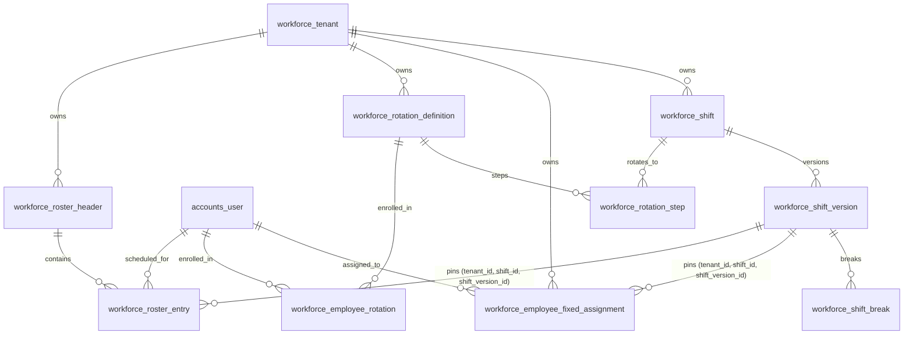

# STAGE 3 — PHASE A: ARCHITECTURE & SCHEMA DESIGN
## Employee Shift Assignment & Roster Management Engine
**Repository:** `pranshavsingh/HRMS`  
**Branch:** `feat/shift-roster-management`  
**Base Commit:** `c9d391a509fd6efec973d8deb3af3b920badff5b`  
**Target Engine:** MariaDB 11.8.9 (`127.0.0.1:3307/hrms_disposable_test`)  
**Design Date:** 2026-11-16  
**Status:** **GATE 2 COMPLETE — AWAITING EXPLICIT USER APPROVAL BEFORE MIGRATION 015**  

---

## 1. Executive Summary & Design Tenets

Stage 3 provides an enterprise-grade, concurrency-safe, and tenant-isolated **Employee Shift Assignment and Roster Management System**. It directly builds upon the immutable shift versions, canonical snapshots, and policy foundations created in Stage 2.

### Non-Negotiable Tenets:
1. **Critical Dependency Rule (Exact Version Pinning):**  
   Every employee assignment and roster entry references the exact published `shift_version_id`. Historical assignments and past roster entries are never retroactively repointed to mutable shift templates or newer versions.
2. **Defensive Immutability (Database Triggers):**  
   Published assignments and roster entries are strictly immutable. Updates to published records are blocked at the MariaDB storage engine layer via fail-closed triggers (`SIGNAL SQLSTATE '45000'`). Changing a schedule requires creating a new revision or replacement assignment.
3. **Deterministic Rotations:**  
   The rotation engine is purely deterministic: given an employee enrollment date, pattern cycle, step order, and work date, it calculates the exact shift and detects rest-period violations.
4. **Monotonic Lock Hierarchy:**  
   To eliminate race conditions and deadlocks, all assignment, rotation, and roster transactions adhere to a single global lock acquisition order.
5. **Zero Remote Contact (Air-Gap):**  
   All DDL, DML, and tests run exclusively on local MariaDB 11.8.9 at port 3307. Production server `srv999.hstgr.io` remains 100% untouched.

---

## 2. Entity Relationship Diagram (ERD)



---

## 3. Database Schema Specification (Migration 015)

Migration `015_workforce_assignments_and_roster.sql` will evolve the existing Stage 1 workforce tables and add required constraints, virtual columns, and immutability triggers.

### 3.1 Evolving `workforce_employee_fixed_assignment`

```sql
-- Add shift_version_id, lifecycle status, audit fields, and snapshot hashes
ALTER TABLE workforce_employee_fixed_assignment
  ADD COLUMN IF NOT EXISTS shift_version_id BIGINT NOT NULL AFTER shift_id,
  ADD COLUMN IF NOT EXISTS status ENUM('draft', 'published', 'superseded', 'cancelled') NOT NULL DEFAULT 'draft' AFTER shift_version_id,
  ADD COLUMN IF NOT EXISTS assignment_snapshot LONGTEXT NULL AFTER effective_to,
  ADD COLUMN IF NOT EXISTS snapshot_hash CHAR(64) NULL AFTER assignment_snapshot,
  ADD COLUMN IF NOT EXISTS created_by BIGINT NULL AFTER is_active,
  ADD COLUMN IF NOT EXISTS updated_by BIGINT NULL AFTER created_by,
  ADD COLUMN IF NOT EXISTS published_by BIGINT NULL AFTER updated_by,
  ADD COLUMN IF NOT EXISTS published_at DATETIME NULL AFTER published_by,
  ADD COLUMN IF NOT EXISTS cancelled_by BIGINT NULL AFTER published_at,
  ADD COLUMN IF NOT EXISTS cancelled_at DATETIME NULL AFTER cancelled_by,
  ADD COLUMN IF NOT EXISTS cancellation_reason VARCHAR(255) NULL AFTER cancelled_at,
  ADD COLUMN IF NOT EXISTS is_active_draft TINYINT GENERATED ALWAYS AS (
    CASE WHEN status = 'draft' THEN 1 ELSE NULL END
  ) VIRTUAL AFTER cancellation_reason;

-- Enforce composite foreign key to published shift version
ALTER TABLE workforce_employee_fixed_assignment
  ADD CONSTRAINT fk_wefa_shift_version
  FOREIGN KEY (tenant_id, shift_id, shift_version_id)
  REFERENCES workforce_shift_version(tenant_id, shift_id, id)
  ON DELETE RESTRICT;

-- Enforce single active draft per employee
ALTER TABLE workforce_employee_fixed_assignment
  ADD UNIQUE KEY uq_wefa_single_active_draft (tenant_id, user_id, is_active_draft);

-- Performance and lookup index
CREATE INDEX idx_wefa_tenant_user_dates ON workforce_employee_fixed_assignment(tenant_id, user_id, status, effective_from, effective_to);
```

### 3.2 Evolving `workforce_rotation_definition` & `workforce_rotation_step`

```sql
-- Evolve rotation definition
ALTER TABLE workforce_rotation_definition
  ADD COLUMN IF NOT EXISTS description VARCHAR(1000) NULL AFTER name,
  ADD COLUMN IF NOT EXISTS cycle_length_days INT NOT NULL DEFAULT 7 AFTER description,
  ADD COLUMN IF NOT EXISTS status ENUM('draft', 'published', 'archived') NOT NULL DEFAULT 'draft' AFTER cycle_length_days,
  ADD COLUMN IF NOT EXISTS created_by BIGINT NULL AFTER is_active,
  ADD COLUMN IF NOT EXISTS updated_by BIGINT NULL AFTER created_by,
  ADD COLUMN IF NOT EXISTS published_by BIGINT NULL AFTER updated_by,
  ADD COLUMN IF NOT EXISTS published_at DATETIME NULL AFTER published_by,
  ADD COLUMN IF NOT EXISTS archived_by BIGINT NULL AFTER published_at,
  ADD COLUMN IF NOT EXISTS archived_at DATETIME NULL AFTER archived_by,
  ADD COLUMN IF NOT EXISTS is_active_draft TINYINT GENERATED ALWAYS AS (
    CASE WHEN status = 'draft' THEN 1 ELSE NULL END
  ) VIRTUAL AFTER archived_at;

-- Evolve rotation step to support off-days and optional shift version hints
ALTER TABLE workforce_rotation_step
  ADD COLUMN IF NOT EXISTS is_off_day BOOLEAN NOT NULL DEFAULT 0 AFTER duration_days,
  ADD COLUMN IF NOT EXISTS shift_version_id BIGINT NULL AFTER is_off_day;

-- Evolve employee rotation enrollment
ALTER TABLE workforce_employee_rotation
  ADD COLUMN IF NOT EXISTS effective_to DATE NULL AFTER start_date,
  ADD COLUMN IF NOT EXISTS offset_days INT NOT NULL DEFAULT 0 AFTER initial_step_order,
  ADD COLUMN IF NOT EXISTS status ENUM('draft', 'published', 'superseded', 'cancelled') NOT NULL DEFAULT 'published' AFTER offset_days,
  ADD COLUMN IF NOT EXISTS created_by BIGINT NULL AFTER is_active,
  ADD COLUMN IF NOT EXISTS updated_by BIGINT NULL AFTER created_by,
  ADD COLUMN IF NOT EXISTS published_by BIGINT NULL AFTER updated_by,
  ADD COLUMN IF NOT EXISTS published_at DATETIME NULL AFTER published_by,
  ADD COLUMN IF NOT EXISTS cancelled_by BIGINT NULL AFTER published_at,
  ADD COLUMN IF NOT EXISTS cancelled_at DATETIME NULL AFTER cancelled_by,
  ADD COLUMN IF NOT EXISTS is_active_draft TINYINT GENERATED ALWAYS AS (
    CASE WHEN status = 'draft' THEN 1 ELSE NULL END
  ) VIRTUAL AFTER cancelled_at;
```

### 3.3 Evolving `workforce_roster_header` & `workforce_roster_entry`

```sql
-- Evolve roster header with team scope and snapshots
ALTER TABLE workforce_roster_header
  ADD COLUMN IF NOT EXISTS team_name VARCHAR(120) NULL AFTER department_id,
  ADD COLUMN IF NOT EXISTS name VARCHAR(255) NULL AFTER team_name,
  ADD COLUMN IF NOT EXISTS scope_type ENUM('all', 'team', 'custom') NOT NULL DEFAULT 'all' AFTER name,
  ADD COLUMN IF NOT EXISTS created_by BIGINT NULL AFTER version_number,
  ADD COLUMN IF NOT EXISTS updated_by BIGINT NULL AFTER created_by,
  ADD COLUMN IF NOT EXISTS archived_by BIGINT NULL AFTER published_at,
  ADD COLUMN IF NOT EXISTS archived_at DATETIME NULL AFTER archived_by,
  ADD COLUMN IF NOT EXISTS snapshot_hash CHAR(64) NULL AFTER archived_at;

-- Evolve roster entry with source tracking and snapshot hash
ALTER TABLE workforce_roster_entry
  ADD COLUMN IF NOT EXISTS source_type ENUM('fixed_assignment', 'rotation', 'manual', 'swap') NOT NULL DEFAULT 'manual' AFTER status,
  ADD COLUMN IF NOT EXISTS source_id BIGINT NULL AFTER source_type,
  ADD COLUMN IF NOT EXISTS note VARCHAR(255) NULL AFTER source_id,
  ADD COLUMN IF NOT EXISTS shift_snapshot LONGTEXT NULL AFTER note,
  ADD COLUMN IF NOT EXISTS snapshot_hash CHAR(64) NULL AFTER shift_snapshot;
```

---

## 4. Database Triggers (Immutability & Integrity Protection)

MariaDB triggers enforce fail-closed safety directly at the database layer.

### 4.1 Fixed Assignment Immutability Trigger
```sql
DELIMITER $$
CREATE TRIGGER trg_wefa_prevent_update_on_published
BEFORE UPDATE ON workforce_employee_fixed_assignment
FOR EACH ROW
BEGIN
    IF OLD.status IN ('published', 'superseded', 'cancelled') THEN
        -- Allow state transitions: published -> superseded or published -> cancelled
        -- Allow setting effective_to when superseded
        IF NOT (
            OLD.status = 'published' AND
            NEW.status IN ('published', 'superseded', 'cancelled') AND
            NEW.user_id = OLD.user_id AND
            NEW.shift_id = OLD.shift_id AND
            NEW.shift_version_id = OLD.shift_version_id AND
            NEW.effective_from = OLD.effective_from AND
            (OLD.effective_to IS NULL OR OLD.effective_to = NEW.effective_to) AND
            NEW.assignment_snapshot <=> OLD.assignment_snapshot AND
            NEW.snapshot_hash <=> OLD.snapshot_hash
        ) THEN
            SIGNAL SQLSTATE '45000'
            SET MESSAGE_TEXT = 'Immutability violation: Published fixed assignments cannot be modified';
        END IF;
    END IF;
END$$

CREATE TRIGGER trg_wefa_check_overlap_on_publish
BEFORE UPDATE ON workforce_employee_fixed_assignment
FOR EACH ROW
BEGIN
    DECLARE overlap_count INT DEFAULT 0;
    -- When publishing an assignment, verify no other published assignment overlaps
    IF NEW.status = 'published' AND (OLD.status != 'published' OR OLD.effective_to != NEW.effective_to) THEN
        SELECT COUNT(*) INTO overlap_count
        FROM workforce_employee_fixed_assignment
        WHERE tenant_id = NEW.tenant_id
          AND user_id = NEW.user_id
          AND id != NEW.id
          AND status = 'published'
          AND effective_from <= COALESCE(NEW.effective_to, '9999-12-31')
          AND COALESCE(effective_to, '9999-12-31') >= NEW.effective_from;
          
        IF overlap_count > 0 THEN
            SIGNAL SQLSTATE '45000'
            SET MESSAGE_TEXT = 'Overlap violation: Employee already has an active published assignment for this period';
        END IF;
    END IF;
END$$
DELIMITER ;
```

### 4.2 Roster Entry Immutability Triggers
```sql
DELIMITER $$
CREATE TRIGGER trg_wre_prevent_mutation_on_published_header
BEFORE UPDATE ON workforce_roster_entry
FOR EACH ROW
BEGIN
    DECLARE header_status VARCHAR(20);
    SELECT status INTO header_status FROM workforce_roster_header WHERE id = OLD.roster_header_id;
    IF header_status IN ('published', 'archived') THEN
        IF NOT (
            -- Only allow runtime operational status updates (e.g., completed, absent, swapped)
            NEW.roster_header_id = OLD.roster_header_id AND
            NEW.user_id = OLD.user_id AND
            NEW.work_date = OLD.work_date AND
            NEW.shift_id = OLD.shift_id AND
            NEW.shift_version_id = OLD.shift_version_id AND
            NEW.shift_snapshot <=> OLD.shift_snapshot AND
            NEW.snapshot_hash <=> OLD.snapshot_hash
        ) THEN
            SIGNAL SQLSTATE '45000'
            SET MESSAGE_TEXT = 'Immutability violation: Roster entries in published headers cannot be modified';
        END IF;
    END IF;
END$$

CREATE TRIGGER trg_wre_prevent_delete_on_published_header
BEFORE DELETE ON workforce_roster_entry
FOR EACH ROW
BEGIN
    DECLARE header_status VARCHAR(20);
    SELECT status INTO header_status FROM workforce_roster_header WHERE id = OLD.roster_header_id;
    IF header_status IN ('published', 'archived') THEN
        SIGNAL SQLSTATE '45000'
        SET MESSAGE_TEXT = 'Immutability violation: Roster entries in published headers cannot be deleted';
    END IF;
END$$
DELIMITER ;
```

---

## 5. Concurrency & Monotonic Lock Order

To eliminate race conditions and avoid deadlocks across multi-threaded transactions (e.g. concurrent bulk assignment, simultaneous publishing, or roster generation):

### Monotonic Lock Order Table
```
[1] workforce_shifts (Parent template row)
      ↓
[2] workforce_shift_versions (Specific version row)
      ↓
[3] accounts_user (Target employee row - serialized per employee)
      ↓
[4] workforce_employee_fixed_assignment / workforce_employee_rotation
      ↓
[5] workforce_roster_header (Roster scope row)
      ↓
[6] workforce_roster_entry (Individual date slot row)
```

**Rule:** Every service method acquiring row locks (`SELECT ... FOR UPDATE`) must acquire them in this strict top-to-bottom sequence. Multi-employee operations sort employee IDs numerically (`ORDER BY id ASC`) before locking.

---

## 6. Deterministic Rotation Engine Algorithm

Given:
- `E`: Employee enrollment with `start_date` ($D_0$) and `initial_step_order` ($S_0$)
- `R`: Rotation definition with steps $S = [s_1, s_2, ..., s_k]$, where step $s_i$ has `duration_days` $d_i$
- Total cycle length: $L = \sum_{i=1}^k d_i$
- Target work date: $D_t$

### Calculation Steps:
1. **Elapsed Days:** $\Delta = D_t - D_0$ (in integer calendar days). If $\Delta < 0$, the rotation has not started.
2. **Cycle Position:** $P = (\Delta + \text{offset}) \pmod L$.
3. **Step Resolution:** Iterate cumulatively through steps $s_i \in S$ until cumulative days $> P$.
4. **Shift Assignment:**
   - If $s_i.\text{is\_off\_day} = 1$, the employee has a designated weekly off.
   - Otherwise, resolve the active published `shift_version_id` for $s_i.\text{shift\_id}$ effective on $D_t$.

---

## 7. Minimum Rest Period & Overnight Attribution

### 7.1 Minimum Rest Calculation
Between consecutive work dates $D_1$ and $D_2$:
$$\text{Rest Period} = \text{Start Time}(D_2) - \text{End Time}(D_1)$$
- If Shift 1 is overnight (`start_time = 22:00`, `end_time = 06:00`), its end timestamp is $(D_1 + 1\text{ day}) \text{ 06:00:00}$.
- If Shift 2 starts on $D_2 = D_1 + 1$ at `14:00`, the rest duration is $14:00 - 06:00 = 8\text{ hours}$.
- If configured company policy requires $\ge 11\text{ hours}$ rest, the rotation engine rejects or flags the schedule with `REST_PERIOD_VIOLATION`.

### 7.2 Overnight Date Attribution
- A shift scheduled for work date `2026-11-20` starting at `22:00` and ending at `06:00` has `work_date = '2026-11-20'`.
- It remains strictly attributed to `2026-11-20` on all calendars and attendance records. It is never shifted to `2026-11-21`.

---

## 8. API Specification & REST Contracts

### 8.1 Shift Assignment Endpoints (`/api/v1/workforce/assignments`)
- `GET /api/v1/workforce/assignments`: List assignments with filters (`user_id`, `team`, `status`, `page`, `limit`).
- `GET /api/v1/workforce/assignments/:id`: Retrieve assignment details, including frozen shift snapshot and break details.
- `POST /api/v1/workforce/assignments`: Create a draft fixed assignment (`user_id`, `shift_id`, `shift_version_id`, `effective_from`, `effective_to`).
- `POST /api/v1/workforce/assignments/:id/publish`: Publish draft assignment, freeze RFC 8785 snapshot, and supersede conflicting older versions.
- `POST /api/v1/workforce/assignments/:id/cancel`: Cancel an active assignment with audit reason.
- `POST /api/v1/workforce/assignments/bulk`: Atomic bulk assignment with structured validation summary.

### 8.2 Rotation Pattern Endpoints (`/api/v1/workforce/rotations`)
- `GET /api/v1/workforce/rotations`: List rotation definitions.
- `POST /api/v1/workforce/rotations`: Create rotation definition with steps.
- `POST /api/v1/workforce/rotations/:id/publish`: Publish rotation pattern.
- `POST /api/v1/workforce/rotations/:id/enroll`: Enroll employee into rotation (`user_id`, `start_date`, `initial_step_order`).
- `GET /api/v1/workforce/rotations/:id/preview`: Preview generated schedule for a date range.

### 8.3 Roster Management Endpoints (`/api/v1/workforce/rosters`)
- `GET /api/v1/workforce/rosters`: List roster headers by date range and team.
- `POST /api/v1/workforce/rosters/generate`: Generate draft roster from active assignments and rotations for a date range (`start_date`, `end_date`, `team_name`).
- `GET /api/v1/workforce/rosters/calendar`: Retrieve calendar matrix (Daily, Weekly, Monthly) with employee rows.
- `POST /api/v1/workforce/rosters/:id/publish`: Atomically publish roster header and entries.
- `GET /api/v1/workforce/my-roster`: Employee self-service endpoint returning personal upcoming schedule and shift timings.

---

## 9. Role-Based Access Control (RBAC) Matrix

| Endpoint Action | Super Admin | Admin | HR Manager | Team Manager | Employee |
| :--- | :---: | :---: | :---: | :---: | :---: |
| List & View All Assignments | ALLOW | ALLOW | ALLOW | ALLOW (Team only)| DENY (403) |
| Create Draft Assignment | ALLOW | ALLOW | ALLOW | DENY (403) | DENY (403) |
| Publish Assignment | ALLOW | ALLOW | ALLOW | DENY (403) | DENY (403) |
| Cancel Assignment | ALLOW | ALLOW | ALLOW | DENY (403) | DENY (403) |
| Bulk Shift Assignment | ALLOW | ALLOW | ALLOW | DENY (403) | DENY (403) |
| Manage Rotation Patterns | ALLOW | ALLOW | ALLOW | DENY (403) | DENY (403) |
| Generate & Publish Rosters | ALLOW | ALLOW | ALLOW | DENY (403) | DENY (403) |
| View Calendar Schedules | ALLOW | ALLOW | ALLOW | ALLOW (Team only)| DENY (403) |
| View Personal Schedule (`my-roster`) | ALLOW | ALLOW | ALLOW | ALLOW | ALLOW |

---

## 10. Frontend & Mobile Architecture

### 10.1 Web Application (`hrms_saas`)
- **Shift Assignments Tab:** Employee selector, published shift version selector, effective date picker, conflict validator, draft/publish action, assignment history timeline.
- **Rotation Builder Tab:** Multi-step rotation sequence builder (Morning -> Evening -> Off), duration days, preview calendar.
- **Roster Calendar:** Interactive FullCalendar/Timeline view with Day/Week/Month toggles, team filter, overnight shift badge, draft/published color coding.
- **Bulk Assignment Modal:** Multi-employee checklist, team select-all, shift version picker, pre-flight conflict summary modal.

### 10.2 Mobile Application (`hrms_mobile`)
- **Roster Schedule Card in Portal:** Dedicated upcoming schedule widget on `dashboard.tsx` showing current assigned shift, today's timings, and 7-day upcoming roster.
- **Overnight Shift Formatting:** Displays `22:00 - 06:00 (+1 day)` clearly so employees know their overnight work schedule.

---

## 11. Test Strategy & Verification Matrix

| Test Suite | Focus Area | Assertions / Scenarios |
| :--- | :--- | :--- |
| **Suite 1: Migration 015** | DDL verification, column addition, FK constraints, idempotency, checksum. | 8 assertions |
| **Suite 2: Fixed Assignments** | Draft creation, exact version pinning, single draft constraint, publication, superseding. | 12 assertions |
| **Suite 3: Rotation Engine** | Deterministic calculations, multi-step cycles, offset handling, minimum rest validation. | 10 assertions |
| **Suite 4: Roster Calendar** | Date range generation, daily/weekly/monthly views, overnight attribution, team filtering. | 10 assertions |
| **Suite 5: Concurrency & Locks** | Dual-connection concurrent assignment and concurrent roster publishing serialization. | 4 assertions |
| **Suite 6: Attendance Regression**| Verifying `punch_in_status`, `punch_out_status`, `punctuality_status`, and punch lifecycle remain 100% intact. | 4 assertions |

---

## 12. Migration & Rollback Strategy

1. **Preflight Validator (`preflight_015.mjs`):** Confirms connection to MariaDB 11.8.9 at port 3307, confirms migrations 001-014 recorded in ledger, verifies `workforce_shift_version` has published canonical shifts.
2. **Execution:** Migration applied through `node_backend/scripts/run-migrations.js` preserving delimiter syntax.
3. **Postflight Validator (`postflight_015.mjs`):** Confirms all 4 new triggers created, all altered columns present, and re-run idempotency passes.
4. **Recovery Plan:** If partial DDL failure occurs, safe idempotent `DROP TRIGGER IF EXISTS` and `ALTER TABLE ... DROP COLUMN IF EXISTS` scripts allow clean rollback and re-application.

---

## 13. Stop Gate & Approval Request

> [!IMPORTANT]
> **GATE 2 COMPLETE — AWAITING EXPLICIT USER APPROVAL**  
> Per Section 13 and Section 17 of the Master Prompt:
> *"Stop and wait for explicit user approval before creating or executing database migrations."*
> 
> The Discovery Report (`STAGE_3_PHASE_A_DISCOVERY_REPORT.md`) and Schema & Architecture Design (`STAGE_3_PHASE_A_SCHEMA_AND_ARCHITECTURE_DESIGN.md`) are complete and verified.
> 
> Database implementation (Migration 015) will proceed immediately upon your explicit approval.
