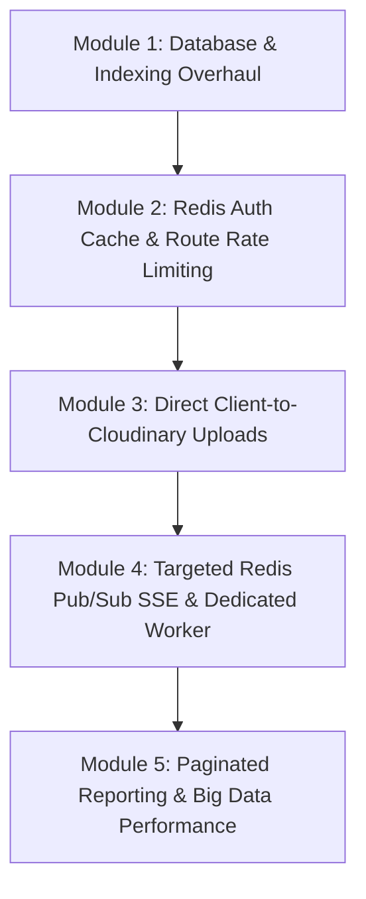

# Enterprise Production Readiness Blueprint: 8,000 Users / 2,000 Concurrency

## Executive Summary
An exhaustive audit of the HRMS codebase (`node_backend`, `hrms_saas`, `hrms_mobile`) identified that the current architecture is **not yet production-ready** for 1,000–2,000 concurrent users and 5,000–8,000 registered employees. 

On a **Hostinger VPS KVM 4 (4 vCPU, 16 GB RAM, 200 GB NVMe)**, the application will experience event-loop freezing, memory exhaustion (OOM), HTTP 504 timeouts, and rate-limit lockouts during morning peak punch-in windows without architectural remediation.

This blueprint establishes the production-grade architecture agreed upon during the architecture alignment, broken into 5 interactive implementation modules.

---

## 1. Baseline Bottlenecks Identified

```
[ Current Request Path - Morning 9:00 AM Rush ]
2,000 Users (Selfie Multi-part 2MB)
       │
       ▼
 [ express-rate-limit ] ───▶ Locked out after 300 reqs (Corporate NAT IP Blocked!)
       │
       ▼
 [ Node Single Event Loop ] ───▶ Holds 2GB-4GB image buffers in RAM (OOM Crash Risk)
       │
       ├───▶ Synchronous Cloudinary Outbound Streams (1,000+ open HTTP sockets)
       │
       ├───▶ MySQL Connection Pool (connectionLimit: 10) (Massive wait queue)
       │
       ├───▶ N+1 Approval Loop (Sequential INSERT for 20-50 reviewers)
       │
       └───▶ In-Memory SSE Broadcast (1,000,000 writes across 2,000 connections)
```

---

## 2. Target High-Throughput Architecture

```
[ Optimized Enterprise Request Path ]
2,000 Users (Browser / Mobile)
       │
       ├─────────────────────────────────┐
       ▼ (1. 2ms Sign Request)           ▼ (2. Direct Upload Image 2MB)
[ Nginx Reverse Proxy (SSL/Gzip) ]  [ Cloudinary Edge CDN ]
       │                                 │
       ▼ (3. Pure JSON Payload ~200B)    │ (Returns Public ID)
[ PM2 Cluster (4 API Instances) ] ◀──────┘
       │
       ├───▶ [ Redis Cache ] (User auth session checked in 0.2ms)
       │
       ├───▶ [ MySQL Pool (120 conns) ] (Indexed queries + Batch INSERT)
       │
       ├───▶ [ Redis Pub/Sub ] ───▶ Targeted SSE to Manager/HR ONLY
       │
       └───▶ [ Dedicated PM2 Worker ] ◀── [ BullMQ Queue ] (Emails & Cron Cleanup)
```

---

## 3. Server Capacity & Sizing (Hostinger VPS KVM 4)

| Component | Allocation | Role |
| :--- | :--- | :--- |
| **OS & Nginx** | 1 vCPU / 1 GB RAM | SSL termination, static React asset delivery, reverse proxying |
| **PM2 Cluster (API)** | 2.5 vCPU / 4 GB RAM | 4 Node.js worker instances handling REST traffic (1 GB heap each) |
| **MySQL 8.0** | 0.5 vCPU / 8 GB RAM | `innodb_buffer_pool_size = 6G`, `max_connections = 250` |
| **Redis 7.x** | Shared / 1.5 GB RAM | Auth cache, session revocation, BullMQ, SSE Pub/Sub |
| **PM2 Worker** | Shared / 1 GB RAM | 1 isolated Node process for cron jobs and background email queue |

---

## 4. Five-Stage Implementation Roadmap



### Module 1: Database & Indexing Overhaul
- **Composite Indexes**:
  - `attendance_attendance(user_id, date)`
  - `attendance_attendance(date, status)`
  - `attendance_attendanceapproval(attendance_id, status)`
  - `attendance_attendanceapproval(approved_by_id, status)`
  - `leave_leave(user_id, status, from_date, to_date)`
  - `accounts_user(role, is_active, deleted_at)`
- **Connection Pool Optimization**:
  - Scale pool to 25–35 connections per PM2 worker (100–140 total pool size).
  - Configure keepalive, idle timeout, and bounded queue limits.
- **Batch Approval Insertion**:
  - Replace N+1 sequential loops in `attendance.service.js` with single multi-row `INSERT INTO attendance_attendanceapproval VALUES (...)`.

### Module 2: Redis Auth Caching & Tiered Rate Limiting
- **Redis Service**: Resilient Redis client with automatic reconnect and graceful fallbacks.
- **Auth Cache**:
  - Cache active user metadata in `user:session:<userId>` for 5 minutes.
  - Intercept incoming requests in `middleware/auth.js` via Redis in <1ms, bypassing 99% of MySQL auth queries.
  - Automatic cache invalidation on password reset, role update, or deactivation.
- **Route-Tiered Rate Limiter**:
  - Rate limit authenticated routes per `userId` (1,200 req/min).
  - Rate limit unauthenticated routes (`/login`) per IP (15 req/min) using Redis store (`rate-limit-redis`).

### Module 3: Direct Client-to-Cloudinary Signed Uploads
- **Presigned Upload Signature**:
  - Server exposes `/api/v1/attendance/signed-upload-params`.
  - Client uploads directly to Cloudinary edge servers.
- **Payload Minimization**:
  - Punch-in and punch-out accept `{ latitude, longitude, photo_url, public_id }` as JSON.
  - Server bypasses handling heavy 2MB multipart binaries across 2,000 concurrent devices.

### Module 4: Targeted Redis Pub/Sub SSE & PM2 Worker Isolation
- **Targeted SSE**:
  - Subscribe to Redis channels: `channel:superadmin`, `channel:hr`, `channel:manager:<managerId>`, `channel:user:<userId>`.
  - Normal employees do not receive global punch broadcasts.
- **Worker Isolation**:
  - `ecosystem.config.cjs`: 4 cluster instances for `src/server.js`, 1 fork instance for `src/worker.js`.
  - Migrate all node-cron jobs and BullMQ queue consumers to `src/worker.js`.

### Module 5: Paginated Reporting & Big Data Performance
- **Server-Side Pagination**:
  - `teamAttendance` refactored to support `page=1&limit=50` and department filtering.
  - Eliminate loading 8,000 employees and 240,000 rows into Node memory.
- **Algorithmic Fix**:
  - Replace $O(N \times M)$ 2-billion iteration nested filter loop with $O(1)$ Map indexing.

---

## 5. Enterprise Security & Production Hardening (Completed)

| Area | Implementation Details | Status |
| :--- | :--- | :--- |
| **Password Cryptography** | Upgraded to **Bcrypt** (12 rounds) with unique salt per user. Added transparent auto-migration on login from legacy PBKDF2 hashes. | ✅ Implemented |
| **Memory DOS Protection** | Enforced 5MB file size ceiling in Multer memory storage with centralized `MulterError` handling. | ✅ Implemented |
| **Secrets & Boot Validation** | Startup fail-fast validator in `env.js` that halts production boot if default placeholders (`change-me-...`) are detected. | ✅ Implemented |
| **Process Lifecycle & Draining** | Intercepts `SIGTERM`/`SIGINT`, stops new connections, drains in-flight requests (15s ceiling), and drains MySQL/Redis pools. Configured PM2 `wait_ready: true` for zero-downtime rolling reload. | ✅ Implemented |
| **Health Observability** | Added deep `/health/ready` probe inspecting MySQL and Redis ping latency, memory RSS/heap, and system uptime. | ✅ Implemented |
| **Automated Data Protection** | Automated 2:00 AM daily database backup routine with `mysqldump`, streaming fallback, and 30-day retention pruning. | ✅ Implemented |

