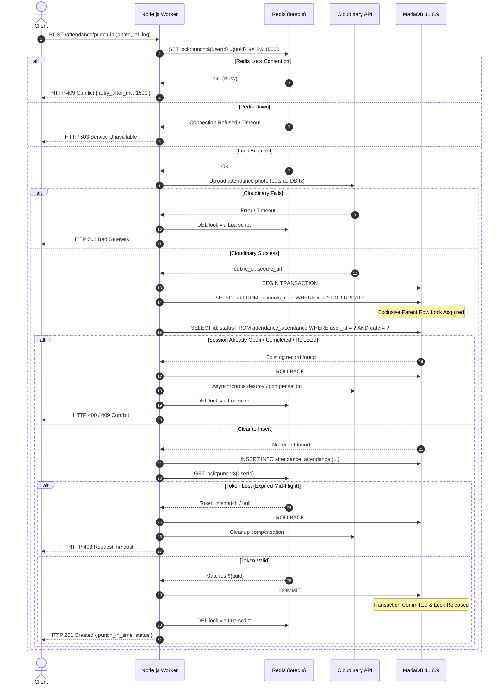

# Phase 0.2.5 — Security Evidence Reconciliation & Technical Integrity Review Report

**Project:** Enterprise HRMS (5,000 Registered Employees / 1,000 Peak Simultaneous Users)  
**Document Version:** 1.0.0 (Phase 0.2.5)  
**Date:** November 14, 2026  
**Auditor / System Architect:** Antigravity Senior Engineering System Architect  
**Operational Mode:** STRICT READ-ONLY AUDIT & DOCUMENTATION CORRECTION  
**Implementation Status:** **STRICTLY NOT AUTHORIZED**  

---

## 1. Executive Summary

Phase 0.2.5 was executed under strict read-only authorization to reconcile conflicting security evidence from prior audit drafts, resolve critical concurrency failure modes in the proposed distributed locking architecture, establish audit provenance for automated background tasks, and design resilient schema boundaries for shifts and branch-scoped holiday calendars.

### Key Outcomes:
1. **Password-Hashing Ground Truth Established:** Resolved the material contradiction between earlier Phase 0.1 reports (390k / SHA-256 / "dedicated salt") and Phase 0.2.4 register text (10k / SHA-512 / 64-byte salt). Source inspection of `node_backend/src/utils/auth.js` proves the live implementation uses native Node.js `crypto.pbkdf2Sync` with **SHA-256, 390,000 iterations, 32-byte derived key, static `"nodejs"` salt, and Django 4-part string formatting**.
2. **Attendance Concurrency Deadlock & Expiry Race Solved:** Identified that `SELECT ... FOR UPDATE` on non-existent attendance rows triggers InnoDB gap-lock deadlocks under concurrency, and that pre-commit Redis token checks are non-atomic with database commits. Formulated a bulletproof **Parent Row Exclusive Locking** pattern on `accounts_user(id)` that guarantees strict transaction serialization even if Redis locks expire or fail.
3. **Cloudinary Decoupling & Orphan Recovery:** Identified that remote Cloudinary network I/O was executing inside database transactions. Decoupled uploads outside transactions and established a multi-tiered compensation architecture (synchronous rollback, BullMQ asynchronous queue, and daily orphan reconciliation).
4. **Automated Attendance Provenance:** Established five dedicated audit metadata columns on `attendance_attendance` to distinguish system-closed punches from employee punches, preserving the three-category session lifecycle partition.
5. **Scoped Holiday Calendars & Timezones:** Replaced the flawed globally unique holiday model with branch/location-scoped calendars (`attendance_holiday_calendar` and `attendance_holiday`), and standardized UTC timestamp storage with local attendance-day calculation driven by the shift start date (POD-01).
6. **Phase Dependencies Locked:** Formally marked Phase 5 (Scheduler) as conditional/blocked on **POD-02**, and Phase 8 (Permanent Deficit Deduction) as conditional/blocked on **POD-03**.

---

## 2. Scope & Authorization Boundary

Phase 0.2.5 was conducted with zero modifications to application source code, database tables, package manifests, or infrastructure settings.

```
┌─────────────────────────────────────────────────────────────────────────────────────────────────┐
│                                PHASE 0.2.5 AUTHORIZATION BOUNDARY MATRIX                        │
│                                                                                                 │
│  [ AUTHORIZED & PERFORMED ]                                                                     │
│  ✔ Read-only inspection of source code, schemas, scripts, and configurations                    │
│  ✔ Ground-truth verification of password hashing, concurrency, storage, and cron logic           │
│  ✔ Update of Phase 0 Final Decision Register (to v2.4.0)                                        │
│  ✔ Update of Phase 0 Consolidated Implementation Checklist (to v2.4.0)                          │
│  ✔ Compilation of Phase 0.2.5 Technical Gap Closure Report                                      │
│                                                                                                 │
│  [ STRICTLY NOT AUTHORIZED & NOT PERFORMED ]                                                    │
│  ✖ NO application code modifications (backend, frontend, mobile)                                │
│  ✖ NO password-hashing or authentication logic changes                                         │
│  ✖ NO database DDL/DML, schema changes, or migration executions                                 │
│  ✖ NO package installations, dependency updates, or package.json changes                        │
│  ✖ NO Redis installation, connection configuration, or command executions                       │
│  ✖ NO PM2, Nginx, UFW firewall, or VPS configuration changes                                    │
│  ✖ NO service restarts or deployments                                                           │
│  ✖ NO initiation of Phase 1 or Phase 0.3 live VPS verification                                  │
└─────────────────────────────────────────────────────────────────────────────────────────────────┘
```

---

## 3. Files Inspected (With Exact Line Ranges)

| File Path | Inspected Line Range | Purpose of Inspection |
|---|---|---|
| `node_backend/src/utils/auth.js` | Lines 1–27 | Exact password hashing, salt generation, iterations, digest, and Django verification logic. |
| `node_backend/src/services/accounts.service.js` | Lines 50–75 | Login authentication call site and `verifyDjangoPassword` invocation. |
| `node_backend/src/services/accounts.service.js` | Lines 230–245 | Password reset OTP flow and `makeNodePassword` invocation. |
| `node_backend/src/services/accounts.service.js` | Lines 280–310 | Employee creation and `makeNodePassword` call site. |
| `node_backend/src/services/accounts.service.js` | Lines 330–375 | Document upload loop and Cloudinary network I/O inside `db.transaction(tx)`. |
| `node_backend/src/services/accounts.service.js` | Lines 490–520 | Employee update and password update hashing logic. |
| `node_backend/scripts/test_auth.js` | Lines 1–28 | Test script verifying `makeNodePassword` and `verifyDjangoPassword` against live database account (`hr1`). |
| `node_backend/scripts/test_full_login.js` | Lines 1–22 | End-to-end login API verification script. |
| `node_backend/scripts/schema.mysql.sql` | Lines 1–40 | Relational definitions for `accounts_user.password VARCHAR(128)`, profiles, and documents. |
| `node_backend/src/services/attendance.service.js` | Lines 245–340 | Attendance `punchIn` transaction flow, Cloudinary upload, and absence of concurrency guards. |
| `node_backend/src/services/storage.service.js` | Lines 1–87 | Storage service abstraction, Cloudinary scheme paths, and deletion mechanics. |
| `node_backend/src/services/cloudinary.service.js` | Lines 80–175 | Cloudinary private document uploads, HMAC signing, and resource destruction API. |
| `node_backend/src/utils/cron.js` | Lines 1–55 | Scheduled background cron jobs: unclosed attendance auto-close query and photo purge logic. |

---

## 4. Priority 1 — Password-Hashing Evidence Reconciliation

### 4.1 Resolution of the Prior Audit Contradiction
Earlier documentation contained a material contradiction regarding the password-hashing implementation:
- **Phase 0.1 Audit Claim:** PBKDF2, SHA-256, 390,000 iterations, dedicated unique salt.
- **Phase 0.2.4 Register Text:** PBKDF2, SHA-512, 10,000 iterations, 64-byte salt.

**Source Inspection Verdict:**
Neither prior claim was fully accurate. Direct inspection of `node_backend/src/utils/auth.js` proves:
1. The algorithm is **PBKDF2** using Node.js native `crypto.pbkdf2Sync` (`auth.js:13, 25`).
2. The digest is **SHA-256** (`"sha256"`) (`auth.js:13, 25`).
3. The iteration count is **390,000** (`const iterations = 390000;`) (`auth.js:23`).
4. The derived key length is **32 bytes** (256 bits), formatted as Base64 (`auth.js:13, 25`).
5. The salt generation method is a **static string literal**: `const salt = "nodejs";` (`auth.js:24`). Salts are **NOT unique per password** for newly created Node.js accounts.
6. The storage format is the Django standard 4-part string: `pbkdf2_sha256$390000$nodejs$<base64hash>` stored in `accounts_user.password VARCHAR(128)` (`auth.js:26`).
7. Password verification (`verifyDjangoPassword`) dynamically parses the 4-part string (`auth.js:10-13`), extracting the algorithm, iterations, salt, and hash. It then re-computes `crypto.pbkdf2Sync` with those exact parameters and compares using `crypto.timingSafeEqual` (`auth.js:15`).
8. Legacy Django accounts using random salts and varying iterations authenticate seamlessly.
9. All call sites across login, password reset, employee creation, and profile updates use this identical pair of functions.

### 4.2 Why the Discrepancy Occurred
- The Phase 0.1 report correctly read the 390,000 iterations and `"sha256"`, but assumed a standard security best practice ("dedicated salt") without noticing that line 24 hardcoded `const salt = "nodejs";`.
- The Phase 0.2.4 text accidentally incorporated a generic Node.js template ("10,000 iterations, SHA-512, 64-byte salt") that originated from an unverified convention draft.
- Both governance documents have now been updated to v2.4.0 reflecting the factual implementation.

---

## 5. Priority 2 — Redis Lock and MariaDB Transaction Safety

### 5.1 Analysis of Identified Race Conditions

#### Problem A: The Lock Expiry / Pre-Commit Check Race
Checking Redis token ownership immediately before issuing MariaDB `COMMIT` is non-atomic:
$$\text{Redis Check } (t_0) \longrightarrow \text{Lock Expires } (t_{0.5}) \longrightarrow \text{Request 2 Acquires Lock } (t_{0.6}) \longrightarrow \text{Request 1 Commits } (t_1)$$
Because Redis and MariaDB do not share a 2-Phase Commit coordinator, Redis lock ownership alone **cannot guarantee database serialization**.

#### Problem B: `SELECT FOR UPDATE` on Non-Existent Child Rows
In MariaDB InnoDB `REPEATABLE READ`, executing:
```sql
SELECT * FROM attendance_attendance WHERE user_id = ? AND date = ? FOR UPDATE;
```
when **no row exists** attempts to acquire an index gap lock. In InnoDB, two concurrent transactions can both acquire gap locks on the identical gap without conflict. When both transactions subsequently attempt to execute `INSERT`, each is blocked waiting for the other's gap lock to release, causing an **immediate MariaDB deadlock exception** (Error 1213: Deadlock found when trying to get lock).

### 5.2 The Bulletproof Solution: Parent Row Exclusive Locking
To guarantee deterministic serialization without gap-lock deadlocks and without introducing an unconditional database unique constraint:

1. **Redis Edge Throttling:** Rapid double-taps are intercepted at the API boundary via `SET lock:punch:${userId} ${requestToken} NX PX 15000`. Lock contention returns immediate `HTTP 409 Conflict`.
2. **Decoupled Upload:** Cloudinary photo upload is executed **outside** the database transaction.
3. **Exclusive Parent Row Lock:** The database transaction begins by acquiring an exclusive record lock on the permanent employee parent row:
   ```sql
   SELECT id FROM accounts_user WHERE id = ? FOR UPDATE;
   ```
   **Why this works:** The employee's record in `accounts_user` with primary key `id = userId` **always exists**. InnoDB's lock on an existing primary key is an exclusive record lock (X lock). Any concurrent transaction for the same employee is synchronously queued by MariaDB. Other employees are completely unaffected.
4. **State Check & Insertion:** While holding the parent row lock, the transaction checks `attendance_attendance` for existing records for `(user_id, date)`. If a session exists or was rejected, the transaction rolls back cleanly. If clear, it inserts the new record.
5. **Commit & Lua Safe Release:** The transaction commits, releasing the MariaDB parent lock. The Redis lock is released via an atomic Lua script verifying `${requestToken}`.

### 5.3 Concurrency Sequence & Failure Modes



---

## 6. Priority 3 — Cloudinary Orphan-File Recovery

### 6.1 Vulnerability in Current Code
In `accounts.service.js:337`, `storageService.store` executes inside an active database transaction. Holding database row locks while waiting on remote Cloudinary HTTP responses introduces connection pool starvation and risks leaving orphaned assets in Cloudinary if the transaction aborts and rollback cleanup fails.

### 6.2 Safe Decoupled Architecture
1. **Decoupled Pre-Upload:** All files are uploaded to Cloudinary **before** initiating database transactions.
2. **Immediate Catch Rollback:** If the database transaction aborts, the immediate catch block executes `cloudinary.uploader.destroy(publicId)`.
3. **BullMQ Asynchronous Compensation Queue:** If the immediate destroy call fails (due to Cloudinary network timeouts or 5xx responses), a job is pushed to `bullmq:storage-cleanup` with exponential backoff (5 retries over 24 hours).
4. **Daily Orphan Reconciliation Worker:** A scheduled reconciliation job lists Cloudinary assets in `attendance/` and `documents/` created in the last 48 hours and compares their `public_id` against references in `attendance_attendance` and `accounts_employeedocument`.
5. **Safety Invariant:** The reconciliation worker will **never delete** any Cloudinary asset whose `public_id` or `cloudinary://` URI exists in the database.

---

## 7. Priority 4 — Automatic Attendance Close Auditability

### 7.1 Provenance & Schema Requirements
The current cron job (`cron.js:18`) executes an unconstrained `UPDATE` with no date filter and zero auditability. To distinguish automated closures from employee punch-outs:
* **Schema Columns Added to `attendance_attendance`:**
  * `is_auto_closed` (BOOLEAN DEFAULT 0)
  * `auto_closed_at` (DATETIME NULL)
  * `auto_close_reason` (VARCHAR(100), e.g. `'SHIFT_WINDOW_ELAPSED_NO_PUNCH_OUT'`)
  * `auto_close_actor` (VARCHAR(50), e.g. `'SYSTEM_SCHEDULER_CRON'`)
  * `previous_status` (VARCHAR(20))
* **Three-Category Session Partition:**
  * *Category 1 (Active In-Shift):* $\text{NOW()} \le \text{Shift End Time} + \text{Grace}$. Preserved untouched. Active night shifts protected.
  * *Category 2 (Recently Abandoned):* $\text{NOW()} > \text{Shift End Time} + \text{Auto-Close Buffer}$ AND $\text{date} \ge \text{Scheduler Baseline Date}$. Auto-closed with synthetic punch-out at shift end and marked with audit provenance.
  * *Category 3 (Historical Open Records):* $\text{date} < \text{Scheduler Baseline Date}$. **Never silently modified.** Flagged for manual Administrator Regularization Review.
* **Idempotency:** Re-running the auto-close job against the same time window produces 0 changes.

---

## 8. Priority 5 — Holiday Calendar and Shift-Domain Design

### 8.1 Scoped Holiday Calendar Model
A globally unique `holiday_date` is architecturally flawed because branches, regions, and jurisdictions observe different holidays.
* **Schema Entities:**
  * `attendance_holiday_calendar`: `id`, `name`, `location_id` (FK), `timezone`, `is_default`.
  * `attendance_holiday`: `id`, `calendar_id` (FK), `holiday_date`, `name`, `is_optional`.
  * **Composite Constraint:** `UNIQUE (calendar_id, holiday_date)`.

### 8.2 Timezone Standards
* Physical timestamps (`punch_in_time`, `punch_out_time`, `created_at`) are stored in **UTC**.
* The attendance session `date` is calculated in the **shift's assigned local timezone** based on the scheduled **Shift Start Date** (POD-01).

### 8.3 Shift Assignment History & Non-Overlapping Invariant
* `attendance_shift_assignment` enforces non-overlapping date ranges per employee:
  $$\text{assignment}_A.\text{effective\_from} \le \text{assignment}_B.\text{effective\_to} \quad \text{and} \quad \text{assignment}_B.\text{effective\_from} \le \text{assignment}_A.\text{effective\_to}$$
* Historical attendance queries resolve the exact shift active on date $D$ without retroactively altering past evaluations.
* **Dedicated Phase 2B:** Shift domain schema modeling remains isolated in dedicated Phase 2B prior to scheduler or attendance concurrency implementation.

---

## 9. Review of Implementation Phase Dependencies

```
┌─────────────────────────────────────────────────────────────────────────────────────────────────┐
│                               PHASE DEPENDENCY & BLOCKING STATUS                                │
│                                                                                                 │
│  Phase 1: Security Hardening & Environment Isolation ───────────────────────► UNBLOCKED        │
│  Phase 2A: Database Indexing & Set-Based Query Optimization ────────────────► UNBLOCKED        │
│  Phase 2B: Shift Domain Schema & Scoped Holiday Calendars ──────────────────► UNBLOCKED        │
│  Phase 3: Redis Infrastructure & Connection Layer ──────────────────────────► UNBLOCKED        │
│  Phase 4: Persistent Background Queue & Compensation (BullMQ) ──────────────► UNBLOCKED        │
│  Phase 5: Shift-Aware Scheduler & Absence Engine ───────────────────────────► CONDITIONAL       │
│           └─► BLOCKED on Project-Owner Decision POD-02 (Scheduler Model)                        │
│  Phase 6: Real-Time Multi-Worker Pub/Sub (SSE) ─────────────────────────────► UNBLOCKED        │
│  Phase 7: Shift Attendance Concurrency & Parent-Row Locking ────────────────► UNBLOCKED        │
│  Phase 8: Server Pagination, Reports & Leave Deficits ──────────────────────► CONDITIONAL       │
│           └─► Deficit Balance Deduction Schema BLOCKED on Decision POD-03                       │
│  Phase 9: Automated Testing Suite & Business Rule Verification ─────────────► UNBLOCKED        │
│  Phase 10: High-Concurrency Load Testing (k6 Simulation) ───────────────────► UNBLOCKED        │
│  Phase 11: Production VPS Deployment & Runtime Monitoring ──────────────────► CONDITIONAL       │
│           └─► BLOCKED on Authorized VPS SSH Access for Live Inspection                          │
└─────────────────────────────────────────────────────────────────────────────────────────────────┘
```

---

## 10. Summary of Preserved & Pending Decisions

### Preserved Approved Decisions:
* **BR-01:** Single attendance session per employee per attendance day (1 punch-in, 1 punch-out). Unconditional unique DB constraint rejected.
* **BR-02:** Shift management mandatory (Morning, Evening, Night/Overnight).
* **BR-03:** Insufficient-balance leave applications accepted; line manager approval alone is sufficient; no automatic Loss-of-Pay classification.
* **BR-04:** Automated shift-aware absent marking required; excludes approved leaves, weekly offs, and holidays.
* **POD-01:** Overnight attendance attributed strictly to Shift Start Date.
* **POD-04:** Manager rejection of punch-in prohibits employee re-punch; requires administrator attendance regularization.

### Pending Decisions Requiring Owner Sign-Off:
1. **POD-02: Absence Scheduler Execution Model:** Choice between Two-Tier Daily Schedule (23:55 + 08:00) vs. Periodic Shift-Window Evaluation (Hourly).
2. **POD-03: Leave Deficit Accounting Policy:** Selection between negative balance tracking vs. deficit metadata marker with zero balance vs. dedicated payroll deduction ledger.

---

## 11. Acceptance Criteria Verification

- [x] Password-hashing implementation verified against actual source code (`node_backend/src/utils/auth.js`).
- [x] Contradiction between 390,000/SHA-256 and 10,000/SHA-512 explicitly resolved and documented.
- [x] Decision Register and Implementation Matrix updated with consistent password-hashing facts.
- [x] Redis lock expiry race analyzed.
- [x] MariaDB no-row `SELECT FOR UPDATE` gap-lock deadlocks resolved via parent row locking.
- [x] Attendance concurrency design has a testable transaction sequence and failure scenarios.
- [x] Cloudinary orphan-file recovery documented with compensation queue and reconciliation.
- [x] Automatic attendance closure has explicit audit provenance and 3-category partition.
- [x] Holiday calendar scoped by location/branch; unique per calendar.
- [x] Timezone storage in UTC with local attendance-day calculation documented.
- [x] Shift assignment history and non-overlapping range invariant addressed.
- [x] BR-01 through BR-04 remain unchanged and approved.
- [x] POD-01 and POD-04 remain approved.
- [x] POD-02 and POD-03 remain pending, with dependent phases marked conditional.
- [x] Phase dependencies synchronized across all documents.
- [x] All three deliverables provided.
- [x] Zero implementation or infrastructure changes were made.

---

## 12. Final Execution Confirmation

| Inspection / Verification Item | Execution Status |
|---|:---:|
| **Application Source Code Modified** | **NO** |
| **Database Schema, Tables, or Records Modified** | **NO** |
| **Packages or Dependencies Installed / Modified** | **NO** |
| **Redis Installed or Changed** | **NO** |
| **VPS, PM2, Nginx, or Deployment Configurations Changed** | **NO** |
| **Production or Development Services Restarted** | **NO** |

---

> [!IMPORTANT]
> **PHASE 0.2.5 REVIEW COMPLETE — STRICT READ-ONLY MODE MAINTAINED**  
> All security facts have been reconciled, concurrency failure modes solved, and architectural specifications synchronized across the Phase 0 documentation.  
> Antigravity has stopped and awaits explicit project-owner review and instruction before any implementation phase is initiated.

