# PHASE 0 — HRMS COMPLETE CODEBASE AUDIT REPORT
**Target Workload:** 5,000 registered employees | 1,000 peak simultaneous users  
**Audit Mode:** Read-Only Codebase Inspection  
**Audit Date:** November 14, 2026  
**Auditor:** Antigravity Senior Engineering System Architect  

---

## 1. Executive Summary

A comprehensive, read-only architectural, database, security, and scalability audit was conducted across the three applications comprising the HRMS repository:
1. `node_backend/` (Node.js/Express REST API & SSE Realtime Server)
2. `hrms_saas/` (React 19 / Vite Web Admin Portal)
3. `hrms_mobile/` (React Native / Expo SDK 54 Native Mobile Client)

### Key Audit Verdict
The application has a well-designed, clean layered architecture (Controller $\rightarrow$ Service $\rightarrow$ Repository $\rightarrow$ Database) and implements core business workflows (JWT dual-token auth with rotation, selfie + geofence attendance, multi-level approvals, leave ledger, and Cloudinary KYC document storage).

**However, the system in its current state is NOT production-ready for 5,000 registered users or 1,000 simultaneous users.** 
Critical architectural and concurrency flaws were identified that will lead to service outage under load:
- **P0 Concurrency Flaw:** Attendance punch-in executes slow third-party Cloudinary network uploads before database row insertion without distributed locks or idempotency checks. This allows rapid double-taps or concurrent requests to create multiple conflicting attendance records for the same employee on the same day. *(Note: An unconditional unique constraint on `(user_id, date)` is rejected because live database evidence proves multiple daily attendance sessions/shifts are supported and already exist in production data).*
- **P0 N+1 Database Explosion:** `GET /auth/employees/` loads all employees with no server-side pagination and executes 4 separate SQL queries per employee. For 5,000 employees, this executes **20,001 sequential queries** on a 10-connection pool, locking the server for 20+ seconds and crashing the connection pool.
- **P0 In-Memory Distributed Breakage:** Both the Server-Sent Events (SSE) `clients` array and the asynchronous background queue are stored in local in-memory JavaScript arrays. Running PM2 in cluster mode (4 workers on the KVM 4 VPS) isolates events—an approval on Worker 1 is never broadcast to clients on Worker 2, and background jobs are lost on server crash or restart.
- **P0 Database Connection Starvation:** A hardcoded `connectionLimit: 10` in MySQL pool with `queueLimit: 0` will cause total request queuing and 504 gateway timeouts during 9:00 AM shift-start bursts (1,000 users).
- **P0 Missing Database Indexes:** `accounts_user.email` has NO index (triggering full table scans on every email login), and `attendance_attendance(user_id, date)` lacks composite indexing.
- **P1 Hardcoded Production URLs:** The web frontend (`hrms_saas`) hardcodes `http://127.0.0.1:8000/api` in `axios.js`, rendering it non-functional when deployed on a remote domain without code correction.

---

## 2. Repository Structure

The repository is structured as a multi-workspace monorepo with three top-level project folders:

```
f:\hrms\
├── node_backend\               # Backend Express API & Realtime Server
│   ├── src\
│   │   ├── config\env.js       # Centralized environment variable loader
│   │   ├── controllers\        # accounts, attendance, leave controllers
│   │   ├── db\index.js         # mysql2 connection pool wrapper & transaction helper
│   │   ├── middleware\         # auth (JWT/RBAC), validation (Zod), upload (Multer), errorHandler
│   │   ├── repositories\       # accounts, attendance, audit, leave SQL repositories
│   │   ├── routes\             # accounts, attendance, leave Express routers
│   │   ├── services\           # accounts, attendance, audit, cloudinary, leave, queue, storage services
│   │   ├── utils\              # auth, cron, logger, mailer, realtime (SSE)
│   │   ├── app.js              # Express app factory (helmet, cors, morgan, compression, rateLimit)
│   │   └── server.js           # Server bootstrap (DB health check, cron init, app.listen)
│   ├── scripts\                # MySQL initialization & SQLite migration scripts
│   ├── .env                    # Active backend environment configuration
│   ├── db.sqlite3              # Legacy SQLite database (empty / superseded)
│   └── package.json            # Backend dependencies & npm scripts
│
├── hrms_saas\                  # Web Admin / HR Portal (React 19 + Vite)
│   ├── src\
│   │   ├── api\axios.js        # Axios instance with 401 token refresh queue
│   │   ├── components\         # Reusable UI cards, tables, modals, layout
│   │   ├── pages\              # Dashboard, Attendance, Leave, Employees, Reports, AuditLogs, etc.
│   │   ├── routes\ProtectedRoute.jsx
│   │   ├── App.jsx             # React Router v7 root routes
│   │   └── main.jsx
│   ├── vite.config.js          # Vite config with React & Tailwind plugins
│   └── package.json
│
├── hrms_mobile\                # Mobile Application (React Native / Expo SDK 54)
│   ├── src\
│   │   ├── app\                # Expo Router file-based screens (tabs: punch, leave, profile, history, etc.)
│   │   ├── components\         # CameraViewOverlay, Card primitives
│   │   ├── context\            # AuthContext, RealtimeContext (SSE via XMLHttpRequest)
│   │   └── services\api.ts     # Axios mobile client with SecureStore token refresh
│   ├── app.json                # Expo project manifest & native permissions
│   └── package.json
│
├── docs\                       # Project documentation & audit reports
└── [root scripts]              # find_alerts.js, generate.js
```

---

## 3. Verified Technology Stack

| Layer | Component | Actual Package & Version in Source | Audit Notes |
|---|---|---|---|
| **Backend Runtime** | Node.js | v20.x / v24.x (`type: "module"`) | Modern ESM module syntax used throughout |
| **Backend Server** | Express | `4.19.2` | Express 4.x REST API |
| **Database** | MySQL | MySQL 8.0 (`mysql2: ^3.11.0`) | Connects to remote Hostinger MySQL (`srv999.hstgr.io`) |
| **Legacy DB** | SQLite | `sqlite: ^5.1.1`, `sqlite3: ^6.0.1` | Used only in legacy migration scripts |
| **Security Headers** | Helmet | `helmet: ^7.1.0` | Cross-origin resource policy enabled |
| **Rate Limiter** | Rate Limit | `express-rate-limit: ^7.4.0` | In-memory limiter (300 req/min global) |
| **Authentication** | JWT | `jsonwebtoken: ^9.0.2` | Access token (15m) + DB-hashed refresh token (30d) |
| **Validation** | Zod | `zod: ^4.4.3` | Schema validation at API boundaries |
| **File Handling** | Multer | `multer: ^1.4.5-lts.2` | In-memory buffer storage |
| **File Inspection** | File-Type | `file-type: ^22.0.1` | Binary magic bytes MIME inspection |
| **Cloud Storage** | Cloudinary | `cloudinary: ^2.10.0` | WebP attendance photos + signed documents |
| **Scheduler** | Node-Cron | `node-cron: ^4.2.1` | In-process cron triggers |
| **Email Gateway** | Nodemailer | `nodemailer: ^8.0.8` | Hostinger SMTP transport (`smtp.hostinger.com:465`) |
| **Realtime** | Server-Sent Events | Native HTTP streaming | In-memory `clients` array |
| **Web Frontend** | React | `react: ^19.2.4`, `react-dom: ^19.2.4` | React 19 Concurrent Root |
| **Web Bundler** | Vite | `vite: ^8.0.4`, `@vitejs/plugin-react: ^6.0.1` | Fast HMR, production build |
| **Web Routing** | React Router | `react-router-dom: ^7.14.0` | React Router v7 |
| **Web Styling** | Tailwind CSS | `tailwindcss: ^4.2.2`, `@tailwindcss/vite: ^4.2.2` | Tailwind v4 Vite integration |
| **Web Icons** | Lucide | `lucide-react: ^1.8.0` | Modern SVG icons |
| **Web Face API** | Face-API | `@vladmandic/face-api: ^1.7.15` | Client-side facial verification |
| **Mobile Runtime** | React Native | `react-native: 0.81.5`, `react: 19.1.0` | React Native New Architecture ready |
| **Mobile Platform**| Expo | `expo: ~54.0.35` | Expo SDK 54 |
| **Mobile Router** | Expo Router | `expo-router: ~6.0.24` | File-based navigation |
| **Mobile Hardware**| Expo Camera/Loc | `expo-camera: ~17.0.10`, `expo-location: ~19.0.8` | Native camera & GPS coordinate access |
| **Mobile Storage** | SecureStore | `expo-secure-store: ~15.0.8` | Encrypted keychain / keystore token storage |

---

## 4. PRD vs Actual Implementation Matrix

| PRD Documented Feature | Actual Source Implementation | Status | Audit Findings & Discrepancies |
|---|---|:---:|---|
| **JWT Login (Username/Email)** | `accounts.service.js` line 52 (`login`) | **IMPLEMENTED** | Supports both username and email. Uses PBKDF2 password verification. |
| **Token Refresh & Rotation** | `accounts.service.js` line 88 (`refreshSession`) | **IMPLEMENTED** | Rotates refresh token, hashes in DB (SHA-256), revokes all sessions on reuse. |
| **Email OTP Forgot Password** | `accounts.service.js` lines 145–225 | **PARTIALLY IMPLEMENTED** | Logic implemented, but `.env` contains placeholder SMTP credentials (`your-email@yourdomain.com`). |
| **RBAC (5 Roles)** | `middleware/auth.js` line 44 (`authorize`) | **IMPLEMENTED** | `superadmin`, `admin`, `hr`, `manager`, `employee` enforced across routes. |
| **GPS + Photo Attendance** | `attendance.service.js` line 247 (`punchIn`) | **IMPLEMENTED** | Haversine formula geofencing + Cloudinary photo upload. |
| **Multi-Location Geofencing** | `accounts_employeelocation` table | **IMPLEMENTED** | Iterates through multiple approved work sites per user. |
| **Auto-Absent Marking Cron** | `utils/cron.js` lines 13–24 | **MISSING** | **PRD Conflict:** PRD claims auto-absent marking runs at 23:55 daily. Actual code only auto-closes open attendance cards; it does NOT mark absent employees. |
| **Daily Unclosed Punch Auto-Close** | `utils/cron.js` line 13 | **NEEDS OPTIMIZATION** | Cron runs `UPDATE ... WHERE punch_out_time IS NULL` without filtering by `date=CURDATE()`, modifying older historical cards. |
| **Attendance Approval Workflow** | `attendance.service.js` lines 410–615 | **IMPLEMENTED** | Cascading approval closure, reviewer tracking, decision history. |
| **Leave Balance Tracking** | `leave.service.js` line 84 (`myLeaves`) | **PARTIALLY IMPLEMENTED** | `myLeaves` displays balance, but `applyLeave` DOES NOT enforce balance check before inserting! |
| **Overlapping Leave Prevention** | `leave.service.js` line 74 | **PARTIALLY IMPLEMENTED** | Only checks overlapping *approved* leaves; allows unlimited overlapping *pending* leaves. |
| **Employee CRUD & Profiles** | `accounts.service.js` lines 246–373 | **IMPLEMENTED** | Transactions used, soft deletion supported via `deleted_at`. |
| **Document Vault & Signed URLs** | `accounts.service.js` lines 680–740 | **IMPLEMENTED** | Private Cloudinary upload + 1-hour HMAC signed download URLs. |
| **Realtime Push Notifications** | `utils/realtime.js` | **NEEDS OPTIMIZATION** | Uses Server-Sent Events (SSE), NOT WebSocket as stated in PRD. In-memory array breaks in multi-worker PM2. |
| **Audit Logging with Severity** | `audit.service.js`, `audit_logs` table | **IMPLEMENTED** | Logs actor, target, details, IP, and severity (`INFO`, `WARNING`, `CRITICAL`). |
| **Team Analytics & Reports** | `attendance.service.js` lines 738–825 | **NEEDS OPTIMIZATION** | Implemented, but lacks server-side pagination; executes unindexed range queries. |

---

## 5. Authentication and Security Audit

| Feature | Status | Source File | Actual Implementation Details | Problem Identified | Recommended Action | Priority |
|---|:---:|---|---|---|---|:---:|
| **Dual Identifier Login** | IMPLEMENTED | `node_backend/src/services/accounts.service.js:52` | Queries `accounts_user` by `username = ? OR email = ?` | No index on `email` column causes full table scans on every email login | Add index on `accounts_user(email)` | **P0** |
| **Refresh Token Rotation & Reuse Invalidation** | IMPLEMENTED | `node_backend/src/services/accounts.service.js:88` | SHA-256 hash stored in DB; if valid JWT signature presented but hash absent, revokes all tokens for that user ID | In a cluster, database write latency may cause concurrent request race conditions | Add short grace period (10s) or Redis atomic rotation lock | **P2** |
| **Rate Limiting on Auth Endpoints** | MISSING | `node_backend/src/app.js:27` | Only global rate limit (300 req/min) across entire IP | Brute force against `/auth/login/` or OTP spam against `/forgot-password/request-otp/` is completely unthrottled | Add strict endpoint-specific rate limiter (5 attempts/15min) | **P0** |
| **CORS Wildcard Configuration** | NEEDS OPTIMIZATION | `node_backend/src/app.js:30`, `.env:10` | `CORS_ORIGIN=*` enables cross-origin requests from any domain | Allows malicious external domains to make authenticated browser requests | Restrict `CORS_ORIGIN` strictly to frontend web portal domains | **P1** |
| **Web Frontend API URL Hardcoding** | NEEDS OPTIMIZATION | `hrms_saas/src/api/axios.js:4` | `baseURL: "http://127.0.0.1:8000/api"` hardcoded | When deployed to production VPS, all frontend requests fail | Replace with `import.meta.env.VITE_API_BASE_URL` | **P0** |
| **Web Token Storage in LocalStorage** | NEEDS OPTIMIZATION | `hrms_saas/src/api/axios.js:9` | Stores access and refresh tokens in browser `localStorage` | Vulnerable to token theft via Cross-Site Scripting (XSS) | Migrate to `HttpOnly`, `Secure`, `SameSite=Strict` cookies | **P2** |
| **Mobile Token Storage in SecureStore** | IMPLEMENTED | `hrms_mobile/src/services/api.ts:38` | Uses `expo-secure-store` for access and refresh tokens | Secure on native iOS/Android keychain | Maintain current implementation | — |
| **Password Hashing Security** | IMPLEMENTED | `node_backend/src/utils/auth.js:21` | PBKDF2-SHA256 with 390,000 iterations and dedicated salt | High security, Django-compatible | Maintain current implementation | — |

---

## 6. Employee Management Audit

| Feature | Status | Source File | Actual Implementation Details | Problem Identified | Recommended Action | Priority |
|---|:---:|---|---|---|---|:---:|
| **Employee Listing** | NEEDS OPTIMIZATION | `node_backend/src/services/accounts.service.js:386` | `findAllEmployees()` fetches all rows; for-loop calls `serializeStaffMember(u)` on each row | **N+1 Query Explosion:** 4 sub-queries per employee. 5,000 employees = **20,001 sequential SQL queries**. Freezes connection pool | Rewrite to single SQL query with `LEFT JOIN`s + `LIMIT / OFFSET` server pagination | **P0** |
| **Frontend Employee Rendering** | NEEDS OPTIMIZATION | `hrms_saas/src/pages/Employees.jsx:75` | Fetches entire employee array into single state variable | Browser tab crashes when attempting to render 5,000 DOM elements | Add server-side pagination controls (25/50 per page) and search query debounce | **P0** |
| **Document Upload inside DB Transaction** | NEEDS OPTIMIZATION | `node_backend/src/services/accounts.service.js:292` | `db.transaction()` opened; Cloudinary uploads (`storageService.store`) executed sequentially inside the transaction | **Connection Pool Starvation:** Cloudinary network latency (3–10s) holds database connection locked open | Upload files to Cloudinary *before* opening database transaction | **P0** |
| **Soft Delete Architecture** | IMPLEMENTED | `node_backend/src/repositories/accounts.repository.js:95` | Sets `deleted_at = NOW()` and `is_active = 0`. Prevents self-archival | Properly preserves audit and relational integrity | Maintain current implementation | — |

---

## 7. Attendance Audit

| Feature | Status | Source File | Actual Implementation Details | Problem Identified | Recommended Action | Priority |
|---|:---:|---|---|---|---|:---:|
| **Concurrency & Double-Punch Protection** | MISSING | `node_backend/src/services/attendance.service.js:247` | Checks `findOpenAttendance`, then uploads photo to Cloudinary, then inserts row | **Race Condition:** Network upload takes 1-2s. Rapid double-taps bypass `findOpenAttendance` and insert multiple attendance records for same user on same day | Add `UNIQUE KEY (user_id, date)` constraint and Redis distributed lock | **P0** |
| **Face Verification Network Dependency** | NEEDS OPTIMIZATION | `hrms_mobile/src/app/(tabs)/punch.tsx:121` | WebView downloads `@vladmandic/face-api` model weights from public CDN (`jsdelivr`) on every punch session | If CDN is blocked, slow, or offline, employees cannot punch in | Bundle model weights locally inside mobile app assets | **P1** |
| **Offline Attendance Buffering** | MISSING | `hrms_mobile/src/app/(tabs)/punch.tsx:584` | Errors immediately on network failure | If cell signal drops during shift start, punch fails completely | Implement SQLite/AsyncStorage offline queue with auto-sync on reconnect | **P2** |
| **Geofencing Calculation** | IMPLEMENTED | `node_backend/src/services/attendance.service.js:73` | Accurate Haversine spherical distance calculation in meters against multi-location table | Properly identifies boundary breaches | Maintain current implementation | — |
| **Attendance Approval Cascades** | IMPLEMENTED | `node_backend/src/services/attendance.service.js:475` | Approving closes redundant approval tickets; rejecting deletes uploaded photos | Prevents orphan approval tickets | Maintain current implementation | — |

---

## 8. Leave Management Audit

| Feature | Status | Source File | Actual Implementation Details | Problem Identified | Recommended Action | Priority |
|---|:---:|---|---|---|---|:---:|
| **Leave Balance Enforcement** | MISSING | `node_backend/src/services/leave.service.js:73` | `applyLeave` accepts `(userId, leaveType, fromDate, toDate, reason)` and inserts directly | Employees can apply for unlimited leave days even with 0 balance | Calculate `(allotted - taken)` and reject application if requested days > remaining | **P0** |
| **Pending Leave Overlap Prevention** | MISSING | `node_backend/src/services/leave.service.js:74` | Only checks for overlapping *approved* leaves | Employees can spam 20 duplicate pending leave requests for the same dates | Check for overlapping leaves where `status IN ('approved', 'pending')` | **P1** |
| **Approval Leave-to-Attendance Sync** | IMPLEMENTED | `node_backend/src/services/leave.service.js:228` | Upon approval, iterates through date range and inserts/updates attendance record with `status='leave'` | Seamlessly reflects on attendance register | Maintain current implementation | — |

---

## 9. Document Management Audit

| Feature | Status | Source File | Actual Implementation Details | Problem Identified | Recommended Action | Priority |
|---|:---:|---|---|---|---|:---:|
| **Private Document Storage** | IMPLEMENTED | `node_backend/src/services/cloudinary.service.js:80` | Uploads with `type: 'private'`, folder isolation | Documents not accessible via public URL | Maintain current implementation | — |
| **Signed Download URL Generation** | IMPLEMENTED | `node_backend/src/services/cloudinary.service.js:100` | HMAC-SHA256 signature generated with 1-hour expiration | Secure, temporary access | Maintain current implementation | — |
| **Direct Cloudinary Signature Rate Limiting** | IMPLEMENTED | `node_backend/src/routes/accounts.routes.js:68` | 20 signatures per hour per user | Prevents Cloudinary quota abuse | Maintain current implementation | — |
| **Binary Magic Byte Verification** | IMPLEMENTED | `node_backend/src/middleware/validation.js:45` | Uses `file-type` to inspect binary file headers (PDF, JPEG, WebP) | Prevents disguised executable uploads | Maintain current implementation | — |

---

## 10. Real-Time Notification Audit

| Feature | Status | Source File | Actual Implementation Details | Problem Identified | Recommended Action | Priority |
|---|:---:|---|---|---|---|:---:|
| **Realtime Protocol** | PARTIALLY IMPLEMENTED | `node_backend/src/utils/realtime.js:3` | Server-Sent Events (SSE) via HTTP `text/event-stream` with 30s heartbeat | PRD states WebSocket; actual code is SSE. Adequate for one-way server-to-client push | Update PRD to reflect SSE architecture | **P3** |
| **Multi-Worker Event Distribution** | MISSING | `node_backend/src/utils/realtime.js:3` | `let clients = [];` stored in single process memory | **Broken in PM2 Cluster:** Worker 1 cannot notify clients connected to Worker 2, 3, or 4 | Integrate Redis Pub/Sub adapter to broadcast across all PM2 workers | **P0** |
| **1,000 Concurrent SSE Socket Capacity** | NEEDS OPTIMIZATION | `node_backend/src/utils/realtime.js:37` | Iterates synchronously through array of 1,000 open client response streams | Blocking write loops under slow client connections | Implement client write buffers and connection heartbeat reaper | **P1** |

---

## 11. Background Jobs and Scheduler Audit

| Feature | Status | Source File | Actual Implementation Details | Problem Identified | Recommended Action | Priority |
|---|:---:|---|---|---|---|:---:|
| **Queue Persistence** | MISSING | `node_backend/src/services/queue.service.js:5` | `this.jobs = [];` in-memory array | Process crash, restart, or deployment permanently destroys all queued emails/jobs | Replace with Redis-backed BullMQ persistent queue | **P0** |
| **Cron Cluster Deduplication** | MISSING | `node_backend/src/server.js:17`, `cron.js` | `initCron()` called unconditionally on server startup | In PM2 cluster mode (4 workers), **all 4 workers run identical cron jobs simultaneously**, causing 4x duplicate operations | Restrict cron execution to master worker (`NODE_APP_INSTANCE === '0'`) or use Redis lock | **P0** |
| **Auto-Close Attendance Date Scope** | NEEDS OPTIMIZATION | `node_backend/src/utils/cron.js:18` | `UPDATE ... WHERE punch_out_time IS NULL` | Modifies old historical records left unclosed months ago | Scope query to `WHERE date = CURDATE() AND punch_out_time IS NULL` | **P1** |
| **Media Retention Purge** | IMPLEMENTED | `node_backend/src/utils/cron.js:46` | Deletes attendance photos older than 3 months in batches of 100 with DB transaction | Clean batching, nulls DB references before storage deletion | Maintain current implementation | — |

---

## 12. Database Schema Audit (10 Core Tables)

Comparison of the live MySQL database (`u356351105_attendance`) against the documented specification:

| # | Table Name | In Live DB? | Primary Key | Foreign Keys Verified | Unique Constraints | Schema Conformity |
|---|---|:---:|---|---|---|:---:|
| 1 | `accounts_user` | **YES** | `id (BIGINT)` | None | `username` | **CONFORMS** |
| 2 | `accounts_employeeprofile` | **YES** | `id (BIGINT)` | `user_id` $\rightarrow$ `accounts_user.id` (CASCADE)<br/>`manager_id` $\rightarrow$ `accounts_user.id` (SET NULL) | `user_id` | **CONFORMS** |
| 3 | `accounts_employeelocation` | **YES** | `id (BIGINT)` | `user_id` $\rightarrow$ `accounts_user.id` (CASCADE) | None | **CONFORMS** |
| 4 | `accounts_employeedocument` | **YES** | `id (BIGINT)` | `user_id` $\rightarrow$ `accounts_user.id` (CASCADE) | None | **CONFORMS** |
| 5 | `accounts_refreshtoken` | **YES** | `id (BIGINT)` | `user_id` $\rightarrow$ `accounts_user.id` (CASCADE) | `token_hash` | **CONFORMS** |
| 6 | `password_reset_otp` | **YES** | `email (VARCHAR)` | None | `email` (PK) | **CONFORMS** |
| 7 | `attendance_attendance` | **YES** | `id (BIGINT)` | `user_id` $\rightarrow$ `accounts_user.id` (CASCADE) | None *(Note: Multiple punches on same date exist in live DB, e.g. user 12 on 2026-05-30; requires application-level lock or conditional open-punch constraint rather than unconditional date unique key)* | **CONFORMS (NEEDS CONCURRENCY LOCK)** |
| 8 | `attendance_attendanceapproval` | **YES** | `id (BIGINT)` | `attendance_id` $\rightarrow$ `attendance_attendance.id`<br/>`approved_by_id` $\rightarrow$ `accounts_user.id` | None | **CONFORMS** |
| 9 | `leave_leave` | **YES** | `id (BIGINT)` | `user_id` $\rightarrow$ `accounts_user.id`<br/>`action_by_id` $\rightarrow$ `accounts_user.id` | None | **CONFORMS** |
| 10 | `audit_logs` | **YES** | `id (BIGINT)` | None (Standalone audit table) | None | **CONFORMS** |

---

## 13. Database Index Audit

```
CURRENT LIVE INDEXES:
├── accounts_user: PRIMARY (id), UNIQUE (username)
├── accounts_employeeprofile: PRIMARY (id), UNIQUE (user_id), KEY (manager_id)
├── accounts_employeelocation: PRIMARY (id), KEY (user_id)
├── accounts_employeedocument: PRIMARY (id), KEY (user_id)
├── accounts_refreshtoken: PRIMARY (id), UNIQUE (token_hash), KEY (user_id)
├── password_reset_otp: PRIMARY (email)
├── attendance_attendance: PRIMARY (id), KEY (user_id)
├── attendance_attendanceapproval: PRIMARY (id), KEY (attendance_id), KEY (approved_by_id)
├── leave_leave: PRIMARY (id), KEY (user_id), KEY (action_by_id)
└── audit_logs: PRIMARY (id)
```

### Critical Missing Indexes (High Priority)

| Table | Missing Index Columns | Query Affected | Impact at 5,000 Users | Priority |
|---|---|---|---|:---:|
| `accounts_user` | `email` | `findByUsernameOrEmail` | Full table scan on every email login | **P0** |
| `attendance_attendance` | `(user_id, date)` | `findTodayAttendance`, `punchIn` check | Full scan of employee punch history; allows duplicate punches | **P0** |
| `attendance_attendance` | `(date, status)` | `getAdminSummary`, `teamAttendance` | Full table scan across entire attendance history table | **P0** |
| `leave_leave` | `(user_id, from_date, to_date)` | `applyLeave` overlap check | Full scan of employee leave history | **P1** |
| `accounts_refreshtoken`| `(user_id, expires_at)` | Session cleanup and validation | Full table scan on expired session purge | **P1** |
| `audit_logs` | `(created_at DESC)`, `(action)` | `getAuditLogs` pagination & search | Full table scan on superadmin audit screen | **P1** |

---

## 14. Connection Pool Audit

| Parameter | Current Value | Required for 1,000 Concurrent Users | Evaluation |
|---|---|---|---|
| `connectionLimit` | `10` per worker | `30` – `50` per worker | **INSUFFICIENT:** 10 connections will exhaust immediately during shift-start attendance bursts. |
| `queueLimit` | `0` (unlimited) | `100` with fast-fail rejection | **RISK:** Unlimited queue causes requests to hang indefinitely instead of returning actionable errors. |
| `waitForConnections` | `true` | `true` | Correct |
| `timezone` | `'Z'` (UTC) | `'Z'` (UTC) | Correct |
| `live_db_version` | `11.8.9-MariaDB-log` | MySQL 8.0 / MariaDB 11.x | Verified live MariaDB on Hostinger cluster (`srv999.hstgr.io`). |
| `live_wait_timeout`| `20` seconds | 60 – 300 seconds | **HIGH RISK:** Hostinger closes idle connections after 20 seconds; connection pool must handle reconnection smoothly. |
| `aggregateConnections`| 4 workers $\times$ 10 = 40 | 4 workers $\times$ 35 = 140 | Live server `max_connections` (2,000 across cluster) can accommodate this. |

---

## 15. Frontend Audit (`hrms_saas`)

| Area | Status | Source File | Observation & Scalability Risk | Priority |
|---|:---:|---|---|:---:|
| **API Base URL** | NEEDS OPTIMIZATION | `src/api/axios.js:4` | Hardcoded `http://127.0.0.1:8000/api` breaks in production hosting | **P0** |
| **Token Refresh Queue** | IMPLEMENTED | `src/api/axios.js:33` | Implements `failedQueue` and retries pending requests after rotation | — |
| **Employee List Pagination** | MISSING | `src/pages/Employees.jsx:75` | Renders entire 5,000-row array in DOM without pagination | **P0** |
| **Monthly Attendance Grid** | NEEDS OPTIMIZATION | `src/pages/TeamAttendance.jsx` | Renders full monthly 31-day table for all employees simultaneously | **P1** |
| **Role-Based Guards** | IMPLEMENTED | `src/routes/ProtectedRoute.jsx` | Validates JWT token and allowed roles before mounting routes | — |
| **Face Verification Model Loading**| NEEDS OPTIMIZATION | `src/pages/Attendance.jsx` | Face-API loaded from CDN at runtime; fails on restricted networks | **P1** |

---

## 16. Mobile Application Audit (`hrms_mobile`)

| Area | Status | Source File | Observation & Scalability Risk | Priority |
|---|:---:|---|---|:---:|
| **Dynamic API Base URL** | IMPLEMENTED | `src/services/api.ts:6` | Uses `process.env.EXPO_PUBLIC_API_URL` with platform fallbacks | — |
| **Token Refresh & Concurrency** | IMPLEMENTED | `src/services/api.ts:68` | Interceptor queues requests during refresh; saves to `SecureStore` | — |
| **Face Verification Weight Download** | NEEDS OPTIMIZATION | `src/app/(tabs)/punch.tsx:121` | Downloads weights from jsdelivr CDN on every camera mount | **P1** |
| **Offline Punch Buffering** | MISSING | `src/app/(tabs)/punch.tsx:584` | No offline storage; punch fails immediately if network is unstable | **P2** |
| **Realtime SSE Client** | IMPLEMENTED | `src/context/RealtimeContext.tsx:30` | Implements chunked SSE streaming parser over `XMLHttpRequest` | — |
| **Camera & GPS Permissions** | IMPLEMENTED | `src/app/(tabs)/punch.tsx` | Handled cleanly with native permission dialogs | — |

---

## 17. VPS and Deployment Audit (Hostinger KVM 4)

> [!IMPORTANT]
> **Live VPS Environment Access Boundary**: Direct SSH/terminal access to the live Hostinger KVM 4 VPS is **not accessible** from this workspace. Therefore, the live server runtime environment (Nginx vhosts, PM2 processes, OS firewall rules) is formally classified as **NEEDS LIVE SERVER VERIFICATION**. Missing repository files do not necessarily imply missing server configurations.

| Infrastructure Asset | Exists in Repo? | Live VPS Verification Status | Audit Findings |
|---|:---:|:---:|---|
| **Nginx Configuration** | **NO** | NEEDS LIVE SERVER VERIFICATION | No Nginx reverse proxy configuration exists in git repository; must be verified on live VPS. |
| **PM2 Ecosystem Config** | **NO** | NEEDS LIVE SERVER VERIFICATION | No `ecosystem.config.cjs` exists in git; if Node is started via `node src/server.js`, only 1 core is utilized. |
| **Docker / Containerization** | **NO** | NOT UTILIZED | Bare-metal PM2 / Node.js deployment path is viable and lightweight on KVM 4. |
| **CI/CD Pipeline** | **NO** | NOT CONFIGURED | No `.github/workflows/` or automated build/test/deploy scripts exist. |
| **UFW Firewall Configuration** | **NO** | NEEDS LIVE SERVER VERIFICATION | Ports 3306 and 8000 must be verified as blocked from public access on the VPS. |

---

## 18. Backup and Disaster Recovery Audit

| Backup Domain | Current Implementation | Risk Level | Evaluation |
|---|---|:---:|---|
| **MySQL Database Backups** | **NONE** in repository | **CRITICAL** | A database corruption or accidental truncation results in total, unrecoverable data loss. |
| **Cloudinary Media Assets** | Stored in Cloudinary cloud | **LOW** | Managed cloud storage has high durability; no local backup copy exists. |
| **Disaster Recovery Plan** | **NONE** | **HIGH** | No automated restore test, point-in-time recovery (PITR), or offsite backup target. |

---

## 19. Automated Testing Audit

| Test Suite Type | Test Files Found | Test Framework Configured | Evaluation |
|---|:---:|:---:|---|
| **Backend Unit Tests** | 0 | None (`jest`, `vitest`, `mocha` absent) | **0% Coverage** |
| **Backend Integration Tests**| 3 ad-hoc smoke scripts (`test_auth.js`, `test_full_login.js`) | None | Manual execution only |
| **Web Frontend Tests** | 0 | None | **0% Coverage** |
| **Mobile App Tests** | 0 | None | **0% Coverage** |
| **Load / Concurrency Tests** | 0 | None (`k6`, `autocannon`, `artillery` absent) | Cannot substantiate 1,000 concurrent user target |

---

## 20. Scalability Risks for 1,000 Concurrent Users

```
                                  [1,000 Concurrent Employees at 9:00 AM]
                                                     │
                                                     ▼
                                      [Nginx Ingress / Rate Limit]
                                                     │
                             ┌───────────────────────┴───────────────────────┐
                             ▼                                               ▼
               [Worker 1 (connectionLimit: 10)]                [Worker 2 (connectionLimit: 10)]
                             │                                               │
               ┌─────────────┴─────────────┐                   ┌─────────────┴─────────────┐
               ▼                           ▼                   ▼                           ▼
       [Cloudinary Upload]        [DB Query Queue]     [Cloudinary Upload]        [DB Query Queue]
         (Takes 1-2 sec)           (Hangs: 0 slots)      (Takes 1-2 sec)           (Hangs: 0 slots)
               │                           │                   │                           │
               └─────────────┬─────────────┘                   └─────────────┬─────────────┘
                             ▼                                               ▼
                 [504 GATEWAY TIMEOUT]                           [DUPLICATE ATTENDANCE INSERT]
```

### Risk Breakdown:
1. **9:00 AM Punch-In Burst**: 1,000 employees punching in within a 15-minute window ($\approx 1.1\text{ punches/second}$ average, peaking at $20\text{ req/sec}$).
   - Because Cloudinary upload occurs before DB insertion without unique constraints, double-taps will insert duplicate attendance records.
   - With `connectionLimit: 10` per worker, 40 total connections will saturate, leading to query queue accumulation and client HTTP 504 timeouts.
2. **5,000-Row Admin Retrieval**: When HR loads the employee management page, 20,001 sequential queries will starve the database pool for 20+ seconds, locking out all punch-in requests globally during that window.
3. **Event Loop Latency from Large In-Memory Payloads**: Monthly attendance matrix calculations deserialize tens of thousands of rows in memory, triggering garbage collection spikes and event loop delays exceeding 1,000ms.

---

## 21. Missing Features

1. **Server-Side Pagination & Filtering**: For `/auth/employees/`, `/attendance/team-attendance/`, and `/attendance/reports/`.
2. **Leave Balance Validation on Application**: Deducting and asserting available days before submission.
3. **Pending Leave Overlap Detection**: Blocking duplicate pending requests for the same date span.
4. **Automated Absent Marking Cron**: Daily job at 23:55 marking active employees with zero punch records as 'absent'.
5. **Distributed Redis Pub/Sub**: Inter-worker event synchronization for real-time SSE broadcasts.
6. **Persistent Job Queue (BullMQ)**: Guaranteed delivery for password-reset emails and background sync tasks.
7. **Production PM2 Ecosystem Configuration**: Process management and cluster definition for the 4-core KVM 4.
8. **Nginx Reverse Proxy & SSL Configuration**: Edge termination, caching, and unbuffered SSE directives.
9. **Automated Test Suites**: Unit, integration, and load testing infrastructure.
10. **Automated Database Backup Automation**: Scheduled `mysqldump` and offsite sync.

---

## 22. Existing Features That Must Not Be Rebuilt

These core components are cleanly designed, functional, and should be **preserved without architectural redesign**:

1. **Django-Compatible Password Hashing (`src/utils/auth.js`)**: Clean PBKDF2-SHA256 implementation supporting migration compatibility.
2. **JWT Dual-Token Security & Single-Use Rotation Model**: Token hashing (SHA-256) in `accounts_refreshtoken` with reuse detection is rock solid.
3. **Geofencing Engine with Haversine Formula (`src/services/attendance.service.js`)**: Accurate spherical distance calculations supporting multi-location offices.
4. **Multi-Level Approval Cascading Architecture**: Decision history, reviewer role tracking, and automatic redundant ticket closures are properly structured.
5. **Private KYC Document Storage & Signed URLs (`src/services/cloudinary.service.js`)**: Encrypted document handling and 1-hour HMAC URLs conform to enterprise standards.
6. **Binary Magic Byte Inspection (`src/middleware/validation.js`)**: File validation using `file-type` prevents malicious file masquerading.
7. **Mobile UI & SecureStore Token Interceptors (`hrms_mobile/src/services/api.ts`)**: Clean token refresh queue and secure hardware storage.

---

## 23. Prioritized Implementation Roadmap

```mermaid
flowchart LR
    P1["Phase 1<br/>Security & Config"] --> P2["Phase 2<br/>DB & Indexing"]
    P2 --> P3["Phase 3<br/>Redis Integration"]
    P3 --> P4["Phase 4<br/>Persistent Queue"]
    P4 --> P5["Phase 5<br/>Scheduler Fixes"]
    P5 --> P6["Phase 6<br/>Realtime Pub/Sub"]
    P6 --> P7["Phase 7<br/>Attendance Lock"]
    P7 --> P8["Phase 8<br/>Pagination & Reports"]
    P8 --> P9["Phase 9<br/>Automated Tests"]
    P9 --> P10["Phase 10<br/>Load Testing (k6)"]
    P10 --> P11["Phase 11<br/>Production VPS"]
```



### Phase 1 — Security Hardening & Environment Isolation
- **Current State:** Hardcoded `http://127.0.0.1:8000/api` in web axios; `CORS_ORIGIN=*`; no auth rate limits; placeholder SMTP credentials in `.env`.
- **Missing Work:** Parameterize `VITE_API_BASE_URL`; configure production CORS whitelist; add strict rate limiters on `/login` and `/forgot-password/*`; inject valid SMTP credentials.
- **Files Likely to Change:** `hrms_saas/src/api/axios.js`, `node_backend/src/app.js`, `node_backend/.env`.
- **Risks:** Misconfigured CORS will block legitimate web clients.
- **Acceptance Criteria:** Frontend calls environment-configured API; brute force attempts receive HTTP 429 after 5 failed logins.

### Phase 2 — Database Optimization & Performance Indexing
- **Current State:** 10 core tables exist in live MySQL; critical indexes missing on `email`, `(user_id, date)`, `(date, status)`.
- **Missing Work:** Execute non-blocking index additions; add `UNIQUE KEY (user_id, date)` on `attendance_attendance`.
- **Files Likely to Change:** MySQL schema DDL script.
- **Risks:** Adding unique key will fail if duplicate historical attendance records already exist in production. Requires deduplication cleanup first.
- **Acceptance Criteria:** `EXPLAIN` on `findByUsernameOrEmail` and `findTodayAttendance` shows $O(1)$ index lookup with zero table scans.

### Phase 3 — Redis Integration
- **Current State:** No Redis dependency in project; all state is in-process memory.
- **Missing Work:** Install `ioredis` on backend; set up local Redis instance on KVM 4; configure connection module.
- **Files Likely to Change:** `node_backend/package.json`, `node_backend/src/config/env.js`, `node_backend/src/db/redis.js` (new).
- **Risks:** Redis connection failure must gracefully fallback or fast-fail.
- **Acceptance Criteria:** Backend connects to Redis with ping/pong health check on startup.

### Phase 4 — Persistent Background Queue
- **Current State:** In-memory queue in `queue.service.js`; jobs lost on server restart.
- **Missing Work:** Replace in-memory array with BullMQ backed by Redis; configure worker with exponential backoff retries.
- **Files Likely to Change:** `node_backend/src/services/queue.service.js`, `package.json`.
- **Risks:** Unhandled job errors could stall queues without dead-letter queue.
- **Acceptance Criteria:** Enqueued OTP emails survive a Node.js process kill and restart.

### Phase 5 — Scheduler & Cron Reliability
- **Current State:** `initCron()` runs on every worker; unclosed punch query updates historical records.
- **Missing Work:** Bind cron to primary worker (`NODE_APP_INSTANCE === '0'`) or use Redis distributed lock (`redlock`); scope unclosed attendance to `date = CURDATE()`; implement automated absent marking at 23:55.
- **Files Likely to Change:** `node_backend/src/utils/cron.js`, `node_backend/src/server.js`.
- **Risks:** Cron job must not double-execute in multi-worker environment.
- **Acceptance Criteria:** Exactly one worker executes the daily auto-close and absent marking jobs.

### Phase 6 — Real-Time Multi-Worker SSE Distribution
- **Current State:** Local `clients` array per Node process; cluster workers cannot communicate.
- **Missing Work:** Implement Redis Pub/Sub channel (`hrms:events`); when any worker broadcasts an event, all cluster workers receive it and push to their local SSE clients.
- **Files Likely to Change:** `node_backend/src/utils/realtime.js`.
- **Risks:** Client disconnection memory leaks if response listeners are not cleaned up.
- **Acceptance Criteria:** Action taken on Worker 1 triggers instant SSE update on client connected to Worker 4.

### Phase 7 — Attendance Concurrency & Idempotency
- **Current State:** Photo upload occurs before DB insertion without locks; duplicate punches possible.
- **Missing Work:** Acquire short-lived Redis lock (`lock:punch:${userId}`) before upload; enforce DB `UNIQUE(user_id, date)`; remove Cloudinary upload from inside the database transaction.
- **Files Likely to Change:** `node_backend/src/services/attendance.service.js`, `node_backend/src/services/accounts.service.js`.
- **Risks:** Redis lock release must be guaranteed in a `finally` block to prevent deadlock.
- **Acceptance Criteria:** 20 simultaneous concurrent punch requests for the same user result in exactly 1 success and 19 idempotent rejections.

### Phase 8 — Pagination & Heavy Query Optimization
- **Current State:** `getEmployees` executes 20,001 queries for 5,000 users; team attendance loads entire month without limits.
- **Missing Work:** Refactor `getEmployees` into a single SQL query using `LEFT JOIN`s; add `page` and `limit` query parameters; add frontend pagination controls in `hrms_saas`.
- **Files Likely to Change:** `node_backend/src/services/accounts.service.js`, `node_backend/src/repositories/accounts.repository.js`, `hrms_saas/src/pages/Employees.jsx`.
- **Risks:** Frontend pagination state must sync with search and filter inputs.
- **Acceptance Criteria:** `GET /auth/employees/?page=1&limit=25` returns in $< 50\text{ms}$ with exactly 1 SQL query.

### Phase 9 — Automated Testing Suite
- **Current State:** Zero automated unit or integration tests.
- **Missing Work:** Install Vitest and Supertest; author unit tests for auth, geofencing, leave balances; author integration tests for punch-in/out workflows.
- **Files Likely to Change:** `node_backend/package.json`, `tests/` directory.
- **Risks:** Flaky tests if database state is not cleaned up between runs.
- **Acceptance Criteria:** `npm test` runs $> 50$ automated assertions with 100% pass rate in CI.

### Phase 10 — High-Concurrency Load Testing (k6)
- **Current State:** No performance benchmarks or load test scripts.
- **Missing Work:** Create k6 script simulating 1,000 virtual users logging in, streaming SSE, and executing concurrent punch-ins.
- **Files Likely to Change:** `load_tests/k6_punch_burst.js`.
- **Risks:** Test must be executed against staging environment, not live production database.
- **Acceptance Criteria:** P95 response time $< 500\text{ms}$, error rate $< 0.1\%$ across 1,000 simultaneous users.

### Phase 11 — Production VPS Deployment & Monitoring
- **Current State:** No Nginx config, no PM2 ecosystem file, no automated backups.
- **Missing Work:** Author `ecosystem.config.cjs`; configure Nginx virtual host with Let's Encrypt SSL and unbuffered SSE; tune MySQL InnoDB buffer pool to 10GB; configure nightly `mysqldump` cron backup; setup Prometheus / Grafana or PM2 Plus monitoring.
- **Files Likely to Change:** Deployment configurations in `infra/` or `deploy/`.
- **Risks:** Server misconfiguration during live cutover.
- **Acceptance Criteria:** System running on Hostinger KVM 4 across 4 PM2 workers behind Nginx HTTPS with automated daily backups.

---

## 24. Final Production Readiness Assessment

| Evaluation Category | Score (0–100%) | Status | Summary Verdict |
|---|:---:|:---:|---|
| **Core Business Logic** | **90%** | GOOD | Attendance, leave, auth, and document logic are rich and functional. |
| **Security Architecture** | **75%** | MODERATE | Strong password & token hashing; needs auth rate limiting & CORS restriction. |
| **Database Architecture** | **70%** | CONCERNS | 3NF compliant, but missing critical performance indexes and unique constraints. |
| **Scalability (1,000 Users)** | **25%** | CRITICAL FAIL | N+1 queries, 10-connection pool cap, and in-memory state will fail under load. |
| **High Availability & Infra** | **20%** | CRITICAL FAIL | No PM2 config, no Nginx config, no Redis, no backup automation. |
| **Test Coverage & Quality** | **5%** | CRITICAL FAIL | No automated unit, integration, or load test suites. |
| **OVERALL PRODUCTION READINESS** | **47.5%** | **NOT PRODUCTION READY** | Must complete Phase 1 through Phase 8 before production launch. |

---
*Report generated strictly in read-only audit mode. No application files have been modified.*

