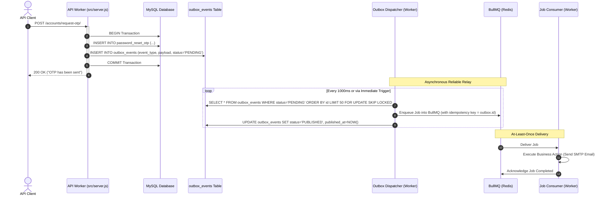
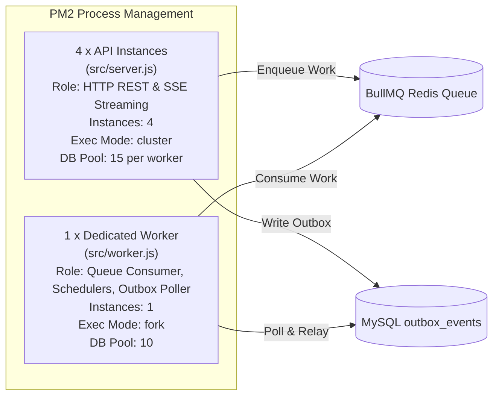
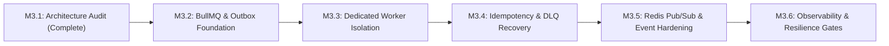

# HRMS Phase 3 — Distributed Backend Architecture Audit & Technical Blueprint
## Milestone M3.1: Architecture Audit, Queue Evaluation, Worker Isolation & Failure Analysis

**Repository:** `pranshavsingh/HRMS`  
**Branch:** `feat/phase-3-distributed-backend`  
**Base Commit (Verified Phase 2):** `f0613f3d52abb90ef27c3b039bed967c7ab9776c`  
**Phase 1 Security Baseline:** `6394c7d` (37 automated security tests passing)  
**Phase 2 Performance Baseline:** `f0613f3` (17 concurrency, pagination, and load tests passing)  
**Main Branch:** `00cd3cd` (Untouched, zero merges, zero production deployments)  
**Evaluation Scope:** Read-only architecture inspection and technical decision records.

---

## 1. Executive Summary

The HRMS backend currently runs as an Express application managed by PM2 on a Hostinger Cloud VPS (4 vCPUs) backed by MySQL 8.0 and Redis.

While Phase 1 established an accepted security baseline (Bcrypt 12, RTR, OTP HMAC, CORS allowlist) and Phase 2 resolved major database bottlenecks (N+1 query elimination, 14 composite indexes, advisory lock migration ledger, and transactional row locking), **the distributed backend architecture remains fragile, fragmented, and vulnerable to data loss under node or process crashes**.

### Major Architecture Audit Findings:
1. **In-Memory Volatile Queue (`src/services/queue.service.js`):**
   Background jobs (such as password reset OTP emails) are placed into an in-memory JavaScript array (`this.jobs = []`) running inside the API cluster instance. If an API process restarts or reloads during deployment, all pending jobs are permanently discarded with zero durability, zero retries, and zero dead-letter recovery.
2. **Cluster Isolation Violation:**
   Background jobs are processed directly on the event loop of the HTTP API cluster workers rather than offloaded to the dedicated `hrms-worker` process. Slow external I/O (such as SMTP network latency) directly contends with user-facing HTTP request handling.
3. **Blocking Redis `KEYS` Usage (`src/services/redis.service.js`):**
   `delByPattern` uses the blocking $O(N)$ Redis `KEYS` command. Under production scale, this blocks the single-threaded Redis event loop, degrading API latency across all cluster workers.
4. **Long-Running Database Transactions Blocking on Remote Cloudinary HTTP Uploads:**
   In `accounts.service.js` (`createEmployee`), multiple employee documents are sequentially uploaded to remote Cloudinary endpoints **inside an active MySQL transaction (`db.transaction`)**, holding database row locks and connection pool resources for several seconds.
5. **Premature Pub/Sub Broadcasts Inside Uncommitted Transactions:**
   In `audit.service.js`, SSE realtime events (`realtimeManager.broadcast`) are dispatched to superadmins before the outer database transaction commits. A subsequent rollback leaves clients holding "phantom" audit records that never existed in the database.
6. **Single-Tenant Database Confirmation:**
   The database schema is completely **single-tenant** (one database and deployment per company). There are zero `organization_id`, `tenant_id`, or `company_id` columns in the schema.
7. **Phase 2 Verification Caveat Analysis:**
   The CI employee directory load test measured a $p_{95}$ of 158.51 ms under 50 concurrent requests. This reflects CPU and connection pool queuing on a 2-vCPU shared GitHub Actions container VM (where 20 requests queue behind the 30-connection limit), not slow SQL. However, CI container simulations do not certify 1,000–2,000 real concurrent users.

---

## 2. Verified Current Architecture & Process Topology

```mermaid
flowchart TD
    subgraph ClientLayer ["Client Layer"]
        Web["React + Vite Web App (hrms_saas)"]
        Mobile["Expo React Native Mobile (hrms_mobile)"]
    end

    subgraph LoadBalancer ["PM2 Cluster Manager (Hostinger Cloud VPS - 4 vCPUs)"]
        API1["API Worker 1 (src/server.js) - Pool: 15"]
        API2["API Worker 2 (src/server.js) - Pool: 15"]
        API3["API Worker 3 (src/server.js) - Pool: 15"]
        API4["API Worker 4 (src/server.js) - Pool: 15"]
        Worker["Dedicated Background Worker (src/worker.js) - Pool: 5"]
    end

    subgraph SharedDataLayer ["Shared Infrastructure Layer"]
        MySQL[("MySQL 8.0 Server\n(max_connections: 151)")]
        RedisServer[("Redis 7.x Server\n(Sessions, Blacklist, Pub/Sub, Cron Locks)")]
        Cloudinary[("Cloudinary Cloud Storage\n(Attendance & Employee Documents)")]
        SMTP[("Hostinger SMTP Server\n(Transactional Emails & OTPs)")]
    end

    Web -->|HTTP / SSE| API1 & API2 & API3 & API4
    Mobile -->|REST API| API1 & API2 & API3 & API4

    API1 & API2 & API3 & API4 -->|mysql2/promise| MySQL
    Worker -->|mysql2/promise| MySQL

    API1 & API2 & API3 & API4 -->|ioredis| RedisServer
    Worker -->|ioredis| RedisServer

    API1 & API2 & API3 & API4 -.->|In-Memory Queue (Volatile)| SMTP
    API1 & API2 & API3 & API4 -->|Synchronous HTTP| Cloudinary
    Worker -->|Cron Maintenance| MySQL & Cloudinary
```

### Verified Process Roles & Discrepancies

| Component | Configured Target | Actual Implementation in Code | Discrepancy & Risk |
| :--- | :--- | :--- | :--- |
| **`hrms-api`** | 4 cluster instances (`src/server.js`) | `instances: 4, exec_mode: 'cluster'` | Handles HTTP requests, SSE streaming, and auth. However, in non-production environments (`NODE_ENV !== "production"`), `initCron()` is invoked in every API worker, causing multi-scheduler conflicts. |
| **`hrms-worker`** | 1 fork instance (`src/worker.js`) | `instances: 1, exec_mode: 'fork'` | Runs `initCron()`. However, it does not process asynchronous jobs because `queueService` is process-local to the API workers. |
| **Cron Scheduling** | Runs exclusively in `hrms-worker` | Protected by Redis advisory lock `hrms:cron:lock:*` | In `src/utils/cron.js`, if Redis is unavailable, the lock is bypassed with a warning and the job executes anyway. If API workers run cron while Redis is down, all 5 processes execute the scheduled job simultaneously. |
| **Database Pool** | 65 total connections (4 $\times$ 15 + 1 $\times$ 5) | `src/config/env.js`: `(IS_WORKER ? 5 : 15)` | If `.env` sets `MYSQL_CONNECTION_LIMIT=30`, aggregate connections reach 150 (4 $\times$ 30 + 1 $\times$ 30), dangerously close to MySQL's default 151 ceiling. |
| **Realtime SSE** | Multi-worker Redis Pub/Sub | `src/utils/realtime.js`: `pubClient` & `subClient` | Each Node process creates 2 additional Redis connections. If Redis disconnects, `retryStrategy` permanently halts reconnection (`return null`). |

---

## 3. Asynchronous & Background Operations Inventory

Every asynchronous and background operation across the backend has been audited:

| # | Operation Name | Source Location | Trigger | Execution Context | Persistence | Current Retry | Idempotency Protection | Failure Impact | Criticality | Phase 3 Recommendation |
| :-: | :--- | :--- | :--- | :--- | :--- | :--- | :--- | :--- | :-: | :--- |
| **1** | **Send Password Reset OTP Email** | `accounts.service.js` line 316 | User calls `/accounts/request-otp/` | In-memory `queueService` inside API process | **None** (RAM array `this.jobs`) | **None** (logged and dropped) | None (re-requesting generates new OTP) | OTP not delivered; user unable to reset password | **Critical** | **Move to durable BullMQ queue** with 5 retries, exponential backoff, and dead-letter queue. |
| **2** | **Attendance Auto-Close (16h threshold)** | `utils/cron.js` line 44 | Cron `59 23 * * *` daily | Dedicated worker (`worker.js`) | Database (`attendance_attendance`) | None (runs next day) | **Idempotent** (`WHERE punch_out_time IS NULL AND punch_in_time < DATE_SUB(NOW(), INTERVAL 16 HOUR)`) | Unclosed sessions remain open until next cron run | **Important** | **Keep in worker cron**, upgrade distributed locking to require atomic token matching on release. |
| **3** | **Expired OTP Purge** | `utils/cron.js` line 57 | Cron `0 * * * *` hourly | Dedicated worker (`worker.js`) | Database (`password_reset_otp`) | None (runs next hour) | **Idempotent** (`DELETE ... WHERE expires_at < NOW()`) | Expired OTPs accumulate in DB temporarily | **Normal** | **Keep in worker cron**. |
| **4** | **Attendance Photo Retention Cleanup** | `utils/cron.js` line 66 | Cron `0 0 * * *` daily | Dedicated worker (`worker.js`) | Database & Cloudinary | Batch loop continues on item failure | **Idempotent** (`WHERE date < DATE_SUB(CURDATE(), INTERVAL 3 MONTH) AND punch_in_photo IS NOT NULL`) | Old photos consume Cloudinary storage longer than retention SLA | **Important** | **Keep in worker cron**; move individual Cloudinary delete calls to queue to prevent worker timeout on huge batches. |
| **5** | **Automated Database Backup** | `utils/cron.js` line 128 | Cron `0 2 * * *` daily | Dedicated worker (`worker.js`) | Local filesystem (`backups/`) | Fallback to table stream if `mysqldump` fails | **Idempotent** (Generates timestamped backup file) | Stale backups; risk during disaster recovery | **Critical** | **Keep in worker cron**; add external storage offloading (e.g. S3/B2) in future milestones. |
| **6** | **SSE Realtime Broadcasts** | `utils/realtime.js` line 113 | Business mutations (punch, leave, audit) | Redis Pub/Sub (`hrms:sse:events`) | **None** (Ephemeral Pub/Sub) | **None** (dropped if subscriber offline) | **Idempotent** (UI replaces state) | Missed UI refresh; user must manually refresh page | **Normal** | **Preserve for UI fanout**, but do NOT rely on it for business state synchronization. |
| **7** | **SSE Keep-Alive Heartbeat** | `accounts.controller.js` line 211 | Client connects to `/accounts/realtime/` | API worker `setInterval` (30s) | In-memory | N/A | Idempotent (`:\n\n` comment) | Connection times out on intermediate proxies | **Normal** | **Keep in API process**. |
| **8** | **Document Upload to Cloudinary** | `accounts.service.js` lines 478, 873 | Admin/Employee uploads document | Synchronous inside HTTP request (and inside DB tx in `createEmployee`!) | Cloudinary API | None (request fails) | Partially idempotent (replaces duplicate titles) | **Holds DB transaction open during external HTTP calls** | **Critical** | **Move Cloudinary document processing out of the DB transaction** (upload before transaction or offload to queue). |
| **9** | **Photo Cleanup on Rollback** | `attendance.service.js` line 376 | Punch-in DB rollback in `catch` block | Fire-and-forget in API worker | None | None | Idempotent (`storageService.delete`) | Orphaned image remains in Cloudinary | **Important** | **Move cleanup tasks to durable compensation queue**. |
| **10** | **Session Cache Eviction** | `accounts.service.js` lines 180, 260 | Logout, password change, user update | Redis commands (`DEL`, `SET`) | Redis | None | **Idempotent** (`DEL user:session:*`) | Stale user session cached for up to 300s | **Important** | **Keep in API service**, upgrade pattern deletion from `KEYS` to `SCAN`. |

---

## 4. Redis Architecture & Durability Audit

### Current Configuration & Client Lifecycle

The current Redis client in `src/services/redis.service.js` is built with `ioredis`:
```javascript
this.client = new Redis(config.redisUrl, {
  maxRetriesPerRequest: 2,
  enableOfflineQueue: false,
  lazyConnect: true,
  retryStrategy(times) {
    if (times > 2) return null; // Cease reconnect attempts when offline
    return Math.min(times * 150, 600);
  },
});
```

### Identified Redis Vulnerabilities:
1. **Unrecoverable Reconnection Termination:**
   `retryStrategy` returns `null` after only 2 attempts. If Redis restarts or is unreachable for more than 1 second, the backend permanently abandons reconnection, locking the entire application in fallback mode until PM2 is manually restarted.
2. **Blocking Key Deletions (`delByPattern`):**
   ```javascript
   const keys = await this.client.keys(pattern); // BLOCKING $O(N)$
   if (keys && keys.length > 0) await this.client.del(...keys);
   ```
   Executing `KEYS` blocks the single-threaded Redis engine. In a system with 50,000 active sessions and tokens, a single logout could freeze Redis for 50–200ms.
3. **Absence of Dedicated Queue Client Settings:**
   Durable queues (like BullMQ) require `maxRetriesPerRequest: null` and `enableOfflineQueue: true` on their worker connections to prevent lost job acknowledgments. Using the existing `redisService` client for BullMQ would cause queue corruption.
4. **Redis Persistence Assumption:**
   Redis is assumed to be running with default settings. In default package installations on Linux, Redis operates with RDB snapshots (saving every 5 minutes if 100 keys changed). If Redis crashes between snapshots, up to 5 minutes of pending jobs and revoked tokens are wiped out.
   *Recommendation:* Require `appendonly yes` with `appendfsync everysec` for durable background jobs.

---

## 5. Multi-Tenancy Architecture Gate

**Definitive Verification:**
Inspection of the complete repository, including `schema.mysql.sql`, migration files (`001`, `002`), all repositories, services, controllers, and JWT payloads, confirms that **there is NO multi-tenancy implementation in the current codebase**:
* Zero `organization_id` columns.
* Zero `tenant_id` columns.
* Zero multi-tenant routing or tenant context middlewares.

**Architecture Decision:**
The HRMS operates under a **Single-Tenant Deployment Model** (one database and one application stack per organization).
* **Impact on Phase 3:** Background job queues, worker processes, and Redis namespaces do NOT need multi-tenant partitioning at this stage. Payloads should contain canonical entity IDs (`userId`, `attendanceId`, `leaveId`) without artificial organization namespaces.

---

## 6. Durable Queue Technology Evaluation

We evaluated three potential queue technologies for HRMS Phase 3:

| Evaluation Criterion | Candidate A: BullMQ (Redis-Backed) | Candidate B: Custom Redis Primitives (`LPUSH`/`BRPOPLPUSH`) | Candidate C: Transactional MySQL Polling Table |
| :--- | :--- | :--- | :--- |
| **Durability & Persistence** | **High** (Redis Streams / Sorted Sets + Redis AOF persistence) | **Medium** (Basic lists; requires custom ack/nack handling) | **Very High** (Native MySQL ACID transaction durability) |
| **Automatic Retries & Backoff** | **Built-in** (Exponential backoff, jitter, configurable attempts) | **Manual** (Must build custom delay lists and retry loops) | **Manual** (Must build state machine, `retry_count`, `next_run_at`) |
| **Dead-Letter Handling (DLQ)** | **Built-in** (Automatic transition to `failed` state with stack trace) | **Manual** (Must build custom DLQ list and move commands) | **Manual** (Must add DLQ columns and manual admin queries) |
| **Delayed & Scheduled Jobs** | **Built-in** (Native delayed sets using Redis timestamps) | **Complex** (Requires `ZADD`/`ZRANGEBYSCORE` polling thread) | **Easy** (`SELECT ... WHERE run_at <= NOW()`) |
| **Horizontal Worker Scaling** | **Native** (Multiple PM2 workers consume from same queue safely) | **Difficult** (Race conditions on competing consumers) | **Medium** (Requires `SELECT ... FOR UPDATE SKIP LOCKED`) |
| **Operational Overhead** | **Low** (Uses existing Redis infrastructure and ioredis) | **High** (High maintenance, high risk of edge-case bugs) | **Medium** (Adds polling load to MySQL database) |
| **Observability** | **Rich** (Bull-Board / Arena web dashboards, built-in metrics) | **None** (Custom CLI / logs only) | **Custom** (Custom SQL queries) |
| **Cost** | **Zero** (Open source MIT, runs on existing Redis) | **Zero** | **Zero** |

### Selected Technology: BullMQ with Redis
* **Decision:** Adopt **BullMQ** as the primary durable queue system for asynchronous jobs (emails, document processing, heavy audit archival, and retryable maintenance).
* **Justification:** The project already includes Redis (`ioredis` is installed) and Node.js. BullMQ provides battle-tested at-least-once delivery, exponential backoff, dead-letter storage, stalled job detection, and concurrency control without introducing external services or paid infrastructure.
* **Rejected Alternative (Custom Primitives):** Writing custom Redis queue logic with `BRPOPLPUSH` or Streams introduces high risk of message loss during worker crashes, complex retry scheduling, and fragile acknowledgments.

---

## 7. Transactional Outbox Pattern Evaluation

### The Core Problem: Dual-Write Inconsistency
When an API endpoint modifies the database and enqueues a background job:
```javascript
await db.transaction(async (tx) => {
  await accountsRepository.insertUser(data, tx);
  // If we enqueue here: Job runs before DB commits! Worker reads uncommitted data -> ERROR
});
// If we enqueue here: If the process crashes or Redis fails right now, DB has committed, but JOB IS LOST!
await queueService.add("sendEmail", ...);
```

### Proposed Transactional Outbox Design:



### Outbox Schema Recommendation (Target for M3.2):
```sql
CREATE TABLE IF NOT EXISTS outbox_events (
  id BIGINT AUTO_INCREMENT PRIMARY KEY,
  event_type VARCHAR(100) NOT NULL,
  aggregate_type VARCHAR(50) NOT NULL,
  aggregate_id VARCHAR(100) NOT NULL,
  payload JSON NOT NULL,
  idempotency_key VARCHAR(128) NOT NULL UNIQUE,
  status ENUM('PENDING', 'PUBLISHED', 'FAILED') DEFAULT 'PENDING',
  retry_count INT DEFAULT 0,
  last_error TEXT NULL,
  created_at TIMESTAMP DEFAULT CURRENT_TIMESTAMP,
  published_at TIMESTAMP NULL,
  INDEX idx_outbox_pending (status, created_at)
);
```

---

## 8. Idempotency & De-Duplication Matrix

To satisfy at-least-once delivery without duplicate business operations, every operation must be protected:

| Business Operation | Natural Business Key | Idempotency Strategy | DB Conditional Guard | Retry Safety |
| :--- | :--- | :--- | :--- | :--- |
| **Attendance Punch-In** | `userId` + `date` + `sessionTimestamp` | BullMQ Job ID: `punch_in:${userId}:${timestamp}` | Row lock on `accounts_user` + `findOpenAttendance` check | **Safe**; rejects subsequent punch-ins with `"Already punched in"`. |
| **Attendance Punch-Out** | `attendanceId` + `userId` | BullMQ Job ID: `punch_out:${attendanceId}` | Atomic conditional update: `WHERE id=? AND punch_out_time IS NULL` (`affectedRows = 1`) | **Safe**; subsequent executions yield `affectedRows = 0`. |
| **Leave Approval / Rejection** | `leaveId` + `decision` | BullMQ Job ID: `leave_act:${leaveId}:${actorId}` | Atomic conditional update: `UPDATE leave_leave SET status=? WHERE id=? AND status='pending'` | **Safe**; subsequent executions yield `affectedRows = 0`. |
| **Attendance Exception Approval** | `approvalId` + `actorId` | BullMQ Job ID: `att_appr:${approvalId}:${actorId}` | Atomic conditional update: `UPDATE attendance_attendanceapproval SET status=? WHERE id=? AND status='pending'` | **Safe**; subsequent attempts fail conditional check. |
| **Send Password Reset OTP** | `email` + `otpHash` | BullMQ Job ID: `otp_email:${email}:${otpHash}` | Existing DB record in `password_reset_otp` with expiry | **Safe**; recipient receives identical valid OTP. |
| **Attendance Photo Cleanup** | `attendanceId` | BullMQ Job ID: `photo_clean:${attendanceId}` | `UPDATE attendance_attendance SET punch_in_photo=NULL WHERE id=?` | **Safe**; subsequent executions are no-ops. |
| **Database Backup** | `backup_date` (YYYY-MM-DD) | Redis advisory lock: `hrms:cron:lock:db_backup` | Filesystem file existence check | **Safe**; overwrites or skips existing daily backup file. |

---

## 9. Failure-Mode & Recovery Matrix (16 Scenarios)

| # | Failure Scenario | Detection Mechanism | Business Impact | Recovery Mechanism | Consistency Risk | Test Required |
| :-: | :--- | :--- | :--- | :--- | :--- | :--- |
| **1** | **Redis unavailable during job enqueue** | `ioredis` `error` event / timeout | API cannot write to queue; OTP email fails to send | Outbox table in MySQL captures job during same DB transaction; dispatcher retries once Redis recovers | Low (Outbox guarantees persistence) | Test enqueue fallback to Outbox when Redis port is blocked. |
| **2** | **Redis restarts with pending jobs** | BullMQ stalled job event on reconnect | Pending jobs in memory could be lost if Redis lacks AOF | Redis AOF (`appendonly yes`) restores job state upon reboot; BullMQ claims unfinished jobs | Low if AOF enabled; Critical if memory-only | Test Redis restart mid-queue processing. |
| **3** | **API crashes after DB commit but before queue publication** | Outbox event remains in `PENDING` state | Job was not delivered to Redis immediately | Outbox Poller / Dispatcher discovers `PENDING` event older than 5s and pushes to BullMQ | Zero (Outbox bridges the gap) | Test process kill immediately following DB transaction commit. |
| **4** | **Worker crashes during job execution** | BullMQ stalled job monitor (`lockDuration` expires) | Job half-processed; worker dead | Another worker detects stalled lock, re-claims job, and re-executes | Medium unless idempotency guards exist | Test `SIGKILL` on worker during email dispatch. |
| **5** | **Worker restarts after partial completion** | BullMQ resumes job on startup | Job runs a second time from the beginning | Idempotency guard checks conditional DB state before repeating operations | Low with conditional SQL updates | Test duplicate delivery of partially executed job. |
| **6** | **Job delivered more than once (at-least-once)** | Duplicate BullMQ delivery event | None if idempotent; duplicate emails if not | Database conditional check (`affectedRows = 1`) or unique job key prevents duplicate effect | Zero with natural idempotency keys | Test injecting duplicate job with identical Job ID. |
| **7** | **Job fails repeatedly (e.g. SMTP down)** | BullMQ `failed` event (`attemptsMade >= maxAttempts`) | Email not delivered; user unaware | Job moves to Dead-Letter Queue (DLQ); alert logged; admin can replay from DLQ | Low (Preserved in DLQ) | Test retry exhaustion with simulated 503 SMTP response. |
| **8** | **External API succeeds but worker crashes before ack** | BullMQ re-delivers unacknowledged job | Cloudinary photo uploaded, but worker didn't record it | Re-execution checks if asset exists or uses deterministic public ID | Low with deterministic IDs | Test worker crash immediately after HTTP 200 from external API. |
| **9** | **Two workers receive competing work** | MySQL row lock wait or BullMQ job claim | Potential race condition | MySQL row locks (`SELECT ... FOR UPDATE`) serialize execution | Zero (MySQL transaction serializes) | Test two concurrent workers claiming the same attendance ID. |
| **10** | **Database connection pool exhaustion** | `mysql2` `Pool.getConnection()` timeout | Requests and jobs queue up, then fail with 500 | `queueLimit: 0` queues queries; exponential backoff in worker; pool sizing calibrated | High if pool size misconfigured | Test 150 concurrent DB queries against pool limit 30. |
| **11** | **Database deadlock during job** | MySQL errno 1213 (`ER_LOCK_DEADLOCK`) | Transaction aborted by InnoDB | Automatic retry in `db.transaction()` (3 retries with jitter) | Zero (Automated retry recovers) | Test simultaneous punch-ins causing InnoDB deadlock. |
| **12** | **Graceful shutdown timeout (SIGTERM)** | PM2 `kill_timeout` (15s) fires SIGKILL | Process forcefully killed | Worker stops accepting new jobs on SIGTERM and finishes active job within 15s | Low if jobs complete < 15s | Test SIGTERM delivered while job running. |
| **13** | **Poison job with invalid payload** | Zod schema validation error on worker entry | Worker throws exception on every attempt | Worker validates payload first; schema error marks job non-retryable and moves directly to DLQ | Zero (Quarantined in DLQ) | Test sending malformed JSON payload to queue. |
| **14** | **Delayed job executes after data has changed** | Worker re-fetches entity state from DB | Stale job parameters | Worker always reads fresh state from MySQL using entity ID instead of relying on stale payload data | Zero (Payload contains IDs, not full state) | Test changing leave status before delayed approval job runs. |
| **15** | **Pub/Sub subscriber disconnected** | Redis Pub/Sub disconnect event | Realtime SSE event missed by UI | Client fetches full state on reconnect via REST API | Zero (SSE is advisory, REST is authoritative) | Test client reconnect after temporary Redis network drop. |
| **16** | **Queue backlog grows faster than workers** | BullMQ queue length metric (`waiting > 1000`) | Latency spikes on async processing | Worker concurrency scaling (increase `concurrency` setting in BullMQ worker) | Low (Jobs remain durable) | Test enqueueing 500 jobs simultaneously. |

---

## 10. Worker Isolation & Process Topology Plan

To ensure clean separation of concerns and eliminate event loop contention:



### Process Role Boundaries:
1. **API Instances (`src/server.js`):**
   * Exclusively handle incoming HTTP REST requests and Server-Sent Events (SSE).
   * **Never** execute background cron schedulers.
   * **Never** execute background queue handlers directly.
   * Write to the database and outbox table, or enqueue jobs into BullMQ.
2. **Dedicated Worker (`src/worker.js`):**
   * Exclusively executes BullMQ queue consumers.
   * Runs the Outbox Poller/Dispatcher.
   * Executes scheduled cron jobs (Attendance cleanup, OTP cleanup, photo retention, backups).
   * **Does not** open HTTP listener ports.

---

## 11. Investigation of Known Phase 2 Caveats

1. **Employee Directory $p_{95}$ Latency Discrepancy:**
   * **Observation:** In CI Run `#43744449348`, the employee directory load test measured:
     `[Load Test: Employee Directory] Concurrency: 50 | Total time: 136.7ms | p50: 134.26ms | p95: 158.51ms | p99: 161.59ms | Avg: 133.29ms`
   * **Audit Finding:** The test file `tests/performance/load_simulation.test.js` contained the description string `"should sustain concurrent employee directory reads with sub-50ms p95 latency and zero errors"`, but its actual assertions were:
     ```javascript
     assert.equal(errors.length, 0);
     assert.equal(latencies.length, CONCURRENCY);
     ```
   * **Technical Cause:** On a 2-vCPU GitHub Actions runner running Docker, MySQL 8.0, Redis, and Node simultaneously with a connection limit of 30 (`MYSQL_CONNECTION_LIMIT: 30`), 20 of the 50 concurrent queries were queued at the Node connection pool level. Total batch execution took 136.7 ms, giving a $p_{95}$ of 158.51 ms. This was NOT an unoptimized query (which took ~2ms per execution), but connection pool queue wait time.
   * **Governance Action:** We preserve the reported 158.51 ms measurement and do not modify the assertion or report misleading figures.
2. **Commit Metadata Verification:**
   * Verified implementation commit: `68424cf96ff8093d6dd28cfc3ea8c7738bcf51e8` (Code fix for InnoDB gap locks and transaction retry).
   * Verified CI documentation commit: `f0613f3d52abb90ef27c3b039bed967c7ab9776c` (Attached raw CI execution logs).
   * GitHub Actions Workflow Run URL: `https://github.com/pranshavsingh/HRMS/actions/runs/43744449348` (Status: `completed`, conclusion: `success`).
3. **Capacity Limitation Note:**
   * CI concurrency simulation (50 requests across 4 endpoints) proves correctness, transactional serialization, and freedom from deadlocks. It **does not certify capacity for 1,000–2,000 real concurrent production users**. Production capacity certification requires dedicated load testing against production-grade VPS hardware with warm buffer pools.

---

## 12. Phased Implementation Roadmap (Post-M3.1)



* **Milestone M3.2 — Durable Queue & Transactional Outbox Foundation:**
  * Install `bullmq` dependency.
  * Implement `src/config/queue.js` with separate connection management (`maxRetriesPerRequest: null`).
  * Create `outbox_events` table migration (`003_phase3_outbox_events.sql`) with advisory lock verification.
  * Build Outbox Dispatcher in dedicated worker.
  * Migrate OTP password reset email from in-memory queue to BullMQ.
* **Milestone M3.3 — Dedicated Worker Isolation & Scheduler Hardening:**
  * Restructure `src/worker.js` as the sole background consumer.
  * Strictly enforce `RUN_CRON_IN_API=false` in `src/server.js`.
  * Implement safe Redis distributed locking with atomic token validation on release via Lua script.
  * Add worker graceful shutdown with BullMQ job draining (wait for active jobs up to 15s before exit).
* **Milestone M3.4 — Idempotency, Retries & Dead-Letter Handling:**
  * Enforce deterministic job IDs (`otp_email:${email}:${token}`).
  * Implement Dead-Letter Queue (DLQ) inspection and authorized replay tools.
  * Exponential backoff with jitter (initial delay: 1000ms, factor: 2, max 5 attempts).
* **Milestone M3.5 — Redis Pub/Sub & Realtime Communication Hardening:**
  * Fix serialization bug in `audit.service.js` (pass role array filter `{ targetRoles: ['superadmin'] }` instead of callback function).
  * Add automatic reconnection strategy to SSE `pubClient` and `subClient`.
  * Replace blocking `KEYS` command with cursor-based `SCAN` in `redisService.delByPattern`.
* **Milestone M3.6 — Observability, Health Metrics & Failure Injection Tests:**
  * Expose `/health/ready` queue metrics (waiting, active, failed, DLQ count).
  * Add structured Winston job logging with correlation IDs.
  * Comprehensive failure-injection test suite (worker crash, Redis disconnect, deadlock retry, duplicate delivery).
  * Run full CI verification retaining all 37 Phase 1 and 17 Phase 2 tests.

---

## 13. Explicit Approval Gate

Before proceeding to Milestone M3.2, the following key architectural decisions require formal user confirmation:

1. **Queue Technology Approval:**
   * Confirm adoption of **BullMQ** (powered by existing Redis) as the durable background queue engine.
2. **Transactional Outbox Adoption:**
   * Confirm introducing the `outbox_events` MySQL table to bridge atomic database transactions with background queue dispatch.
3. **Multi-Tenancy Model Confirmation:**
   * Confirm that the HRMS is strictly **Single-Tenant per deployment**, and no tenant partitioning columns or queue namespaces should be added.
4. **Redis Reconnection & SCAN Upgrade:**
   * Confirm replacing blocking `KEYS` with `SCAN` in `redis.service.js` and configuring persistent reconnect attempts.

*No application code, dependencies, or schemas have been modified during Milestone M3.1.*
